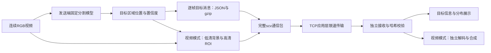

# 水下视频语义通信：阶段 D 最小系统闭环与收发实测

日期：2026-10-14。阶段编号：D。本文依据已归档的通信包、配置、收发记录、独立解码输出与质量评价生成。本阶段没有新增训练、没有使用最终测试集调参。

**阶段结论：最小本机系统已可按批次运行，完成“目标识别—语义消息编码—真实限速传输—独立接收—结果查看”的闭环；鱼类识别可靠性、视频传输效率及跨场景任务收益仍未达到最终研究目标。**

## 1. 阶段定位与前序工作的衔接

本项目的最低目标是先做出简单、能运行的语义通信系统。本阶段将工程交付从训练实验推进到可直接操作的收发原型，使训练问题不再阻挡系统演示。

| 阶段 | 已建立的基础 | 仍需保留的边界 |
|---|---|---|
| A | MLVC-S真实编解码、完整文件与独立进程验证 | 初始画质与工程验证不能代替语义收益 |
| B | 发布者GT评价、发现全局质量与鱼类任务表现可能背离 | 诊断样例少，部分标注帧不连续 |
| C | 连续数据清单、受控GT-ROI微调、固定鱼类评价模型 | ROI收益不稳定，单P帧普通微调在完整GOP中明显退化 |
| D | 显式目标消息、发送时ROI区域控制、真实限速收发、本机界面 | 原型可运行；准确识别、低延迟与实际水声链路尚待验证 |

阶段C的训练结果保留，不撤销或改写。阶段D暂用固定SegFormer与成熟的H.265组件组装最低可用闭环，未把退化的微调权重用于演示。它与阶段C回答不同问题：C检验“语义损失微调是否产生任务收益”；D检验“能否用现有组件把目标信息实际发出去，并提供可操作系统”。

## 2. 最低验收目标与完成情况

| 验收项目 | 本阶段结果 |
|---|---|
| 连续视频输入 | video131真实相邻编号420–469；另有已有潜水员视频 |
| 发送端显式语义提取 | 固定模型输出鱼类或潜水员的位置、置信度与面积信息 |
| 有真实可传输文件 | `.scv`完整通信包，含协议、消息及可选视频，不依赖发送端私有缓存 |
| 真实收发 | 本机TCP回环连接，20 kbps应用层限速，发送与接收为不同进程 |
| 独立接收 | 无原图、GT、分割权重及发送端参考状态；逐项恢复消息，视频模式恢复全部帧 |
| 使用入口 | 双击脚本、本机界面、自己的视频路径、目标与模式选择、结果查看 |
| 完整字节计量 | 消息、背景、ROI视频、协议与封装分别统计，并核对总和 |
| 正负结果保存 | 收发成功、GT任务评价、未胜过基线的结果以及异常输入检查均归档 |

这里“通过”指最低工程闭环通过，不代表已实现可靠的通用鱼类检测，也不代表已验证真实水声通信。

## 3. 系统结构与两种模式



**信息模式**发送任务所需的类别、连接区域位置、置信度、目标像素面积和帧序号。接收端从消息绘制目标分布，不恢复原始视频或像素级分割边界。只有模型已经识别并摘要的信息才能被传送，漏检不能靠传输恢复。

**视频模式**在目标信息之外，发送0.5倍宽高的背景视频与原分辨率ROI裁剪视频。每32帧取预测连接区域外接矩形的时间并集，向外扩16像素；接收端将独立解码的ROI贴回背景上采样画面。ROI使用较低CRF，控制其重建质量。这是发送时根据语义选择编码区域和质量档位，没有修改神经编码器内部的空间量化。

| 方法 | 训练时使用语义 | 编码时显式使用语义 | 接收端获得的内容 |
|---|---|---|---|
| 阶段C GT-ROI损失微调 | 是 | 不显式输入ROI | 神经码流恢复视频 |
| 阶段D信息模式 | 使用既有分割模型，本阶段不训练 | 是：决定消息内容 | 目标消息与分布 |
| 阶段D视频模式 | 使用既有分割模型，本阶段不训练 | 是：控制ROI区域与质量档位 | 视频、目标消息与分布 |

因此，阶段D可以准确称为“显式语义消息与可选ROI视频的数字通信原型”。没有实现端到端学习的联合信源信道编码，没有验证物理水声链路，也没有证明自动获得最优语义比特分配。

## 4. 输入数据、模型与固定配置

### 4.1 输入与GT

鱼类输入来自用户下载的小样本 `video131/sequence/`，采用真实连续的 `00420.jpg` 至 `00469.jpg`，共50帧、1280×720。图像与GT的对应关系沿用阶段C核验结果；未把稀疏标注图片拼成连续视频。视频以名义25 fps播放，对应名义2秒，采集时间戳尚未确认，不据此宣称真实采集码率。

本段仅有4张发布者GT：

| 原始帧编号 | 片段内编号 | GT鱼像素 |
|---:|---:|---:|
| 420 | 0 | 0 |
| 435 | 15 | 255 |
| 450 | 30 | 185 |
| 465 | 45 | 985 |
| 合计 | 4张，其中3张含鱼 | 1,425 |

报告生成时再次核对4张二值GT的尺寸、取值、鱼像素数量及对应RGB像素哈希，记录GT文件SHA256。其余46帧未作为已确认背景评价。video131已经参与阶段C鱼类模型适配，本段也用于工程演示，不属于未接触的最终测试集。不能以本段4张GT推断跨场景泛化。

潜水员输入为已有 `test5_5fps_reconstructed.avi`，1280×720、5 fps、50帧，名义10秒。该输入本身已经重建，不是未经压缩的原始采集视频；没有人工GT，只能报告同模型原图预测一致性。

### 4.2 模型与运行配置

| 项目 | 鱼类 | 潜水员 |
|---|---|---|
| 类别编号 | FV，6 | HD，1 |
| 模型 | 阶段C固定的保留八类结构SegFormer适配权重 | 原SUIM SegFormer-B0固定权重 |
| 输入处理 | 512分块、步长384、重叠区平均logits | 长边256、letterbox、回原尺寸 |
| 判定 | 鱼类概率≥0.9 | 类别argmax为HD且置信度≥0.7 |
| 消息区域 | 8邻域连接区域，至少64像素 | 同左 |
| 备注 | 可靠性有限，未在D阶段调整阈值 | 没有GT，置信度未校准为正确概率 |

连接区域数量不等于真实鱼或潜水员的数量，没有实例跟踪与身份关联。消息中的“29帧非空目标”表示模型输出，不能解释为29帧识别正确。

视频层固定参数：背景640×360、CRF42；ROI原裁剪分辨率、CRF32；`libx265 medium`、GOP32、P-only、`zerolatency`，BT.709 limited-range YUV420。区域与像素误差评测前不调这些参数。接收端预览采用H.264，但该预览由接收端生成，不是传输码流。

本机环境为Python 3.12.14、Torch 2.10.0+cu128、Transformers 5.9.0、FFmpeg 9.0.1；发送端使用RTX 4060 Laptop，GPU报告总显存8188 MiB。接收分支不加载Torch或分割模型，使用NumPy、Pillow和标准FFmpeg。没有本阶段模型更新、4/8帧神经训练或GPU性能基准测量。

## 5. 真实收发与完整文件计量

### 5.1 三项主验收

| 编号 | 流程 | 帧记录数 | 完整包B | 发送方向应用层B | 实际传输秒 |
|---|---|---:|---:|---:|---:|
| D01 | 鱼类信息：从原帧执行完整流程 | 50 | 2,011 | 2,105 | 0.844 |
| D02 | 鱼类视频＋目标 | 50 | 333,588 | 333,684 | 133.484 |
| D03 | 潜水员视频＋目标 | 50 | 292,598 | 292,694 | 117.078 |

D01从原始连续帧开始执行识别、生成消息、发送和独立接收，没有借用已提取的消息跳过识别。另有D04复用消息的通信复测、D05五帧潜水员界面检查，合计5次核验。它们使用两段输入及同源重复检查，不能视为5个独立视频场景。

视频模式合计恢复100个真实视频帧；信息模式共105个目标帧记录及绘制画布。不能将信息模式的画布统计成额外105个原视频重建帧。

### 5.2 包内容与开销

| 编号 | 背景视频B | ROI视频B | gzip语义消息B | 协议与ZIP封装B | 完整包B |
|---|---:|---:|---:|---:|---:|
| D01 | 0 | 0 | 929 | 1,082 | 2,011 |
| D02 | 21,056 | 309,744 | 929 | 1,859 | 333,588 |
| D03 | 38,441 | 250,866 | 1,456 | 1,835 | 292,598 |

`.scv`是ZIP_STORED容器，包含 `manifest.json`、`semantics.json.gz` 与可选 `context.mp4`、ROI MP4。协议记录尺寸、帧数、帧率、区域、固定模型配置及各成员SHA256。MP4内部封装、全部I/P帧和消息都进入完整包大小，没有省略首参考帧或ROI边信息。

发送方向应用层字节还包含TCP文件协议头：D01多94 B，D02/D03各多96 B。反向确认、TCP/IP包头和链路层开销不在该口径内。共享分割权重只在发送端使用，本次不逐视频下发；将来若传模型更新，应另外计费。

在20,000 bit/s限速下，D01的理想应用层发送时间为 `2,105×8/20,000=0.842秒`，实测0.844秒，计量与限速相符。信息模式相比视频模式字节明显减少，但任务内容也不同，不能称为“同等视频质量下节省99%以上码率”。

信息包的gzip内容为929 B，而协议/ZIP为1,082 B，约占完整信息包53.80%。这说明格式仍可精简，但当前2,011 B已经足以完成小规模目标消息收发，不需要为此延迟系统交付。


图1按归档文件计量。右图为真实传输耗时，不含识别与接收端绘图/预览耗时。

## 6. 独立接收、信息保留与异常检查

5次检查均为不同发送/接收进程，收发完整包SHA256相同；gzip消息解压后的目标记录与接收端JSON逐项相等。视频成员哈希、尺寸、帧数、帧率及裁剪边界已核验，接收端保存逐帧RGB哈希。

接收CLI不接收原图、GT、分割权重或发送端缓存参数。Python读取审计拒绝接收目录外的媒体/模型读取，记录的媒体读取均来自接收目录；FFmpeg命令明确只使用收到的流和本地恢复帧。该审计是程序级限制，不是操作系统沙箱，也未证明恶意进程无法访问原图。

| 检查 | 实际结果 |
|---|---|
| 改动包内context.mp4字节，保留旧哈希 | 拒绝：`Packet hash failed: context.mp4` |
| TCP头声明更多字节但连接提前关闭 | 拒绝：文件没有收完整 |
| 接收进程读取发送端私有原图 | `PermissionError`，读取被拒绝 |
| 五帧无目标信息包 | 正常处理为零个非空目标记录 |
| 浏览器视频加载与字节Range | 恢复MP4可加载，Range返回206及规定字节数 |
| Windows重复启动界面 | 改为复用已有服务，独占端口避免重复监听 |

本阶段没有人为模拟丢包、误码或信道衰落。TCP与哈希核对证明本机文件传输和错误拒收，不能代替实际水声弱链路下的纠错、重传和鲁棒性验证。

“消息完整收到”与“目标识别正确”必须分开：前者已通过；后者依赖固定分割器。没有传完整像素掩码，因此不把消息一致性写成分割IoU=100%。

## 7. 恢复画面的任务与画质对照

### 7.1 评价协议

评价程序对恢复后的PNG重新运行固定模型，不从收到的框生成评价预测。鱼类使用固定概率阈值的像素掩码计算GT IoU/召回/精确率；该任务评价没有使用消息生成阶段的64像素连接区域过滤。鱼区PSNR仅计算发布者GT鱼像素。

H.265基线允许4个B帧，采用medium、GOP32与同一颜色配置。其CRF只按完整文件字节选择，选择时不读IoU或PSNR。鱼类基线332,448 B与分层包333,588 B相差-0.342%；潜水员基线291,727 B与分层包292,598 B相差-0.298%。信息和所有视频层的开销均计入语义方案预算。

基线文件在本地独立解码后评价，没有另跑一次基线TCP收发，不能据此直接比较两者端到端延迟。文件匹配是这两个选定点的检查，不是多预算RD曲线或全方法排序。

### 7.2 鱼类：GT评价

| 输入 | 文件B | GT IoU | GT召回 | GT精确率 | 全局PSNR dB | GT鱼区PSNR dB |
|---|---:|---:|---:|---:|---:|---:|
| 原始输入 | — | 26.20% | 33.05% | 55.81% | — | — |
| 仅低清背景＊ | 21056 | 0.00% | 0.00% | 0.00% | 21.95 | 19.64 |
| 语义分层视频 | 333588 | 10.77% | 51.58% | 11.98% | 24.16 | 25.40 |
| 近似同预算H.265 B4 | 332448 | 3.97% | 27.58% | 4.44% | 26.28 | 25.09 |

＊仅背景行是同一基础流的消融，预算不同，不能当作同预算基线。全局PSNR汇总50帧RGB误差；GT指标与鱼区PSNR只使用4张标注，按其像素汇总，不是独立视频均值。原始输入与自身的PSNR不参与压缩失真比较，以“—”表示。

在这一个片段，分层视频的GT IoU比近似同预算H.265高6.79个百分点，召回高24.00个百分点，GT鱼区PSNR高0.30 dB；代价是全局PSNR低2.12 dB。GT精确率只有11.98%，仍存在大量误检。

原始输入GT IoU为26.20%，分层恢复后为10.77%。虽然恢复后召回高于原图，假阳性像素从373增至5,402，不能把召回增加解释为整体识别更可靠。通信成功没有解决分割器本身的错误。

以上是已见训练视频上的4张稀疏GT诊断，有局部积极信号，不能证明跨视频稳定收益，也不能代替阶段C受控训练结论。


图2为片段内第45帧（原始00465），它是4张GT中鱼像素最多的一帧。该图只展示画面；表格使用全部规定评价帧，没有用单帧外观代替指标。

### 7.3 潜水员：原图预测一致性

| 输入 | 文件B | 预测一致性IoU | 对原图预测的召回 | 全局PSNR dB | 原图预测目标区PSNR dB |
|---|---:|---:|---:|---:|---:|
| 仅低清背景＊ | 38441 | 94.87% | 97.01% | 32.99 | 29.58 |
| 语义分层视频 | 292598 | 97.62% | 99.08% | 35.42 | 36.87 |
| 近似同预算H.265 B4 | 291727 | 98.19% | 98.96% | 37.87 | 36.51 |

此表没有GT准确率。分层视频一致性IoU比近似同预算H.265低0.57个百分点，全局PSNR也更低，尽管原图预测目标区PSNR略高。该样例没有证明分层方案整体胜过传统编码。


图3展示第25帧。原输入已重建，不能用它推断原始采集素材的绝对压缩能力。

## 8. 时延与当前视频效率问题

| 主验收 | 提取与编码秒 | 发送秒 | 接收解码、绘制与预览秒 |
|---|---:|---:|---:|
| D01 | 16.540 | 0.844 | 1.149 |
| D02 | 39.229 | 133.484 | 7.066 |
| D03 | 11.483 | 117.078 | 5.482 |

D01已记录三个阶段累计约18.53秒，实际点击到完成还包括接收进程启动与界面轮询；未单独测量精确端到端墙钟。0.844秒仅是发送时间，不是“识别并完成通信只需0.844秒”。三项测试并非严格控制GPU/CPU并行负载的速度基准。

鱼类视频名义2秒，发送就需要133.484秒；潜水员名义10秒，发送117.078秒。当前视频模式是批次恢复，不能宣称在20 kbps上实时运行。轻量模式任务消息较小，但50帧识别耗时16.54秒，同样没有证明25 fps实时处理。

ROI矩形扩张是已定位的问题：鱼类第一个32帧窗口的矩形为 `(0,0,1280,692)`，覆盖画面96.11%；第二个18帧窗口为 `(1058,0,222,330)`。按帧数加权平均为64.37%，ROI流309,744 B，占完整包92.85%。潜水员ROI平均覆盖54.56%，ROI流250,866 B，占完整包85.74%。

这表明窗口内多个目标/误检的外接矩形并集会把大量背景一起编码。目前不能把“高清ROI层”解释为只给少量真实鱼像素分配比特。下一步减少误检和无效保护面积，比继续添加新模型更直接影响系统可用性。

## 9. 可操作界面、复现与交付

双击 [启动语义通信系统.cmd](<../启动语义通信系统.cmd>)，打开 `http://127.0.0.1:8776/`。默认使用信息模式，支持鱼类/潜水员、自己的视频路径、帧数和发送速度。结果包含完整通信包、消息JSON、独立解码记录与视频或目标分布。

本机界面为HTTP服务，文件传输是另一个TCP连接：单独运行的CLI默认端口8772，演示流程自动选择本机空闲端口。本阶段只验收本机回环，没有完成跨机器部署。

```powershell
cd C:\Users\lenovo\Desktop\works\work\semantic-video-mlvc
# 从原帧执行鱼类信息通信，不要求再次训练
& .\.venv\Scripts\python.exe semantic_mvp/system.py demo --target fish --mode information --open
# 潜水员视频模式
& .\.venv\Scripts\python.exe semantic_mvp/system.py demo --target diver --mode video --open
# 独立解码已有归档包；输出目录必须不存在
& .\.venv\Scripts\python.exe semantic_mvp/system.py decode `
  --input runs/semantic_mvp_20261014_fish/receiver/message.scv `
  --output runs/phase_d_decode_reproduce
```

当前代码兼容早期未显式写mode字段的视频包。本报告使用归档包的精确字节统计；重新编码时协议JSON字段或FFmpeg版本变化可改变文件字节和SHA，应按新输出重新核算，不覆盖历史计分。


图4来自D01接收结果。29/50是非空模型预测消息帧数，不是识别正确率。

主要模块：`semantic_mvp/system.py`负责识别组织、编码、完整包、独立接收与复现CLI；`teacher.py`冻结模型；`transport.py`执行TCP限速与确认；`console.py/html`提供界面；`validate.py`计算独立恢复画面的任务/画质；`check_failures.py`保留异常检查。阶段A–C适配器、原始数据与权重未被替换。

### 9.1 五项收发证据

| 编号 | 检查用途 | 帧记录 | 非空预测消息帧 | 证据 |
|---|---|---:|---:|---|
| D01 | 鱼类信息：从原帧执行完整流程 | 50 | 29 | [收发记录](<../runs/semantic_mvp_ui_20261014_174138_eb1c30/end_to_end.json>) |
| D02 | 鱼类视频＋目标 | 50 | 29 | [收发记录](<../runs/semantic_mvp_20261014_fish/end_to_end.json>) |
| D03 | 潜水员视频＋目标 | 50 | 50 | [收发记录](<../runs/semantic_mvp_20261014_diver/end_to_end.json>) |
| D04 | 鱼类信息：复用已提取消息的通信复测 | 50 | 29 | [收发记录](<../runs/semantic_mvp_20261014_fish_information/end_to_end.json>) |
| D05 | 界面潜水员信息，5帧检查 | 5 | 5 | [收发记录](<../runs/semantic_mvp_ui_20261014_171912_f8abbd/end_to_end.json>) |

### 9.2 主通信包哈希

| 编号 | 收发共同SHA256 |
|---|---|
| D01 | `a241c4c1a7b61cdc00f290400b246dfa094f023e0bebf4f59812a78444ae74d0` |
| D02 | `170c0cb4415de786806007aea17a89e6ce76d7b6fcd47626cac611e0fd006b2f` |
| D03 | `1f77d395e6d555f18bed29e0e4c348b4d292359996424654c4e9c4ecc918fadb` |

固定鱼类模型SHA256：`10e4783330112982e941b021afa9603313429d4f30e871d1ddfa059a258a6ca9`。固定潜水员模型SHA256：`ff00cb439a4af290dc3efde8ae76d4acfad797784483b669ab6db79aaf5b1476`。发送端模型不在本次通信包里；它们保存在原工程位置。来源文件、质量JSON、原生基线码流及包成员哈希见 [阶段D实测数据与证据索引](<../../02_历史资料/C_D报告/semantic_communication_phase_d/阶段D_实测数据与证据索引.json>)。

## 10. 现况与下一阶段优先级

| 方面 | 截至阶段D |
|---|---|
| 最小本机语义消息系统 | 已完成闭环、界面和独立收发 |
| 可选语义ROI视频恢复 | 已完成，低速链路耗时大 |
| 鱼类任务可靠性 | 仍不足，漏检与误检明显 |
| 同预算稳定任务收益 | 尚未证明；鱼类单片段有局部改善，潜水员未超过基线 |
| 神经ROI训练问题 | 阶段C问题仍保留，未在D阶段修复 |
| 实时、长视频与跨设备运行 | 未验收 |
| 实际水声信道通信 | 未验收 |

后续工作以这个原型为基础，不再把增加模型或完成复杂训练作为使用前提：

1. 用少量未参与调参的新连续视频检验鱼类目标信息可靠性；video131保留为演示，video96/108可做既有回归检查，但不能重命名为完全未接触测试。
2. 优先减少误检和窗口矩形的无效覆盖，比较更紧的区域或少量分块，记录真实完整包字节与GT任务质量，保留正负结果。
3. 明确使用者需要的是目标位置汇报还是恢复画面，轻量模式先可用；视频模式逐步降低传输量，并单独测量点击到结果的总延迟。
4. 在当前系统稳定后，才接入稳定的预训练MLVC作为可替换视频层；再验证模型同步、完整码流和接收端独立解码。普通多帧微调及可微任务损失保留为后续研究，不抢占最低工程目标。
5. 具备实际水声接口与测量条件后，再核验真实链路的带宽、丢包、误码和延迟；当前TCP限速结果不替代物理信道证据。

**阶段D验收判断：工程闭环通过；研究泛化与实际水声链路尚未通过。**

## 11. 参考与证据来源

- [阶段A首轮工程验证](<phase_a_results_20261013.md>)。
- [阶段B语义评价与ROI准备](<phase_b_results_20261013.md>)。
- [阶段C小规模GT-ROI实测](<../../02_历史资料/C_D报告/semantic_roi_phase_c/阶段C_小规模ROI对照实测_2026-10-13.md>)。
- [阶段D原型简要操作与实测说明](<../../02_历史资料/C_D报告/semantic_communication_mvp/最小语义通信系统_实测说明_2026-10-14.md>)（保留原文件；本报告为正式阶段总结）。
- [鱼类独立任务与画质JSON](<../runs/semantic_mvp_20261014_fish/validation/results.json>)、[潜水员独立任务与画质JSON](<../runs/semantic_mvp_20261014_diver/validation/results.json>)、[协议异常核验](<../runs/semantic_mvp_20261014_protocol_checks/checks.json>)。
- [UVMulti作者仓库](https://github.com/pingchuan/UVMulti)、[官方Figshare来源](https://figshare.com/articles/dataset/30105151)：数据出处与发布者划分记录沿用阶段C。
- [FFmpeg官方libx265接口说明](https://ffmpeg.org/ffmpeg-all.html#libx265)：H.265封装和CRF接口。本文所有结果数值来自本机实际归档，不来自外部示例。
