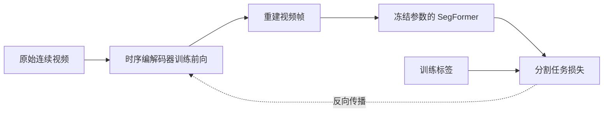

# 水下视频语义通信：现有成果与完整实施计划

版本：1.0  
整理与核对日期：2026-10-12（Asia/Shanghai）  
适用设备：Windows，RTX 4060 Laptop GPU，约 8 GB 显存  
文档用途：项目交接、工程验证执行依据、实验设计与阶段验收

> 状态说明：本文件汇总了已经保存的实验结果，并制定后续实施计划。2026-10-12 本轮进行了聊天记录、现有文件、公开视频源码与配置的核对，尚未部署 MLVC、下载其模型权重、运行 MLVC 编解码或开始新的训练。下文所有 MLVC 性能、显存及语义收益目标均属于待验证事项。

阅读导航：

- 项目方向、已有成果与数据：第 1～4 节。
- 源码细节与统一指标口径：第 5～6 节。
- 当前工程验证的详细执行与验收：第 7～8 节。
- 后续数据、ROI、任务损失、消融与真实链路：第 9～13 节。
- 日志、失败处理、任务单、状态和复现索引：第 14～19 节。

## 1. 已确定的方向与研究问题

主线确定为：**基于 SegFormer 语义监督的任务导向水下视频源编码**。

具体研究问题是：在相同实际传输数据量下，语义感知训练能否更准确地保留鱼、潜水员等目标，同时把整体画质损失和时序失真控制在可接受范围内？反过来，也可以研究在达到相同目标识别准确性时，是否能减少完整压缩文件的大小。

### 1.1 技术选择

- 视频编解码底座：**MLVC-S PSNR 预训练模型作为首选候选**，通过工程和最小微调验证后才正式锁定。
- 语义模型：沿用已在 SUIM 上微调的 SegFormer-B0，前期冻结其权重。
- 推进顺序：**原版 MLVC-S 完整文件基线 → 普通码率—失真微调 → 语义 ROI 加权 → ROI 加权与 SegFormer 任务损失联合训练**。
- 已有 GLC 保留为视频编解码对照与备用研究底座。
- 已有联合图片语义编码保留为单帧语义源编码原型与对照。
- 第一阶段使用可靠文件传输，暂时与物理信道误码、衰落和纠错策略解耦。

这是一条结合论文方法与本机条件选定的工程路线，不是宣称复现了某篇论文的完整系统。DVST 提供“重建视频上的分割任务误差参与视频传输模型训练”的依据；SQ-GAN 提供“语义可以在源编码层参与特征保留和重建”的依据。具体水下效果必须由本项目的独立实验确认。[DVST 第 IV-C 节](https://arxiv.org/html/2205.13129v2)、[SQ-GAN](https://arxiv.org/abs/2502.09520)

### 1.2 本阶段的明确范围

本阶段首先验证 MLVC-S 本身，不立即接入 SegFormer 或 ROI。要回答四个问题：

1. 能否产生保存下来的真实熵编码数据？
2. 接收端仅使用完整文件、共享模型权重和运行环境，能否独立解码全部帧？
3. 在统一输入与计量规则下，它与 GLC、H.265 的码量和画质关系如何？
4. 本机能否完成有效的最小微调，包括反向传播和参数更新？

每个问题都需要留下实际记录。运行模型前向、保存观看用 MP4、得到估计 bpp，分别不足以替代上述验证。

### 1.3 20 kbps 的含义

此前已经明确：**20 kbps 是文件传输速率限制，允许离线发送，不要求视频必须实时播放**。30～40 kbps 可以作为辅助传输档位。

必须分别记录：

- 压缩视频平均码率：完整压缩文件的比特数除以视频播放时长。
- 文件链路净速率：实际每秒能够送达的文件比特数。
- 传输时间：传完整个文件所需的时间。
- 编解码处理时间：模型加载、编码、解码、读写等时间。

例：10 秒视频压缩成 300,000 B，在有效文件吞吐量为 20,000 bit/s 的理想条件下，需要约 120 秒发送；该视频的压缩平均码率为 240 kbps。这并不违反“允许离线发送”的约束。

目前已实测的是本机 TCP 应用层限速。实际水声链路上的净吞吐量、纠错开销、重传和波动仍未验证。阶段汇报应采用“任务导向的语义感知视频源编码及限速文件传输验证”，不能把本机实验称为已经完成物理信道联合优化的 JSCC 系统。

## 2. 工作目录、现有资产与保护原则

### 2.1 已存在的目录

| 用途 | 绝对路径 | 状态 |
| --- | --- | --- |
| 主工程 | `C:/Users/lenovo/Desktop/works/work/semantic-video-training` | 已存在，包含分割、联合图片编码、GLC 和演示界面 |
| 普通视频传输基线 | `C:/Users/lenovo/Desktop/works/Python/video-baseline` | 已存在，包含 FFmpeg、质量评价和传输工具 |
| 导师提供的视频 | `C:/Users/lenovo/Desktop/临时/语义` | 已确认存在 3 个 AVI 文件 |
| 当前文档工作目录 | `C:/Users/lenovo/Documents/Codex/2026-10-12/segformer-c-users-lenovo-desktop-works` | 本轮文档与源码核对工作区 |
| 本文件输出目录 | `C:/Users/lenovo/Documents/Codex/2026-10-12/segformer-c-users-lenovo-desktop-works/outputs` | 用户可直接阅读和交接的文档 |

原主工程已经有独立的 `.venv-segformer` 和 `.venv-glc` 环境。MLVC 应建立自己的环境，以免改变已有实验的依赖版本。

### 2.2 拟建立的 MLVC 独立目录

建议使用以下新的兄弟目录，实际部署前确认其是否已经存在：

`C:/Users/lenovo/Desktop/works/work/semantic-video-mlvc`

建议结构如下；这些目录和脚本属于拟建资产，并非本轮已经实现：

```text
semantic-video-mlvc/
├── upstream/mlvc/             # 固定提交的官方源码
├── adapters/                  # 本地文件封装、独立解码和指标适配
├── configs/                   # 自定义工程验证与短期微调配置
├── checkpoints/               # 官方 I/P 帧模型与本地微调权重
├── data/manifests/            # 视频来源、划分、帧清单和颜色协议
├── data/frames/               # 统一抽取的参考帧或只读数据引用
├── data/masks/                # 后续 ROI/语义训练的缓存
├── runs/                      # 每次实验使用新的目录
├── docs/                      # 实际环境与复现说明
└── .venv/                     # MLVC 专用环境
```

### 2.3 已有工程的版本问题

2026-10-12 读取主工程 Git 状态时，基础提交为：

`f24fcc57a6db6cce42800bcefbc76449e9ca0506`

但工作区有修改文件与大量未跟踪源码，包含 GLC、联合图片编码和演示界面的相关文件。因此，该提交号不能完整表示当前可运行工程。

进入新实验前，应保存以下记录：

1. 当前基础提交号、完整 Git 状态和已跟踪文件差异。
2. 实际使用的本地源码快照与文件 SHA-256 清单，覆盖未跟踪的关键源码。
3. 原实验配置、报告、日志和权重指纹。
4. 运行环境的依赖锁定信息。

这一步是留存可复现证据，不需要为了新实验改写已有结果。旧目录中的文件与指标保持原样，新协议下重评的结果写入新实验目录。

## 3. 已完成实验：证据、结果与限制

以下数字来自已经保存的本机报告。本轮核对了对应 JSON、中文说明与文件位置，没有重新运行整套训练。

### 3.1 SegFormer-B0 水下八类分割

| 项目 | 现有记录 |
| --- | --- |
| 数据 | SUIM：训练 1187 张，验证 297 张，测试 110 张 |
| 模型 | SegFormer-B0，由 ADE20K 预训练模型迁移到 SUIM 八类 |
| 输入 | 等比缩放并居中补齐到 256×256；标签 255 为忽略区域 |
| 训练 | 完成 54 轮；最佳权重来自第 39 轮 |
| 验证集 mIoU | 62.91% |
| 测试集 mIoU | 69.13% |
| 测试集像素准确率 | 86.56% |
| 对照 | 原 LR-ASPP 测试 mIoU 62.65%，原 FPN 59.20% |
| 权重 | `C:/Users/lenovo/Desktop/works/work/semantic-video-training/runs/suim_segformer_b0_20260915/segmentation_best.pt` |

八类索引固定为：

| 索引 | 符号 | 类别 |
| ---: | --- | --- |
| 0 | BW | 背景／水体 |
| 1 | HD | 潜水员 |
| 2 | PF | 水生植物 |
| 3 | WR | 沉船与遗迹 |
| 4 | RO | 机器人与仪器 |
| 5 | RI | 珊瑚礁与无脊椎动物 |
| 6 | FV | 鱼与脊椎动物 |
| 7 | SR | 海床与岩石 |

整体分割改善已经有记录，但极小目标召回并非所有模型中最好。FV 是“鱼与脊椎动物”这一 SUIM 类别，后续报告应保留这一正式定义，不能擅自改成只包含某种鱼的识别任务。

分割模型能处理视频帧，但这不等于已经完成视频时序源编码。现有 SUIM 独立图片不能替代连续视频训练数据。

### 3.2 联合图片语义源编码

现有发送端先用 SegFormer 预测八类，再把 RGB 与预测类别共同输入联合编码器；经过量化、超先验和 rANS 熵编码形成 `.svic`。接收端从码流直接输出 RGB 和类别图。

人工真值用于训练监督，发送端编码条件来自模型预测。接收端的类别图来自潜变量解码头，而不是重新分割还原 RGB。

| 项目 | 297 张验证图的现有记录 |
| --- | ---: |
| 发送端预测 mIoU | 62.91% |
| 联合码流直接解码类别 mIoU | 61.36% |
| 普通 q3 还原后再分割的参考 mIoU | 50.79% |
| 联合模型平均完整文件 | 2565.93 B |
| 普通 q3 参考平均完整文件 | 2496.59 B |
| 联合完整文件 bpp，按 256×256 画布 | 0.3132 |
| 联合 RGB 有效像素 PSNR | 29.90 dB |
| 普通 q3 参考 RGB PSNR | 30.37 dB |

已经保存的验证包括：语义损失能更新编码器；保持 RGB 不变而改变语义条件时，实际熵编码数据发生变化；独立进程只用收到的文件与联合权重，可以得到相同 RGB 和类别索引。

一个 720p 图片示例的完整文件为 16,597 B，20 kbps 限速传输约 6.69 秒。它没有人工真值，不能把两端预测一致率当作真实准确率。

该实验的限制：

- 297 张是参与选轮次的验证集，不是新的独立最终测试集。
- 普通 q3 参考没有相同的水下训练预算，也没有相同的直接类别输出头，不能作为严格架构消融。
- 联合文件平均更大约 2.78%，RGB PSNR 略低，尚未证明码量优势。
- 直接类别头的准确性不等于还原视频画面上的目标一定同样准确。

证据位置：

- `C:/Users/lenovo/Desktop/works/work/semantic-video-training/runs/suim_joint_semantic_codec_20261002`
- `C:/Users/lenovo/Desktop/works/work/semantic-video-training/runs/joint_semantic_validation_20261002_verified`
- `C:/Users/lenovo/Desktop/works/work/semantic-video-training/runs/joint_semantic_independent_20261002/verification.json`

**69.13% 与 61.36% 不得直接相减来表示压缩导致的下降。** 前者来自 110 张测试图上的原图分割，后者来自 297 张验证图上的直接类别解码，两者评价集和输出路径都不同。

### 3.3 GLC 视频真实文件编解码

输入为导师提供的 `test5_5fps_reconstructed.avi`，1280×720、5 FPS、50 帧、10 秒。该输入本身已经是重建视频，因此本实验评价的是相对于这个输入的再次编码失真。

每档使用 2 个 I 帧和 48 个 P 帧，I 帧间隔 32。网络与预训练权重来自 GLC 官方项目；真实熵编码和 `.glcv` 文件容器是本地补充实现，并非官方完整文件格式。

| 档位 | 完整文件 B | 实际 bpp | 视频平均码率 kbps | 逐帧 PSNR 均值 dB | 20 kbps 实传秒 | 编码处理秒 | 解码处理秒 |
| --- | ---: | ---: | ---: | ---: | ---: | ---: | ---: |
| q=0 | 40,545 | 0.007039 | 32.44 | 32.91 | 16.27 | 101.66 | 70.07 |
| q=63 | 87,493 | 0.015190 | 69.99 | 34.43 | 35.05 | 101.60 | 70.06 |

完整文件大小包含容器、码流和校验，容器与校验约占 5 KB。TCP 应用层传输头另有 95 B，已经纳入传输限速，尚未纳入文件大小。

已经完成的验证：

- 两档共 100 帧均能从真实码流解码。
- 编码和解码使用独立进程，接收端没有读取源图片或源视频。
- 接收端与发送端的实际重建 RGB 和参考潜特征一致。
- 发送文件与接收文件的字节一致。
- 本机 RTX 4060 8 GB 能完成此次推理，历史记录的编码峰值分配显存约 3.05 GiB，解码约 2.58 GiB。

这些推理数据不能推导出 MLVC 微调或 GLC 语义训练一定能放进 8 GB。GLC 尚未接入水下语义训练，50 帧单段也不足以证明复杂动态水下场景的普遍表现。

证据位置：

`C:/Users/lenovo/Desktop/works/work/semantic-video-training/runs/glc_stream_720p_final_20261002`

其中保留 `summary.json`、发送与接收 `.glcv`、逐帧编解码记录、传输记录与独立解码校验。

### 3.4 普通视频基线与工具

`C:/Users/lenovo/Desktop/works/Python/video-baseline` 已有视频压缩、解码、指标和限速传输工具，但其历史 H.264 结果不能直接充当新的 H.265 对照。

本轮确认下列 FFmpeg 工具存在，并且提供 `libx265` 软件编码器：

- `C:/Users/lenovo/Desktop/works/Python/video-baseline/tools/ffmpeg-9.0.1-essentials_build/bin/ffmpeg.exe`
- `C:/Users/lenovo/Desktop/works/Python/video-baseline/tools/ffmpeg-9.0.1-essentials_build/bin/ffprobe.exe`

后续 H.265 主对照采用软件 `libx265`，硬件 HEVC 如用于速度演示，应另外标明编码器与参数，不能混用为同一基线。

## 4. 当前视频数据与尚缺的研究数据

### 4.1 本轮实际核对的视频

共同位置：`C:/Users/lenovo/Desktop/临时/语义`

| 文件 | 尺寸 | FPS | 帧数 | 时长 | 输入文件 B | 像素格式 |
| --- | --- | ---: | ---: | ---: | ---: | --- |
| `test5_5fps_reconstructed.avi` | 1280×720 | 5 | 50 | 10 秒 | 138,246,886 | bgr24 |
| `test5_1fps_reconstructed.avi` | 1280×720 | 1 | 10 | 10 秒 | 27,653,926 | bgr24 |
| `test5_1fps_480p_reconstructed.avi` | 720×480 | 1 | 10 | 10 秒 | 10,373,926 | bgr24 |

SHA-256：

```text
test5_5fps_reconstructed.avi
5c0bdb22fb625f7f0e3ca08edc76c4bbccf435ea5ae06a5c41fea9f991c42781

test5_1fps_reconstructed.avi
f4aa8f19d67de7a02ed7555457131e9b94b00565cb6dc171d2db4bdc90ea50aa

test5_1fps_480p_reconstructed.avi
816024912ed5979cf29a4a70cf9a57a7e8ecbc8bc0e66420910f1dd58251b013
```

文件名显示它们可能是同一来源的不同帧率与分辨率版本。这是需要逐帧确认的来源关系；确认前统一放入同一个来源组，不能当作三个独立场景分到训练、验证和测试集。

输入文件体积大主要与其 bgr24 存储有关。它与压缩文件的体积比不能单独用于证明优于其他压缩方法。

### 4.2 工程验证数据

首先复用现有 720p、5 FPS、50 帧片段，便于对齐已有 GLC。1 FPS 和 480p 版本可以用于调试，但应形成独立结果行，不能替代 5 FPS、720p 结果。

随后增加 2～3 段真正不同来源的视频检查鲁棒性。这样的规模用于证明流程可用，尚不足以支持最终泛化结论。

### 4.3 正式语义研究需要补充的数据

需要收集连续水下视频，覆盖：

- 小鱼和较大目标、潜水员及不同目标占比。
- 摄像机移动、目标移动、遮挡和新目标进入。
- 浑浊、低对比度、颜色偏移、气泡及不同背景。
- 较低帧率与正常帧率、不同运动强度。
- 目标丰富与目标稀少片段，避免只选容易展示语义收益的视频。

使用来源视频或拍摄场景级划分。相邻帧、重叠切片、同一片段的不同压缩版本和帧率版本必须在同一划分中。

训练可以利用伪标签，验证和测试应保留人工标注帧。标签使用 SUIM 八类定义，记录标注人员、复核状态、忽略区域和目标类别覆盖情况。伪标签必须标记为模型预测，不能写成真实标注。

## 5. MLVC 源码核对与三个重要接口事实

### 5.1 固定的上游版本

2026-10-12 观察到并下载小量源码用于核对的官方提交：

`64b10d4c0108106e66b7c54d6e5e470200a57abf`

后续部署应锁定该提交；若需要升级，建立新版本记录和新实验目录，不把不同提交的结果混在同一对照中。[固定版本官方仓库](https://github.com/microsoft/mlvc/tree/64b10d4c0108106e66b7c54d6e5e470200a57abf)

MLVC-S 的 PSNR 权重在官方 README 中有下载地址与 SHA-256，视频模型约 5.4M 参数。I 帧模型以及训练时的激活和参考状态另计。论文已注明被 ECCV 2026 接收，但论文中的 NPU 速度和视频会议测试结果不能代替本机水下测试。[MLVC 论文](https://arxiv.org/abs/2606.28027)

### 5.2 ROI 类存在，且工厂有辅助模型初始化依赖

已确认官方存在 `loss_total_rdc_psnr_roi_per_pixel`。该类可以接收预计算掩码；但构造函数包含 `segmentation_model`，损失工厂会尝试从辅助模型对象取得它。因此，应复用现成加权逻辑，并适配外部掩码模式的初始化路径，验证无需加载人脸辅助模型。[固定版本损失源码](https://github.com/microsoft/mlvc/blob/64b10d4c0108106e66b7c54d6e5e470200a57abf/video/src/losses/codec.py)

后续接口适配还必须检查掩码形状和数值：数据集传入的掩码应与裁剪后的帧对齐，PNG 的 0/255 数值先转为 0/1，避免多加一个通道维度。所有几何增强对 RGB、标签和掩码使用一致参数，类别图使用最近邻插值。

### 5.3 `use_i_frame_model: false` 的含义需要准确解释

官方默认测试配置确实关闭独立 I 帧模型。[测试配置](https://github.com/microsoft/mlvc/blob/64b10d4c0108106e66b7c54d6e5e470200a57abf/video/configs/test_video-mlvc.yaml)

进一步核对编码测试器发现：此模式从固定的 **0.5 灰色参考**初始化，真实第 0 帧仍由视频模型编码。它并不直接借用原视频首帧。因此，关闭 I 帧模型本身不能证明漏算首帧，也不能证明独立解码一定失败。[编码测试器](https://github.com/microsoft/mlvc/blob/64b10d4c0108106e66b7c54d6e5e470200a57abf/video/src/utils/encoder_tester.py)

真正的验收条件是：初始化规则、全部首帧编码数据和后续状态更新能够由接收端从共享协议与文件重建。

本阶段主验证先使用**显式 DMCI I 帧＋MLVC-S P 帧**，以便核算并与已有 I 帧间隔 32 的 GLC 对齐。灰色初始化的全视频模型模式可以后续作为单独配置验证，报告首帧实际字节数，不虚构其具有传统 I 帧类型。

编码测试器会输出逐帧 `.bin`，这还需要完整的序列元数据与接收端封装。若启用首帧多次编码，所有编码 pass 的数据及顺序都必须保存；初始工程配置固定为单次编码，降低状态复现难度。

### 5.4 官方默认测试不等于 MLVC-S 配置

默认 `test_video-mlvc.yaml` 指向完整 MLVC 权重和较大的通道设置。部署 MLVC-S 时必须同时校对模型结构、通道数和对应权重，不能只替换 checkpoint 文件名。

也要显式设置实际码流保存路径和实际解码验证；仅启用 `encode_bit_stream` 并不自动建立新的独立接收端程序或完整文件容器。

## 6. 统一比较协议与指标定义

### 6.1 参考输入与色彩处理

建立一次统一的输入解码和参考帧清单，所有方法使用相同帧索引、原始顺序、尺寸、FPS 和视频时长。文件名可以从 0 开始或从 1 开始，但序列编号规则必须写入清单。

现有 AVI 为 bgr24，必须明确 BGR→RGB 转换。输入没有完整色彩标签记录时，应写“实验指定的处理协议”，不能假称已经知道摄影设备的原始色彩空间。

本轮源码核对确认 MLVC 的 RGB/YCbCr 转换采用 BT.709 系数及归一化数值。H.265 的色彩矩阵、量化范围、4:2:0 下采样和 RGB 复原需要据此校准，防止默认转换制造额外失真。[色彩转换源码](https://github.com/microsoft/mlvc/blob/64b10d4c0108106e66b7c54d6e5e470200a57abf/video/src/transforms/functional.py)

正式排名前应完成两类校准：

1. 黑白灰、彩色块与真实帧的无压缩转换检查，记录数值范围、系数、舍入及色度重采样方式。
2. 共用输入预处理后的 GLC、H.265 和 MLVC 重评。若保留各模型原生 RGB/YUV 输入方式，应单独注明，不能声称内部色彩处理完全一致。

指标从直接解码后的无损帧计算，观看用 MP4 仅用于播放。公共预处理如改变了参考帧，必须保存并指明参考，另报告该预处理相对原 RGB 的损失。

### 6.2 实际码量

设 W、H 为有效图像尺寸，N 为编码帧数，F 为 FPS，B 为完整文件字节数：

```text
视频时长秒 = N / F
完整文件 bpp = 8 × B / (W × H × N)
压缩平均码率 kbps = 8 × B / (N / F) / 1000
20 kbps 理想文件传输秒 = 8 × B / 20000
```

使用十进制 kbps；KB=1000 B，KiB=1024 B。宽高与帧数分母使用有效画面，不把神经模型补边算成真实视频像素。

实际总文件至少包含：I 帧或首帧编码数据、所有 P 帧编码数据、必要模型/版本标识、尺寸和帧率、逐帧参数、序列控制信息、容器头与校验数据。

同时列出：payload 字节、首帧字节、后续帧字节、容器字节、完整文件字节。共享模型权重按“双方预部署”的假设另列大小，不混进每段视频码率，也不能省略这一前提。

训练中的概率估计 bpp 仅作优化与诊断；正式比较使用实际文件大小。相同 QP 数字不代表不同模型相同码量，应使用多个档位形成曲线，再比较相近实际码量的结果。

### 6.3 画质

- 主 RGB PSNR：对全部有效帧、全部 RGB 通道累计平方误差，再计算一次 PSNR。
- 辅助 PSNR：逐帧 PSNR 算术平均，保留最低帧及逐帧曲线。
- RGB MS-SSIM：所有方法采用同一实现、版本、输入范围和配置，再对帧求平均。
- 后续 ROI 指标：使用原图人工标注或预先固定的源端掩码计算区域误差，不能按重建图重新选择容易评价的区域。

既有 GLC 的 32.91/34.43 dB 是逐帧 PSNR 均值。统一报告如果采用累计 MSE 的主 PSNR，应从既有重建帧重新计算，原报告的旧值继续保留为历史列。

### 6.4 语义与时序

正式语义阶段至少记录：八类 mIoU、HD/FV 的 IoU、F1/Dice 和召回、分目标面积的小目标指标。忽略标签、类别缺失规则和背景是否计入必须统一。

人工标注是准确率依据。无标注帧上原图预测与重建图预测的接近程度只能叫预测一致性。

跨帧稳定性应考虑真实运动、遮挡和新区域出现；采用运动对齐后的标签一致性或标注目标轨迹检查，不能把相邻帧标签完全一样当作视频质量目标。

### 6.5 时间与显存

分别记录模型加载、抽帧、实际编码、实际解码、图像读写、指标计算和观看视频生成耗时。GPU 计时要在区间边界同步。

记录 PyTorch allocated/reserved 峰值和进程启动前后的设备总显存，附驱动、PyTorch、CUDA、精度及输入规模。区分推理和训练；显存数字不能只按参数量估算。

## 7. 分阶段路线与进入下一阶段的条件

| 阶段 | 工作重点 | 进入下一阶段的条件 |
| --- | --- | --- |
| A0 | 留存旧成果、源码版本与输入清单 | 旧结果可定位，输入与代码来源清楚 |
| A1 | 独立部署 MLVC-S 与必要 I 帧模型 | 固定版本、权重校验、真实熵编码依赖可用 |
| A2 | 小片段完整文件编码与独立解码 | 接收端无需源视频，首帧和状态完整 |
| A3 | 统一协议下的 MLVC-S、GLC、H.265 基线 | 完整字节和共同指标可比较 |
| A4 | 8 GB 上最小微调验证 | 前反向、参数更新、码率项及恢复均有效 |
| B | 连续水下数据和人工测试标注 | 来源级划分、目标覆盖与标签复核完成 |
| C | 普通微调与语义 ROI 加权 | ROI 逻辑生效，并有同预算普通微调对照 |
| D | SegFormer 任务损失 | 语义梯度达到编码器，独立语义评价有效 |
| E | 完整消融、码率曲线与泛化实验 | 可重复证据支持结论或解释无收益条件 |
| F | 后续真实链路与信道研究 | 源编码主线稳定，另行定义物理链路任务 |

阶段通过以实测证据为准。失败应先定位、尝试合理修复，并保留失败记录；不能通过改名、删去失败帧或忽略码量开销来满足验收。

## 8. 当前优先任务：阶段 A 工程验证

### A0：旧成果留存与输入清单

执行内容：

1. 保存第 2.3 节所述的实际源码快照与版本信息。
2. 把现有 SegFormer、联合图片、GLC 报告与关键权重登记到资产清单。
3. 使用输入 SHA-256、帧数、FPS 和尺寸建立视频清单。
4. 把 5 FPS 原片确定为第一条 MLVC/GLC/H.265 共同输入。
5. 所有新实验使用独立目录；引用旧文件时按只读输入使用。

输出：`assets_manifest.json`、`source_snapshot_manifest.json`、`videos_manifest.json`，以及旧源码差异和快照。

通过条件：实验输入和实际代码均可定位；已有结果不会因为新配置而被覆盖。

### A1：独立环境与权重准备

#### A1.1 环境

- 在新目录检出固定 MLVC 提交，保持官方源码与本地适配层可区分。
- 建立专用 Python 环境。官方范围为 Python >=3.12、<3.14，具体小版本与依赖按锁定版本验证。
- 保存操作系统、驱动、Python、PyTorch、CUDA runtime、编译器与依赖清单。
- 本轮读到的 GPU 驱动为 560.94。安装 GPU 依赖时先检查驱动与 wheel 的兼容性，不能仅照抄其他设备上的 CUDA 安装命令。
- 按官方要求构建 `packages/msrtc_rans` C++ 熵编码组件，记录编译命令、编译器版本和产物。
- 先验证 CUDA 张量计算与熵编码组件的最小往返；导入成功本身不代表编码器可用。
- 基线阶段只加载所需模型与指标组件。默认测试配置中的 LPIPS、DeQA 等附加组件可以关闭，避免为本阶段引入无关模型。

#### A1.2 MLVC-S PSNR 权重

官方文件名：`mlvc-s-psnr-v1.ckpt`。

官方 README 提供的 SHA-256：

```text
1b86b757ddb115342293efb57719d6216c6ee2e459ae796ec41723b5c05ca896
```

下载必须使用官方 README 的模型链接。核对实际字节数与 SHA-256；不匹配时该文件不进入实验。保存来源 URL、下载日期、实际大小、指纹和模型加载结果。[官方模型说明](https://github.com/microsoft/mlvc/blob/64b10d4c0108106e66b7c54d6e5e470200a57abf/README.md)

#### A1.3 I 帧模型

按照官方说明准备 DCVC 的 `cvpr2025_image.pth.tar`，用于 DMCI-6.0 I 帧模型。若按项目要求改名为 `DMCI-6.0.pth.tar`，保存原始文件名和改名记录，文件内容不应改变。

本轮没有下载该权重，也未核定其官方期望 SHA-256。因此：

1. 下载时记录官方来源链路。
2. 如果作者提供校验值，直接比对。
3. 如果没有公开校验值，计算并保存本次文件 SHA-256，验证模型结构与载入，并注明“本地计算的复现指纹”，不能写成“已与官方校验值一致”。

#### A1.4 MLVC-S 结构匹配

核对轻量模型的完整结构参数、checkpoint key 和 tensor 形状。第一套测试配置使用 DMCI-6.0 I 帧模型、匹配的 MLVC-S 视频模型，显式记录 I/P QP、I 帧周期和参考重置规则。

初始采用单个质量档位、单任务进程，稳定后再跑多档位。不得借助宽松载入掩盖大量缺失或形状不匹配的参数。

输出：`environment.json`、依赖锁定文件、`weights_manifest.json`、配置、安装与组件验证日志。

通过条件：权重与结构匹配，GPU/熵编码组件能实际工作，环境可重复建立。

### A2：真实文件、完整首帧与独立解码

#### A2.1 先小后大的输入规模

1. 先用同一原片的少量连续帧、适当缩小尺寸检查状态和文件接口。
2. 小片段通过后，运行原始 1280×720、5 FPS、50 帧片段。
3. 调试时使用的缩小尺寸结果与正式 720p 结果分别保存。

#### A2.2 使用原生编码／解码接口

本地适配层负责输入、文件封装、元数据、日志和接收端入口。神经编解码与熵编码尽量调用固定官方版本的 `compress`／`decompress` 路径，避免同时改网络与文件协议。

官方逐帧 `.bin` 应作为真正的编码数据保存。观看 MP4、原始 PNG、原始首帧、发送端参考特征和缓存 DPB 不得作为隐含接收端输入。

注意：已核对的官方测试器在某些异常处理中会生成黑帧并把 bits 设为 0。工程封装应记录该失败并终止有效结果生成，禁止把这种异常回退算作成功压缩。正常的黑色源画面不受此规则影响。

#### A2.3 完整文件封装

建议先使用一个简单、可审计的本地序列容器，例如未再压缩的 ZIP 封装或明确的二进制容器。选择一种后固定格式版本。若命名为 `.mlvcv`，明确这是本项目的本地格式，不宣称为官方标准。

完整文件必须包含或按固定共享协议定义：

| 类别 | 必要信息 |
| --- | --- |
| 模型 | I/P 架构标识、权重指纹、版本兼容信息 |
| 序列 | 宽高、补边与裁剪、帧数、FPS 有理数、帧顺序 |
| 色彩 | 像素格式、矩阵、数值范围、色度重采样协议 |
| 初始化 | DMCI 模式或灰色参考模式、参考状态初始化规则 |
| 逐帧控制 | 帧／pass 索引、QP、类型或编码模式、重置和 LTR 控制 |
| 编码数据 | 首帧及每个后续帧的全部熵编码流 |
| 完整性 | 数据长度、索引和校验，检测缺帧与截断 |

精度和运行 profile 可写入实验记录；影响正确解码的 profile 要作为接收端兼容条件明确检查。

#### A2.4 两种首帧模式的验收方式

主验证使用 DMCI＋MLVC-S：

- 第 0 帧及每个刷新点有真实 I 帧编码数据。
- I 帧数据进入完整文件和实际字节统计。
- 接收端首先从这些数据重建参考，然后顺序解码 P 帧。

如果后续验证固定灰色初始化模式：

- 灰色值、尺寸、数据类型和后续帧状态更新规则明确。
- 第 0 帧真实编码数据同样进入文件并纳入码率。
- 由接收端自行生成灰色参考，不读取原视频或发送端缓存。
- 所有需要的编码 pass 均保存；不能只保留最后一次覆盖后的逐帧文件。

#### A2.5 独立接收端测试

接收进程只接收完整码流文件、所需共享权重、解码输出目录和必要运行参数。它不需要数据集清单、原视频路径、源端类别图或源图 PNG。

验证步骤：

1. 完成发送端编码并关闭发送进程。
2. 在单独接收目录启动新的解码进程，不预载入发送端 DPB。
3. 解码全部帧，恢复有效尺寸、顺序与 FPS。
4. 保存无损重建帧，单独生成观看视频。
5. 核对实际发送端解码重建与独立接收端输出。同机相同精度下优先逐像素一致；如使用预先定义的浮点容差，记录最大误差、累计误差和跨帧漂移，不能临时放宽容差掩盖熵解码错误。
6. 检查解码入口和文件读取日志，确认没有源视频、源帧、标签或发送端特征的读取。
7. 验证错误权重、截断文件、缺帧和校验失败会明确报错，不生成被标记为成功的结果。

单独工作目录本身不是充分证据，还要结合解码代码的数据依赖、进程参数和读取日志。

输出：完整文件、无损重建帧、观看副本、编码／解码日志、逐帧数据、独立解码验证 JSON 与错误处理记录。

通过条件：全部实际数据和控制信息足以独立解码，首帧不借用源端资料，无异常回退帧，文件与重建验证通过。

### A3：MLVC-S、GLC、H.265 统一基线

初始共同条件：

- 输入：同一 1280×720、5 FPS、50 帧、10 秒片段。
- 视频内容：同一帧清单，视频通道单独研究，音频不进入本阶段码率。
- I 帧／刷新间隔：主对照优先 32；其他模型原生模式另外标明。
- 色彩和参考：按第 6.1 节完成校准，不以默认行为代替记录。
- 码量：完整可独立解码文件，另外列出 payload 与容器开销。
- 指标：同一评价程序直接读取解码帧。

建议档位：

- GLC：先沿用 q=0、63，再按曲线覆盖情况增加中间档。
- MLVC-S：先跑官方 QP 范围内若干档，例如 0、21、42、63；按实际结果确定方向，不预设 QP 与文件大小的单调关系。
- H.265：固定软件编码器和 preset，扫描若干 CRF／QP，使实际文件大小覆盖神经模型的范围。无法覆盖时应如实报告。

每个档位都生成完整文件、独立解码结果与同口径指标。先跑一次代码正确性，再进行必要的重复耗时测量；不为收集漂亮数字而反复更改输入。

GLC 旧报告保留。共同颜色协议或 PSNR 聚合规则改变时，在新的对照目录生成重评结果，清楚标注历史值和统一协议值。

输出统一表格，至少包含：

```text
source_id, input_sha256, codec, code_commit, weights_sha256,
width, height, fps_num, fps_den, frames, duration_s,
init_mode, intra_period, precision, color_protocol,
quality_parameter, first_frame_bytes, iframe_bytes, pframe_bytes,
payload_bytes, container_bytes, total_file_bytes, bpp_total,
video_kbps_total, rgb_psnr_global, rgb_psnr_frame_mean, rgb_msssim,
load_s, encode_s, decode_s, io_s,
peak_allocated_mib, peak_reserved_mib, device_memory_mib,
transfer_20kbps_theory_s, independent_decode_pass
```

通过条件：所有主表结果能独立解码、使用共同输入与统一计量；不同颜色或初始化协议的结果不混合成同一排名。

### A4：8 GB 上最小微调验证

#### A4.1 初始配置

| 项目 | 初始方案，尚待实测 |
| --- | --- |
| 起点 | MLVC-S PSNR 预训练权重 |
| batch size | 1 |
| 序列长度 | 2 帧，即参考／首帧与一个后续帧 |
| 裁剪 | 256×256，整段使用一致几何变换 |
| I 帧模型 | 初期冻结，记录其参考生成方式 |
| P 帧模型 | 小学习率微调，记录实际解冻范围 |
| 目标 | 非零码率项＋重建误差，暂不加入语义模型 |
| 精度 | 优先验证混合精度；对非有限数和必要算子单独检查 |
| 梯度检查点 | 按支持情况启用，记录启用前后占用 |
| 规模 | 少量步骤和一个固定小批次的学习检查，单独新配置 |

不直接使用官方 423 epoch 的训练日程。实际损失权重和学习率应依据预训练模型的损失数值尺度选择并记录，不能把一个随意数值当作跨配置通用参数。

#### A4.2 必须实际验证的内容

1. 前向输出、估计 rate、重建误差和总损失均有限。
2. 反向传播产生有效梯度，选定的 P 帧参数在 optimizer step 后确实更新。
3. 码率损失不是被配置关闭，也不是只打印了一个与总损失无关的数值。
4. 多步训练的损失变化合理。若不下降，定位数据、学习率、精度与冻结范围，不以一次参数变化宣称训练成功。
5. 记录加载、前向、反向和 optimizer step 各阶段的显存峰值及耗时。
6. 保存权重、optimizer、随机状态和必要精度状态；可以恢复并继续一个步骤。
7. 使用微调后权重重新实际编码并在新进程解码，核对文件与指标。不能只验证训练 forward，而遗漏实际码流路径。

若 2 帧成功，下一步再尝试 4 帧、8 帧和较长 GOP 的解码稳定性。2 帧测试只证明最小微调链路可用，不能证明长序列训练或 720p 训练可行。

#### A4.3 显存不足时的定位与缩减顺序

按发生阶段区分：权重加载、I 帧参考生成、P 帧前向、反向、optimizer 状态创建、验证峰值。

优先处理可控因素：质量档位串行、batch=1、短序列、混合精度、检查点、参考状态的明确截断、减少解冻范围或训练局部适配参数。必要时降低裁剪尺寸，但保证满足模型结构约束，并把改变写入配置。

梯度累积不能解决单个样本本身的显存溢出。缩减到单帧图像训练也不能替代视频微调验收。CPU 上的正确性测试不等于 GPU 训练能力已经通过。

若最终无法在 8 GB 上完成有效微调，输出失败配置、实际 OOM 位置、峰值、已尝试的缩减方案和其代价。再决定局部微调、其他可训练底座或计算资源方案，不继续用“模型参数少”来推断一定能训练。

### 阶段 A 总验收清单

- [ ] MLVC 官方源码固定到具体提交，适配层与修改有记录。
- [ ] MLVC-S 权重与结构匹配，必要 I 帧权重来源和指纹清楚。
- [ ] 原生熵编码组件已实际工作。
- [ ] 完整文件包括首帧及全部必要编码数据和控制信息。
- [ ] 新进程可以仅凭文件与共享权重解码全部帧。
- [ ] 所有异常与缺帧被标明，不用回退黑帧伪装成功。
- [ ] 完整字节数与共同 RGB PSNR、MS-SSIM 已保存。
- [ ] GLC／H.265／MLVC 的输入与协议差异已控制或标明。
- [ ] 最小前反向、参数更新、保存恢复与微调后实际编解码有结果。
- [ ] 本机训练能力结论有实测支撑；失败同样有详细记录。

## 9. 阶段 B：研究数据与人工标注

在正式语义训练前，建立来源级 train/validation/test 划分，并保存划分版本。正式测试片段不参与参数选择、损失权重选择或早停。

关键工作：

1. 新增真正独立的水下场景，整理来源、授权和拍摄条件记录。
2. 抽取连续训练片段，保留原始帧顺序、间隔和时间戳；同一次裁剪应用到整段。
3. 按现有 SegFormer 的预处理协议生成训练伪标签，记录权重、补边、反变换与空间尺度。
4. 标注验证和测试帧，人工复核 HD、FV 和小目标边界，保留忽略区域。
5. 统计每个划分的目标类别、面积、运动和场景覆盖。目标类别严重缺失时先补数据。
6. 低置信度伪标签可以降权或忽略，规则只在训练/验证中确定；人工真值与伪标签分别存储。

既有 SUIM 可以继续提供单帧监督、数据预热和辅助训练，但其图片顺序不能人为拼成真实水下运动。它也不能替代新的连续视频测试。

输出：来源与划分清单、标注说明、人工标签、伪标签来源清单、类别覆盖与质量统计。

通过条件：评价有独立人工依据，划分无同源片段泄漏，数据足以支持所研究目标。

## 10. 阶段 C：普通微调与 ROI 语义加权

### 10.1 先建立同预算普通微调对照

从相同 MLVC-S 初始权重出发，仅使用码率—失真目标进行水下微调，得到 `M_RD`。记录同样的数据、输入尺寸、优化器、训练步数、QP 采样和随机种子。

它用于区分“水下数据适配”与“语义信息带来的额外收益”。原版预训练模型仍保留，但不作为唯一消融对照。

### 10.2 ROI 定义与缓存

初始 ROI 为 HD/FV 的并集，即索引 1 和 6。RO 等其他目标是否加入，由后续任务定义确定，并单列实验，避免一次改变多个因素。

掩码由源端原图预测或人工训练标签生成，离线缓存可使用原 SegFormer 环境。本阶段无需让接收端得到这些掩码；它们首先是训练目标权重的来源。

预计算掩码需要保存 source_id、frame_id、生成模型指纹、类别映射、空间尺寸和增强关系。训练随机翻转、裁剪和缩放时，与视频帧使用相同参数。

### 10.3 优先复用官方 ROI 类

复用 `loss_total_rdc_psnr_roi_per_pixel` 和官方归一化逻辑。增加一个小的外部掩码适配层或工厂分支，明确：

- 使用预计算掩码时，避免无意义地初始化人脸分割模型。
- 此模式缺少掩码时明确报错，不悄悄回退到人脸掩码。
- 传入 0/1、形状正确的掩码，并处理标签忽略区。
- 保留码率项和非 ROI 区域的重建约束。
- 如需修改官方工厂，保存最小 patch 与原因，不复制一整套难以比对的新损失实现。

训练目标的概念形式为：`L_ROI = lambda_R × R + lambda_D × D_ROI`。D_ROI 使用经过归一化的目标／背景权重。实际公式与数值尺度以所复用官方实现为准，避免把加权误差当作普通 PSNR。

### 10.4 ROI 生效验证

在受控的同等误差样本上，验证提高 ROI 权重会提高目标像素的误差梯度相对权重；不能只依据配置文件和日志中的损失名字。

还要覆盖：无目标、全目标、小目标、多个目标、掩码裁剪对齐、缺失掩码及数值范围错误。语义加权不得因目标面积变化而无控制地改变总损失尺度。

先运行小规模训练与实际码流检查，再逐步做相近文件大小下的 ROI 画质和人工标注语义指标比较，得到 `M_ROI`。

通过条件：官方 ROI 逻辑被实际调用，掩码和权重正确，码率约束保留，实际文件能解码，并有 `M_RD` 对照。

## 11. 阶段 D：SegFormer 任务损失

### 11.1 监督目标

主模型输出正常视频帧。在重建 RGB 上运行冻结的 SegFormer，计算对人工标签或可信训练伪标签的分割误差，并让该误差更新视频编解码器。

概念目标：

```text
L = lambda_R × R + lambda_D × D_ROI + lambda_S × L_seg
```

先保留像素与码率约束，再逐步启用语义项。损失权重依据验证集选定。具体交叉熵、类别权重、Dice 和忽略区策略应形成单独配置，不以直接最大化 mIoU 作为可微损失。

### 11.2 梯度路径



必须做到：

- SegFormer 参数不更新，并处于适当的评价模式。
- 重建图经过 SegFormer 的计算保留梯度；不整体使用 `no_grad()`／`inference_mode()`，不对重建图 `detach()`。
- 语义损失使用可微的 logits；不把 argmax 类别图当作训练梯度入口。
- YUV→RGB、缩放、补边、归一化使用可微 tensor 操作；不通过 NumPy、OpenCV 或保存图片再读取的方式计算训练语义损失。
- 原图伪标签的离线生成可以不保留梯度。
- 训练采用模型的可微量化近似和 rate 估计；实际熵编码用于验证，不要求对文件字节进行反向传播。

固定的小批次上，仅启用语义损失，检查选定编码器参数的梯度非零；同时检查 SegFormer 参数未变化。之后再恢复联合目标。[PyTorch autograd 说明](https://github.com/pytorch/pytorch/blob/main/docs/source/notes/autograd.md)

### 11.3 显存与标签可靠性

冻结 SegFormer 权重不代表其重建图前向无需保存激活，加入任务损失后必须重新测显存。先在已经通过的短序列配置上加入一帧任务损失，再扩大标签帧覆盖和序列长度。

无标注帧可以参与码率、像素和时序训练，语义项只对有标签或符合伪标签规则的帧计算。补边与忽略区不能作为背景参与语义计分。

### 11.4 避免评价只对同一个分割模型有效

使用冻结 SegFormer 评价重建帧对人工标签的准确性，同时利用现有 LR-ASPP 作为不同结构的辅助评价器，并抽查视频中实际目标的存在、轮廓和数量。

若 SegFormer 分数改善而独立评价和视觉目标保留没有改善，要检查是否只形成了针对监督模型的偏好或不自然图像特征。不能仅用训练教师自身的预测一致性宣称语义收益。

输出模型 `M_ROI_SEM`、联合训练记录、语义梯度验证、完整码流与独立评价结果。

通过条件：语义项确实更新编码器，监督标签规则清楚，完整实际编解码仍有效，评价有人工依据与独立检查。

## 12. 阶段 E：消融实验、码率曲线与最终结论

### 12.1 核心实验组

| 组别 | 内容 | 用途 |
| --- | --- | --- |
| H265 | 软件 H.265，固定 preset 与完整文件 | 传统压缩基线 |
| GLC | 已有生成式潜空间视频编码，新协议下重评 | 神经／生成式压缩对照 |
| M_PRE | 原版 MLVC-S PSNR 权重 | 预训练工程基线 |
| M_RD | 同预算普通码率—失真微调 | 分离水下适配收益 |
| M_ROI | 码率—失真＋ROI 加权 | 衡量区域加权收益 |
| M_ROI_SEM | ROI＋SegFormer 任务损失 | 衡量完整任务监督的额外收益 |
| M_SEM，可选 | 普通失真＋任务损失，不加 ROI | 分离 ROI 和任务损失的独立作用 |

单帧联合图片模型可在附加实验中按相同视频逐帧编码，统计全部帧与封装开销，用于测量视频时序收益。它不是核心实验必须重复训练的第七条主线。

### 12.2 公平条件

- MLVC 微调组共享相同初始权重、数据和划分、训练预算、基本增强、QP 采样、优化器及参考生成策略。
- 提高训练帧数或增加训练步骤时，所有对应消融组保持一致。
- 语义类别权重、ROI 定义和 lambda_S 在验证集选择，测试集只用于最终评价。
- 同一段视频、同一帧数与 FPS、同一尺寸及输入色彩协议。
- 完整文件字节包含首帧和容器；所有方法能独立解码。
- 模型共享权重的假设一致，不能一组依赖外部首帧而另一组计入首帧。

### 12.3 主要结果图和表

1. 完整文件 bpp／kbps—RGB PSNR 曲线。
2. 完整文件 bpp／kbps—RGB MS-SSIM 曲线。
3. 完整文件 bpp／kbps—HD/FV IoU、召回及八类 mIoU 曲线。
4. 实际字节数—20 kbps 理论传输时间表。
5. 目标区域质量与背景质量的取舍。
6. 编解码耗时、显存和微调资源表。
7. 按目标尺寸、运动强度、浑浊程度和场景分组的结果。
8. 统一选择规则下的成功与失败片段、逐帧曲线和视频对照。

码量相近比较应事先规定匹配容差，或者在共同曲线范围内插值。曲线范围不重叠时，不外推宣称优势。采用 BD-rate 等综合指标前，确认对应指标的单调性、共同范围和计算方法。

### 12.4 重复与不确定性

核心小规模训练在预算允许时使用多个随机种子，区分方法收益与单次训练波动。统计不确定性优先以视频／场景为单位，不能把强相关的相邻帧当作大量独立样本。

数据量小、单个种子或人工标注稀疏时，明确结论范围。2～3 段工程验证视频不产生“在水下普遍有效”的结论。

### 12.5 成功、部分成功与负结果

成功证据：在相近实际文件大小下，人工标注的关键目标指标改善，整体画质与时序损失可接受，收益能在独立场景和评价检查中复现；或相同任务准确性下减少实际字节。

部分成功：ROI 画质改善但识别没有改善，或教师分割指标改善但独立评价不一致。这些都需要分别报告，不能合并成“全面更好”。

负结果：MLVC-S 整体不如 GLC，语义项引入更多码量，背景损失过大，小鱼被忽略，或某些极低码率条件下任务监督无效。保留结果并分析失效条件。

MLVC-S 不是研究成败的唯一条件。若它的码量、可训练性或迁移效果不合适，在已保存对照的基础上再评估 GLC 的语义微调或其他可训练视频底座。GLC 是否可有效训练同样需要验证，不能由既有推理成功推导。

## 13. 阶段 F：限速文件传输、真实链路与后续通信研究

### 13.1 先把源编码收益转换为传输收益

从完整实际文件大小计算 20／30／40 kbps 的理想发送时间。在应用层限速实传中，另外统计发送头、有效文件字节、校验、实际耗时和平均应用层速率。

如要报告端到端等待时间，分别列出：输入处理＋编码＋传输＋解码＋输出准备。模型已预载入的结果与包含冷启动的结果分开记录。

这样可以回答：语义训练减少了多少文件字节、换取了多少理论或本机实传时间收益，以及编码开销是否抵消了部分收益。

### 13.2 真实水声链路需要另行明确的条件

- 发送和接收设备、接口及可用计算能力。
- 双方是否能够预部署相同权重；模型更新的频率与成本。
- 20 kbps 是物理层标称速率还是有效文件吞吐量。
- 误码、丢包、纠错、重传、时延与信道波动的测量方式。
- 每个实验是否使用相同可靠性要求与协议配置。

数字熵编码码流遇到误码可能无法继续解码。后续需要研究分包、校验、保护与恢复策略，并将其开销计入通信成本。模拟信道时，应作用于相应的数字比特或数据包链路；给 RGB 图像随意加噪声不能代表真实数字链路误码。

此阶段可以形成语义感知源编码与可靠传输结合的系统。若进一步研究 JSCC，应另行选择连续信道符号及联合优化模型，不能把当前数字文件格式换个名字就称为 JSCC。

## 14. 实验产物与日志规范

### 14.1 每次实验一个新目录

建议命名：`日期_阶段_来源ID_模型_配置短名_运行ID`。失败运行同样保留，不覆盖上一轮成功实验。

建议单次目录结构：

```text
runs/<run_id>/
├── run_manifest.json             # 实验身份、状态和输入输出关系
├── config.yaml                   # 实际生效配置
├── command.txt                   # 实际运行命令与工作目录
├── environment.json              # 硬件、驱动、环境与精度
├── provenance.json               # 源码、权重、输入指纹
├── source_patch.diff             # 本地修改；没有修改则注明
├── logs/
│   ├── setup.log
│   ├── encode.log
│   ├── decode.log
│   └── train.log
├── bitstreams/                   # 真正的压缩文件及逐帧原生流
├── recon/                        # 直接解码的无损重建帧
├── preview/                      # 仅供观看的 MP4／对比图
├── metrics/
│   ├── summary.json
│   ├── per_frame.csv
│   ├── per_class.csv
│   └── rate_distortion.csv
├── verification/
│   ├── independent_decode.json
│   ├── file_access.json
│   ├── integrity_checks.json
│   └── gradient_memory_audit.json
├── checkpoints/                  # 微调后的模型与恢复状态
└── report.md                      # 结果、问题、限制和复现步骤
```

上述为拟定结构，可根据官方程序的实际输出做路径适配，但要保持真实码流、重建帧与观看副本的用途清楚。

### 14.2 运行身份字段

`run_manifest.json` 至少记录：

- run_id、开始／结束时间、状态、失败阶段和返回码。
- 阶段与方法名，例如 M_PRE／M_RD／M_ROI／M_ROI_SEM。
- 源码提交与本地修改指纹。
- 输入来源 ID、输入文件 SHA-256、具体帧范围和预处理协议。
- I/P 权重 SHA-256、初始化模式及模型结构。
- 输出实际码流的路径、大小、SHA-256 和独立解码结果。
- 若用于训练，记录数据划分、种子、实际步骤、优化器与损失配置。
- 完整命令、工作目录和环境标识。

状态区分为：准备中、运行中、成功、失败、待验证。只有完整验收通过的运行可进入正式结果表。

### 14.3 逐帧数据

逐帧日志至少包含 frame_id、源帧标识、编码模式、QP、编码 pass、实际 stream_bytes、估计 bits、编码／解码时间、RGB 误差、PSNR、MS-SSIM 和参考重置事件。

若单帧发生异常，记录原始错误与退出状态。不能仅报告剩余成功帧的平均值而仍把总帧数写成原片帧数。

### 14.4 训练数据

至少记录 step、epoch／采样位置、实际 batch、序列长度、裁剪尺寸、QP、R、D、ROI 误差、L_seg、总损失、学习率、梯度范数、溢出／跳步、时间和显存。

语义阶段另记录有标签帧数、伪标签比例、忽略像素、ROI 面积与 teacher 指纹。恢复训练时记录恢复 checkpoint 与实际起始步骤。

### 14.5 复现要求

单次实验报告应使另一个执行者能够：

1. 找到固定源码与同版本适配层。
2. 建立相同环境并取得对应权重。
3. 校验输入、权重和配置。
4. 运行实际编码与独立解码。
5. 从无损重建帧重新计算主指标。
6. 解释原报告中相同输入、计量口径和模型共享前提。

不能只保存一个截图或无法追溯输入与模型的 MP4。

## 15. 关键失败模式与处理办法

| 问题 | 定位重点 | 处理与报告要求 |
| --- | --- | --- |
| 熵编码器构建失败 | 编译器、Python ABI、依赖和平台支持 | 保存构建日志，先修复最小往返；不把估计 bpp 标为真实文件 |
| 权重与结构不匹配 | MLVC 与 MLVC-S 的通道、模型类型、checkpoint key | 校对轻量配置和指纹；不宽松忽略大量参数 |
| 首帧缺失或初始化不一致 | DMCI／灰色初始化、QP、pass 与 DPB | 补齐数据和协议，冷启动接收端重验 |
| 同进程成功、独立解码失败 | 隐藏参考、发送端缓存、尺寸、序列控制 | 逐项消除外部依赖，不以同进程重建替代验收 |
| 黑帧且异常码量偏低 | 测试器错误回退、跳帧 | 把运行判为失败，保留 traceback，禁止进入排名 |
| 文件大小异常 | 容器重复、逐帧文件遗漏、缓存或原图混入 | 按字节分解，核对每帧和每个 pass |
| PSNR 异常 | BGR/RGB、范围、BT.709、4:2:0、补边与参考 | 先色彩校准，再重新计算；不直接解释为模型质量差 |
| GPU OOM | 加载／前向／反向／optimizer／验证 | 记录具体阶段和峰值，按 A4 顺序缩减并保留代价 |
| 有损失日志但参数不更新 | 冻结范围、梯度中断、optimizer、精度溢出 | 进行参数前后与梯度核对，不只看标量 loss |
| ROI 配置启用但无作用 | 工厂辅助模型、mask 是否传入、数值与几何 | 复用官方 ROI 类，做受控权重生效验证 |
| 分割监督无编码器梯度 | no_grad、detach、argmax、非 tensor 转换 | 恢复可微路径，单独反传语义损失验证 |
| 教师分数改善、目标视觉表现更差 | 监督模型偏好、伪标签错误 | 人工标签、第二模型和视频抽查共同判断 |
| 背景过度退化 | ROI 权重、语义权重、码率档位 | 保留全图约束，量化目标／背景取舍 |
| 短序列有效、长 GOP 漂移 | 状态重置、级联训练、参考累积 | 增加长序列解码检查，报告漂移，不只展示首几帧 |
| MLVC-S 不如 GLC | 码量范围、I 帧策略、域迁移与训练目标 | 保留负结果，再决定底座，不删除已有 GLC 基线 |

未知问题首先在最小输入上复现，再记录修复前后变化。每次只改变能够解释的因素，避免同时改网络、颜色协议、数据与损失而失去归因能力。

## 16. 下一次实际执行的任务单

以下用于工程验证开始时执行，不表示本轮已经完成部署。

### 16.1 当前必须完成的顺序

1. 留存旧源码与结果，创建新的 MLVC 目录和独立环境。
2. 固定提交，下载并核验 MLVC-S PSNR 与必要 I 帧权重。
3. 构建真实熵编码依赖，验证小片段。
4. 建立完整序列文件和独立解码入口，首帧及全部编码数据正确计入。
5. 在原 720p、5 FPS、50 帧片段上测完整码量、共同画质与耗时。
6. 完成 GLC／H.265／MLVC-S 的统一基线表，标明协议和历史结果差异。
7. 做最小微调与保存恢复测试，测量 8 GB 上的实际能力。
8. 出具阶段 A 报告：成功证据、失败位置、缩减方案与进入语义阶段的建议。

阶段 A 的目标是得到可运行、可比较和可训练性的实际证据。ROI 与任务损失放到阶段 C/D；网页界面扩展不是本阶段的优先工作。

### 16.2 进入 ROI 前的任务

- 准备真正连续的水下训练视频与人工验证／测试标注。
- 建立同预算普通微调 `M_RD`。
- 缓存水下 ROI 掩码。
- 复用官方 ROI 类，适配预计算掩码初始化路径。
- 验证梯度权重、真实码流和对照指标。

### 16.3 进入任务损失前的任务

- 明确 teacher 预处理和冻结方式。
- 验证可微的重建 RGB→SegFormer 路径。
- 记录加入 teacher 后的完整显存峰值。
- 建立人工标签与独立评价方案。
- 逐步增加语义项并完成消融。

## 17. 当前状态看板与尚待实测事项

| 项目 | 截至 2026-10-12 的状态 |
| --- | --- |
| SegFormer 水下微调与权重 | 已完成，有保存的测试报告 |
| 联合图片语义码流 | 已完成原型、验证集实码与独立双输出解码 |
| GLC 视频真实文件 | 已完成有限片段实码、限速收发与独立解码 |
| 既有 GLC 水下语义训练 | 尚未完成 |
| MLVC 源码／配置核对 | 已完成本轮小量固定版本源码核对 |
| MLVC 项目部署与专用环境 | 尚未执行 |
| MLVC-S 与 DMCI 权重下载 | 尚未执行 |
| MLVC 独立完整文件解码 | 尚未执行 |
| MLVC-S 8 GB 最小微调 | 尚未执行，不能保证成功 |
| MLVC／GLC／H.265 统一对照 | 尚未完成，旧值仍是历史口径 |
| 正式连续水下视频数据划分 | 尚待建立 |
| 独立视频人工测试标签 | 尚待补充 |
| ROI 与任务损失视频训练 | 后续阶段，尚未执行 |
| 真实水声链路测试 | 尚未执行 |

待工程验证回答的核心问题：真实文件接口、冷启动解码、原生颜色处理、轻量模型与 I 帧组合的实际开销、8 GB 可训练范围，以及与 GLC 的公平比较结果。

待研究实验回答的核心问题：语义监督能否带来实际码量—目标保留收益、收益是否跨场景成立、对极小目标和连续帧的影响，以及失败条件是什么。

## 18. 复现与来源索引

### 18.1 本机关键报告

| 记录 | 绝对路径 |
| --- | --- |
| 分割对照 | `C:/Users/lenovo/Desktop/works/work/semantic-video-training/runs/suim_segformer_b0_20260915/comparison_with_baseline/summary.json` |
| 联合图片实码验证 | `C:/Users/lenovo/Desktop/works/work/semantic-video-training/runs/joint_semantic_validation_20261002_verified/summary.json` |
| 联合图片独立解码 | `C:/Users/lenovo/Desktop/works/work/semantic-video-training/runs/joint_semantic_independent_20261002/verification.json` |
| GLC 实码汇总 | `C:/Users/lenovo/Desktop/works/work/semantic-video-training/runs/glc_stream_720p_final_20261002/summary.json` |
| 联合图片中文说明 | `C:/Users/lenovo/Desktop/works/work/semantic-video-training/docs/联合语义编码.md` |
| GLC 中文说明 | `C:/Users/lenovo/Desktop/works/work/semantic-video-training/docs/GLC-Video.md` |
| SegFormer 中文说明 | `C:/Users/lenovo/Desktop/works/work/semantic-video-training/docs/SegFormer-B0微调.md` |

### 18.2 已记录的上游来源

- GLC 网络代码预期提交：`126db25f9c093508cd0c99cee32b53fd60074f9a`，由现有项目脚本记录。
- 原图像压缩基础 CompressAI 提交：`1c9e3eee83a8f4c8162d38b52f78f5b0c40de175`，由准备脚本记录。
- SegFormer 预训练模型：`nvidia/segformer-b0-finetuned-ade-512-512`，权重版本 `489d5cd81a0b59fab9b7ea758d3548ebe99677da`。
- MLVC 本轮核对提交：`64b10d4c0108106e66b7c54d6e5e470200a57abf`。

现有模型权重与本地源码快照还应在 A0 中形成完整哈希清单。本节不替代运行时 provenance。

### 18.3 论文与官方源码

1. [Wireless Deep Video Semantic Transmission，DVST](https://arxiv.org/html/2205.13129v2)：重点阅读 IV-C 的任务损失与视频重建联合优化。
2. [SQ-GAN: Semantic Image Communications Using Masked Vector Quantization](https://arxiv.org/abs/2502.09520)：参考源编码层的语义条件与特征保留，注意它是图片方法。
3. [Generative Latent Coding for Ultra-Low Bitrate Image and Video Compression](https://arxiv.org/abs/2505.16177)：已有 GLC 基线的论文来源。
4. [GLC 官方实现](https://github.com/jzyustc/GLC)：原生网络与权重入口，区分其接口和本项目文件扩展。
5. [MLVC: Multi-platform Learned Video Codec for Real-World Deployment](https://arxiv.org/abs/2606.28027)：MLVC 的架构与跨硬件设计依据。
6. [固定版本 MLVC README](https://github.com/microsoft/mlvc/blob/64b10d4c0108106e66b7c54d6e5e470200a57abf/README.md)：模型、权重校验、依赖和训练入口。
7. [固定版本 MLVC-S 训练配置](https://github.com/microsoft/mlvc/blob/64b10d4c0108106e66b7c54d6e5e470200a57abf/video/configs/train_video-mlvc_s.yaml)：轻量模型结构、I 帧依赖及官方长训练日程。
8. [固定版本测试配置](https://github.com/microsoft/mlvc/blob/64b10d4c0108106e66b7c54d6e5e470200a57abf/video/configs/test_video-mlvc.yaml)：默认完整模型、I 帧开关与指标配置。
9. [固定版本损失源码](https://github.com/microsoft/mlvc/blob/64b10d4c0108106e66b7c54d6e5e470200a57abf/video/src/losses/codec.py)：ROI 类、掩码与损失工厂依赖。
10. [固定版本编码测试器](https://github.com/microsoft/mlvc/blob/64b10d4c0108106e66b7c54d6e5e470200a57abf/video/src/utils/encoder_tester.py)：灰色初始化、逐帧码流、实际解码与异常回退。
11. [固定版本视频训练入口](https://github.com/microsoft/mlvc/blob/64b10d4c0108106e66b7c54d6e5e470200a57abf/video/train_video.py)：掩码传递、参考生成与训练路径。
12. [PyTorch autograd 说明](https://github.com/pytorch/pytorch/blob/main/docs/source/notes/autograd.md)：冻结参数与输入梯度的区别。

### 18.4 已有 GLC 的命令行复现入口

以下 PowerShell 命令使用现有脚本，输出到一个新目录；本轮没有执行这次重跑。运行前确认环境和权重仍完整，完成后按第 6 节重新计算统一指标。

```powershell
Set-Location 'C:/Users/lenovo/Desktop/works/work/semantic-video-training'
$taskReplayStamp = Get-Date -Format 'yyyyMMdd_HHmmss'
$taskReplayOutput = Join-Path 'runs' ('glc_reference_replay_' + $taskReplayStamp)
& './.venv-glc/Scripts/python.exe' -X utf8 './scripts/glc_video_roundtrip.py' --input 'C:/Users/lenovo/Desktop/临时/语义/test5_5fps_reconstructed.avi' --output $taskReplayOutput --frames 50 --width 1280 --q 0 63 --kbps 20 --intra-period 32
```

本机 JSON 记录也可以直接复核。读取报告不等于重新执行了原实验：

```powershell
Get-Content -LiteralPath 'C:/Users/lenovo/Desktop/works/work/semantic-video-training/runs/glc_stream_720p_final_20261002/summary.json' -Raw | ConvertFrom-Json
Get-Content -LiteralPath 'C:/Users/lenovo/Desktop/works/work/semantic-video-training/runs/joint_semantic_independent_20261002/verification.json' -Raw | ConvertFrom-Json
```

### 18.5 MLVC 固定版本与校验命令示例

这些是后续部署时的准备命令示例，尚未执行。目标源码目录已经存在时先检查其归属与状态，避免把其他工作目录当成新的检出目录。

```powershell
$taskMlvcRoot = 'C:/Users/lenovo/Desktop/works/work/semantic-video-mlvc'
$taskMlvcUpstream = Join-Path $taskMlvcRoot 'upstream/mlvc'
if (Test-Path -LiteralPath $taskMlvcUpstream) { throw '目标源码目录已存在，请先核对现有状态。' }
New-Item -ItemType Directory -Path (Join-Path $taskMlvcRoot 'upstream') -Force | Out-Null
git clone https://github.com/microsoft/mlvc.git $taskMlvcUpstream
if ($LASTEXITCODE -ne 0) { throw '源码检出失败，请保留错误日志并定位。' }
git -C $taskMlvcUpstream checkout --detach 64b10d4c0108106e66b7c54d6e5e470200a57abf
if ($LASTEXITCODE -ne 0) { throw '固定版本失败，不能继续使用未核对版本。' }
git -C $taskMlvcUpstream rev-parse HEAD
```

下载官方权重到所选目录之后，核对实际校验值：

```powershell
$taskWeightPath = 'C:/Users/lenovo/Desktop/works/work/semantic-video-mlvc/checkpoints/mlvc-s-psnr-v1.ckpt'
$taskExpectedSha = '1b86b757ddb115342293efb57719d6216c6ee2e459ae796ec41723b5c05ca896'
$taskActualSha = (Get-FileHash -LiteralPath $taskWeightPath -Algorithm SHA256).Hash.ToLowerInvariant()
if ($taskActualSha -ne $taskExpectedSha) { throw 'MLVC-S 权重 SHA-256 不匹配。' }
```

环境安装、测试与训练命令应在实际配置生成并核对官方入口之后补入运行报告。完整文件适配程序尚未实现，因此本文不把拟新增的编码／解码脚本写成已经存在的可执行命令。

## 19. 交接结论

总体方向已确定，下一项实际工作是阶段 A 的 MLVC-S 工程验证。当前已有的三块成果——SegFormer、联合图片编码、GLC 视频码流——提供了可复用基础；新增模型的价值必须由统一实验系统中的实测证据判断。

优先把完整文件、独立解码、统一指标和最小微调测清楚，再进入 ROI 与任务损失。最终成果围绕“有限码量下保留重要水下目标”的证据组织，明确有效范围、成本与失败条件。


