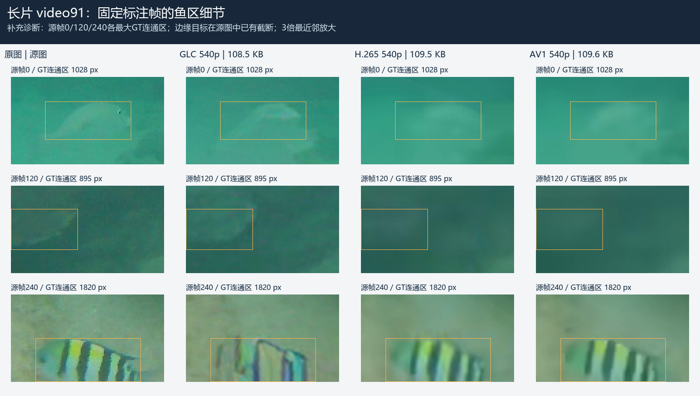

# 新阶段 A · GLC 第二轮实验报告

日期：2026-10-17。分支：codex/glc-priority-validation。仅使用现成预训练模型，本轮没有训练、没有改写 GLC 网络。**结论：继续以 GLC-Video 为优先主候选；本轮支持它的低预算感知优势，同时暴露了目标保真和时序上的限制，尚不能宣布最终验收通过。**

先看[结果图索引](结果图索引.md)，完整数值见[25点汇总CSV](evidence_round2/summary.csv)和[JSON](evidence_round2/summary.json)。参数、输入修订和关键帧修正见[试验约定](第二轮试验约定.md)，运行方法见[复现说明](第二轮复现与证据说明.md)。

## 1. 本轮得到什么

- 完成25个最终编码点：7个GLC、9个H.265、9个AV1；共评价3,650个重建帧。7个GLC真实文件的1,150帧全部通过发送端/独立接收端 latent 与 RGB 校验，解码器未读取源媒体。核验结果为 [PASS](evidence_round2/verification.json)。
- 短片获得45.3、27.8、16.7 KB三档GLC文件；每档保留原生720p和相同工作分辨率的普通编码对照。3个连续长片各250帧，其中video108另做GOP128。
- 本轮已测配置的GLC DISTS均低于相应普通编码对照，整体纹理观感方向值得继续；4个AV1点未进入±2%文件容差，必须单列，不能当作严格等预算结果。
- **目标收益并不稳定。** 短片3张GT上的鱼区误差较好，但video91的17张GT上，GLC鱼区PSNR为24.67 dB，H.265为28.60 dB、AV1为28.93 dB。补充图中能看到鱼身条纹/轮廓改变，不能只用较低DISTS作为目标验收。
- GLC的全局PSNR、MS-SSIM低于对照，相邻重建误差变化量也更高；I帧和参考重置附近存在值得进一步排查的跳变。**时序稳定性尚未判定通过。**
- 交付18张对照/诊断图，以及仅留本地的18份连续播放副本。每个观看副本全部RGB像素均通过SHA256一致性检查，见[预览核验](evidence_round2/preview_verification.json)；没有填写任何人工偏好或识别率分数。

## 2. 输入与比较口径

| 输入 | 源帧 | 输出帧率 / 时长 | DISTS采样 | 正鱼GT |
|---|---|---|---|---|
| short / video6 | 50–99 | 名义25 fps / 2秒 | 全50帧 | 3帧，2,010像素 |
| long108 / video108 | 0–249 | 名义25 fps / 10秒 | 49帧 | 所用17张GT无正鱼像素 |
| long91 / video91 | 0–249 | 来源时间记录15 fps / 16.67秒 | 56帧 | 17帧，42,459像素 |
| long24 / video24 | 0–249 | 名义25 fps / 10秒 | 49帧 | 所用17张GT无正鱼像素 |

这些都是旧工程已有开发资料，未证明摄录来源独立；没有确认的潜水员验收片段。没有GT正像素不等于全片没有鱼。

GLC固定q0、reset32；短组GOP64，长组以GOP64为主。下采样使用相同RGB源图和OpenCV AREA；低分辨率输出统一用Pillow LANCZOS恢复到720p评价。DISTS不缩到256p；PSNR/MS-SSIM和时序误差使用全部帧，鱼区指标只使用GT。DISTS自同一图像检查约为0，MS-SSIM为1，权重和实现哈希已保存。

H.265使用x265 slow，AV1使用libaom cpu-used6，均为BT.709/YUV420；GLC内部为RGB。文件大小包括真实容器和必要元数据，按字节差选择CRF，未按画质选点。最终实际关键帧位置均核对为0、GOP、2×GOP……。这不是穷尽普通编码器最佳预设的上限比较，也不能据此计算或宣称BD-rate收益。

## 3. GLC短片的文件预算

用户的20–40 kbps只约束链路发送速率，允许离线和等待，不限制压缩视频自身的平均码率。本表时间为纯文件负载换算，不是新做的网络实传，不含编码、协议、重传和解码时间。

| GLC工作分辨率 | 完整文件 B | 40 / 20 kbps等待秒 | DISTS ↓ | 鱼区PSNR dB ↑ |
|---|---:|---:|---:|---:|
| 720p | 45,280 | 9.06 / 18.11 | 0.1263 | 32.49 |
| 540p | 27,767 | 5.55 / 11.11 | 0.1589 | 30.47 |
| 360p | 16,681 | 3.34 / 6.67 | 0.1771 | 30.11 |

540p相对本轮720p文件小38.7%，360p小63.2%。这些变化同时包含工作分辨率变化，不能解释成固定分辨率的纯码率收益。16.7 KB是本轮最小实测点；本轮没有测10 KB配置，也没有证明GLC的绝对下限。

从固定源帧90的局部看，360p鱼身细节已明显变弱，因此保留为压力测试点，不直接作为默认交付配置。

### 27.8 KB档的两类对照

| 方法 | 工作分辨率 | 完整文件 B | 相对GLC预算 | DISTS ↓ | 鱼区PSNR ↑ | 全局PSNR ↑ |
|---|---:|---:|---:|---:|---:|---:|
| GLC | 540p | 27,767 | 基准 | 0.1589 | 30.47 | 28.35 |
| H.265 | 720p | 27,353 | -1.49% | 0.2286 | 29.47 | 31.77 |
| AV1 | 720p | 27,468 | -1.08% | 0.1790 | 29.56 | 33.29 |
| H.265 | 540p | 28,315 | +1.97% | 0.2224 | 29.89 | 32.02 |
| AV1 | 540p | 28,024 | +0.93% | 0.1868 | 29.93 | 33.37 |

在此短片上，控制相同540p工作输入后，GLC的DISTS优势仍然存在；与此同时，全局PSNR仍较低。鱼区PSNR只涵盖3张GT，且不直接衡量GT外伪目标、数量或动作，不能写成识别率提高。

## 4. 连续250帧结果

各编码均使用同一540p工作输入、720p评价。EΔ为相邻帧重建误差变化量的均值，单位为8-bit像素值，**不是感知闪烁分数**。所有PSNR单位为dB；“—”表示没有鱼区正GT。

| 片段 | GOP | 方法 | 完整文件 B | 预算偏差 | DISTS ↓ | 鱼区PSNR ↑ | 全局PSNR ↑ | EΔ |
|---|---:|---|---:|---:|---:|---:|---:|---:|
| long108 | 64 | GLC | 98,172 | 基准 | 0.1867 | — | 31.82 | 3.879 |
| long108 | 64 | H.265 | 99,249 | +1.10% | 0.2228 | — | 37.41 | 2.861 |
| long108 | 64 | AV1 | 95,707 | -2.51%† | 0.2230 | — | 38.19 | 2.715 |
| long108 | 128 | GLC | 98,951 | 基准 | 0.1886 | — | 32.19 | 3.877 |
| long108 | 128 | H.265 | 98,127 | -0.83% | 0.2223 | — | 37.31 | 2.874 |
| long108 | 128 | AV1 | 101,536 | +2.61%† | 0.2220 | — | 38.24 | 2.706 |
| long24 | 64 | GLC | 109,527 | 基准 | 0.1060 | — | 32.99 | 2.942 |
| long24 | 64 | H.265 | 110,074 | +0.50% | 0.1802 | — | 38.78 | 1.761 |
| long24 | 64 | AV1 | 106,071 | -3.16%† | 0.1760 | — | 39.73 | 1.610 |
| long91 | 64 | GLC | 108,511 | 基准 | 0.1504 | 24.67 | 31.29 | 4.517 |
| long91 | 64 | H.265 | 109,515 | +0.93% | 0.2243 | 28.60 | 36.05 | 3.341 |
| long91 | 64 | AV1 | 109,556 | +0.96% | 0.2245 | 28.93 | 36.85 | 3.161 |

video91是本轮长组中有正鱼GT的片段。GLC的全局DISTS明显更低，但鱼区误差反而较大。以下是结果后追加的诊断：固定源帧0、120、240各最大的源GT连通区，未按重建好坏选帧或选目标。帧120和240的对象在源图中就被画面边界截断，不能将原本不在画面的部分算成编码丢失。

图中GLC的条纹和局部形状发生变化；普通编码更模糊，但部分结构更接近原图。这是截图观察，不是人工识别率或正式盲评结论。主指标仍包含全部预定GT，选区清单见[补充图记录](evidence_round2/long91_supplementary_crop_manifest.json)。

## 5. 时序与GOP判断

- 短片720p由前轮GOP32的43,623 B改为GOP64的45,280 B，文件反而增大3.80%。
- video108由GOP64的98,172 B改为GOP128的98,951 B，增大0.79%；DISTS由0.1867变为0.1886，EΔ约3.879变为3.877。当前没有证据支持靠拉长GOP节省文件，也没有明确的时序改善，继续把GOP64作为默认试验配置。
- 参考重置位置附近值得重点排查。例如video91，GLC在8个reset参考位置的EΔ均值为7.72，其余位置为4.41；AV1在相同位置约为3.14 / 3.16。峰值还会出现在重置后的相邻帧。这是定位线索，尚未证明因果，更不能据此直接宣称有/无可见闪烁。
- 同一设备的latent/RGB一致性校验通过，说明这轮时序误差不是接收端读错源图或两端数值不一致。是否影响实际观看，需要正常速度连续播放和真实人工核对。

见[逐帧曲线](结果图索引.md)、[重置位置诊断](evidence_round2/temporal_boundary_diagnostics.json)。DISTS只是逐帧感知指标，静态图和均值都不能代替视频时序验收。

## 6. 方法修正与未命中预算

本机FFmpeg/libaom组合中，共用强制关键帧表达式会使短片AV1额外在索引1插入关键帧。同一CRF对照中，去掉该表达式并使用固定最小/最大GOP后，文件由45,614 B变为42,923 B。正式指标前归档并重跑了全部5个短片AV1点，长片从首次运行就使用修正参数；原始审计见[关键帧修正记录](evidence_round2/av1_keyframe_correction.json)。前轮曾记录额外关键帧但未做此消融，旧数值保留为历史结果。

以下4点未命中±2%容差，保留整数CRF有界搜索中的最近点，不补零、不截断：

| 片段 / 配对 | 实际 B | 相对目标 |
|---|---:|---:|
| short / av1_720_for_360_g64 | 17,738 | +6.34% |
| long108 / av1_540_for_540_g128 | 101,536 | +2.61% |
| long108 / av1_540_for_540_g64 | 95,707 | -2.51% |
| long24 / av1_540_for_540_g64 | 106,071 | -3.16% |

GLC本地研究容器包含逐帧latent/RGB校验信息。360p短片的容器开销为5,010 B，占30.0%；长片约22,235 B。未来可评估精简封装，但本轮完整计入文件，没有把诊断信息搬出预算后虚报压缩收益。约1.17 GB的GLC I/P预共享模型另列，不计入每段文件；首次分发模型的成本没有消失。

## 7. 下一轮优先方向

1. **继续GLC主线，先提高目标保真。** 在video91及新的鱼类片段上，保持GOP64/reset32不变，优先验证720p和较高合法质量档；允许文件变大，再按20–40 kbps发送。当前540p/q0是已知试验起点，不是已经验收的产品默认值。
2. **独立排查参考重置。** 固定分辨率、质量档和GOP，仅改变reset间隔，观察重置附近的跳变是否改善；不能一次同时改所有参数后归因。先用现有接口和模型完成消融，再决定是否需要训练。
3. **完成真实人工观看与独立素材验收。** 先看完整原图与重建，分别核对目标可见性、轮廓、数量、动作和时序，再看局部。补充来源独立及含潜水员的素材；目前没有人工评分，不虚构通过率。
4. **保留H.265/AV1作持续对照。** 每次改进继续按真实完整文件匹配预算；模型与码流已有适配器继续复用，暂不另写编解码系统。
5. **质量条件明确后再衔接传输与封装。** 复用现有文件收发和限速代码，测试20/30/40 kbps实传、完整性和跨设备解码，再评估研究容器的开销优化。

## 8. 交付与边界

- 小型证据在本目录evidence_round2：25点指标、逐帧记录、源图/GT哈希、命令、模型与环境来源、18张图和验证结果；[图片入口](结果图索引.md)。
- 原图、模型、候选/最终码流、逐帧PNG、18份无损观看副本只保留本地，未上传GitHub。连续播放入口：实验输出目录下的gallery/index.html；部分浏览器不支持RGB H.264时使用兼容的本地播放器。
- 本轮仅评价视频图像，不含音频；未进行新训练、正式人工盲评、独立来源留出验证、潜水员目标验收、跨硬件解码或新网络实传。
- 本轮完成的是新A阶段的GLC优先开发实验。最终采用与否，要结合目标内容和连续观看，不能由DISTS单项决定。
