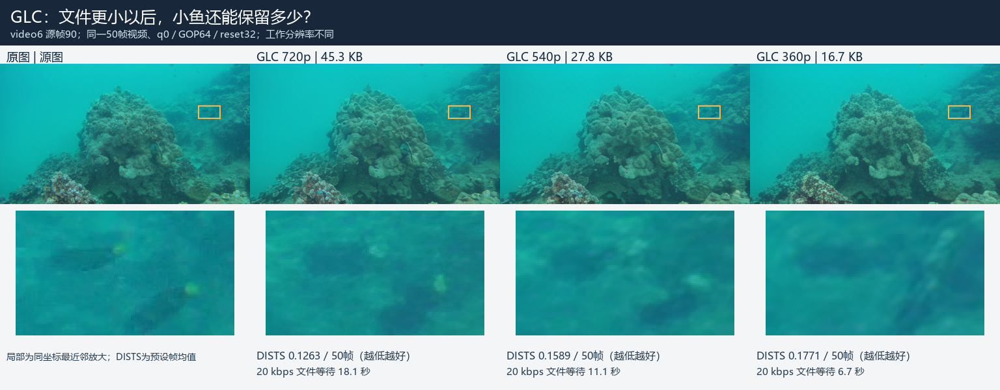
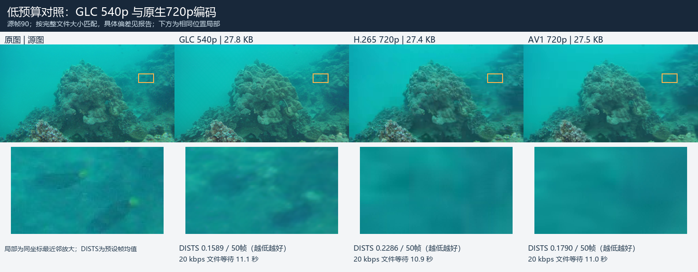

# GLC 第二轮结果图

先看重建画面，再看指标。下列图均从真实文件的独立解码像素生成；没有使用生成式补图、锐化或AI放大。低分辨率重建统一用 LANCZOS 恢复到720p，鱼类局部用最近邻放大。DISTS越低越好，不能替代目标是否存在的判断。

## 1. GLC 自己降预算后的变化

同一2秒、50帧源视频：720p / 45,280 B，540p / 27,767 B，360p / 16,681 B。工作分辨率和文件预算同时变化，不能把这张图理解为只改变码率的实验。

## 2. 相近文件大小下的传统编码对照

- [16.7 KB 档，原生720p对照](evidence_round2/figures/02_同预算_360p与原生对照.png)：AV1文件预算偏差+6.34%，不属于严格±2%配对。
- [27.8 KB 档，全部使用相同540p工作输入](evidence_round2/figures/03_同预算_同分辨率_540p.png)。
- [16.7 KB 档，全部使用相同360p工作输入](evidence_round2/figures/03_同预算_同分辨率_360p.png)。

同分辨率对照用来区分下采样影响与编码器影响。完整预算偏差以[实验报告](第二轮实验报告.md)和JSON证据为准。

## 3. 不挑选小鱼案例

发布者GT三帧中共有10个连通目标，全部展示；连通区域不必然等同于生物学个体计数。橙框表示GT区域，不是解码器预测框，也不是检测成功的标记。

- [27.8 KB 档：全部10个GT局部](evidence_round2/figures/04_全部小鱼目标_540p预算.png)。
- [16.7 KB 档：全部10个GT局部](evidence_round2/figures/04_全部小鱼目标_360p预算.png)。

另有 [video91固定GT鱼区补充诊断](evidence_round2/figures/09_long91_固定GT鱼区补充诊断.png)：在观察到长片鱼区误差后追加，固定源帧0、120、240各最大GT连通区。它是事后诊断图，未改变预定指标集合；两处边缘目标在源图中也已截断。

## 4. 长片段固定取帧

三个已有开发片段，均展示固定索引0、124、249，未按输出效果挑帧。它们不是已证明来源独立的最终留出集。

- [video108 首/中/末帧](evidence_round2/figures/07_long108_首中末固定帧.png)；[末帧大图](evidence_round2/figures/05_long108_连续末帧.png)。
- [video91 首/中/末帧](evidence_round2/figures/07_long91_首中末固定帧.png)；[末帧大图](evidence_round2/figures/05_long91_连续末帧.png)。
- [video24 首/中/末帧](evidence_round2/figures/07_long24_首中末固定帧.png)；[末帧大图](evidence_round2/figures/05_long24_连续末帧.png)。

## 5. 时序诊断

- [跨索引64的I帧边界局部](evidence_round2/figures/06_跨I帧边界时序对照.png)：源图、GLC GOP64 / 128、H.265、AV1，索引61–66按时间横排。
- [video108逐帧曲线](evidence_round2/figures/08_long108_逐帧诊断.png)。
- [video91逐帧曲线](evidence_round2/figures/08_long91_逐帧诊断.png)。
- [video24逐帧曲线](evidence_round2/figures/08_long24_逐帧诊断.png)。

相邻重建误差的变化量只是诊断，不是感知闪烁分数。静态图和曲线也不能证明没有闪烁，连续观看副本在本地实验输出目录的 `gallery/index.html`，不上传GitHub。尚无真实人工偏好评分；请以源图为参照核对目标的数量、轮廓、位置及连续运动。
