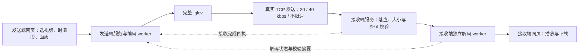

# C5 收尾方案：视频时序适配、双机收发与有限性能优化

日期：2026-10-20（Asia/Shanghai）。**方案已获用户授权执行。C5 为 C 轮最后一个阶段。** 文件名保留原方案入口；原文中的“本次规划未启动”描述方案提交时状态，实际进度以 [执行记录](C5执行记录_20261020.md) 为准。

**执行中用户更新：20/40 kbps 仅实现功能，本机不做限速实验。以下涉及三档本机实测的原安排由此更新取代：采用虚拟时钟校验节流逻辑，本机网络集成统一最大速度，不自动跑限速矩阵。**

依据：项目交接、C0–C4 报告和当前源码，以及用户提供的 `C:\Users\lenovo\Desktop\临时\C4.md`。本次用户增加了发送端与接收端分离、第二台电脑测试，以及 **20 kbps、40 kbps、最大速度** 三档真实传输要求。

已确认设备：发送端为现有 RTX 4060 Laptop；接收端为 **RTX 4070 Laptop、8 GB 显存**，未来连接同一局域网，目前不在用户身边。接收端操作系统、驱动和软件环境尚未确认。首版部署步骤先按现有 Windows 环境规划，实际环境通过预检记录。

## 1. 收尾目标与范围

必达目标：

1. 按视频真实时间轴选择“前 10 秒／指定片段／整段”，四档画质继续由用户选择；保留原 B4 取帧方式和历史复现。
2. 发送电脑编码并实际发送 `.glcv`；接收电脑自行接收、校验、解码、播放和下载。两端具有各自的进程、配置、任务目录和启动入口。
3. 接收端可选 20 kbps、40 kbps、最大速度，发送端读取并执行该档位；三档采用同一完整传输和解码流程。
4. 提供接收端安装清单、环境预检、双机操作说明和可导出的验收记录；验证取消、断连、重试、队列和有限连续运行。

性能为有限挑战：优先诊断实际热点，再评估单角色常驻和至多两个有依据的优化候选。约 52 秒是同条件本机网页等待的参考目标，40 秒是挑战目标；均非预测或完成收尾的硬门槛。

本阶段维持 GLC 网络、权重、FP32、四档空间分辨率、熵编码与 `.glcv` 容器 v2。新增任务识别与传输控制属于双机连接所需的薄适配。新模型、训练、语义 ROI、量化、新容器、实时流式解码、断点续传、互联网穿透及水声信道建模不纳入 C5。既有完整文件传完后再解码的工作方式继续使用。

**最终验收需要两台真实电脑。** 当前可以完成本机开发、两个独立服务的测试及部署交付；第二台电脑不可用时，只能记录“本机验收完成、双机验收待执行”。不得据此宣布跨电脑测试通过或 C5 全部完成。双机测试沿用 C5，不另开 C6。

## 2. 当前实现与必须处理的差距

冻结基线为 `codex/glc-c` 的 `a6de3270e762c861d71e4cc2fec25b28a0cc4cba`。规划开始时本地工作树干净，与本地记录的远端分支一致。

| 当前事实 | 代码位置（相对仓库） | 对 C5 的影响 |
| --- | --- | --- |
| 网页编码后调用 `shutil.copyfile`，再启动本机解码；HTTP 绑定回环地址 | `08_新阶段C_编解码加速与网页展示/c3_server.py`，`run()`、`main()` | 需要真实传输服务与远端任务回执，单改监听地址不能完成收发分离 |
| 已有 TCP 长度头、文件大小、SHA-256、接收确认、取消和发送节流 | `01_主工程/semantic_mvp/transport.py` | 复用其核心；旧数值速率接口保留，新建明确的不限速分支 |
| 现有速率要求 1–100000 kbps；接收 CLI 接一份文件后结束 | 同上，`send_file()`、`main()` | 最大速度不能用 100000 kbps 冒充；需要长期接收的任务服务 |
| `MemoryFrames` 按源帧序号和 stride 取帧，fps 为名义源 fps / stride | `08_新阶段C_编解码加速与网页展示/c1_io.py` | 不能直接支持任意 fps / VFR 的固定时长 |
| Web 将帧数限制在档位默认值；底层运行器与容器最多 10000 帧 | `c3_server.py:parse_options()`、`c1_runtime.py:options()`、`glc_container.py:validate_header()` | 整段模式需要独立参数校验，不能只去掉前端上限 |
| 解码前要求发送端 arithmetic 与本机 profile 完全相等，包含 GPU 名称 | `c1_runtime.py:_decode()`；`glc_video_codec.py:configure()` | 4060 Laptop → 4070 Laptop 按当前规则会被拒绝，需要专门的设备配对验证 |
| 已有单角色常驻运行器，但网页按任务创建新进程 | `c1_runtime.py:ResidentRunner`、`c2_worker.py`、`c3_server.py:execute()` | 可复用常驻能力；必须补齐服务端生命周期、退出恢复和任务隔离 |
| decoder-only 禁止调用编码模块，但仍加载完整模型 | `glc_video_codec.py:NeuralCodec.__init__()` | 不能仅凭“接收端”角色宣称显存占用已降低；8 GB 要实测 |
| 当前迁移预检只检查路径 | `c4_config.py`、`C4启动与迁移说明.md` | 需要版本、权重、native 后端和真实解码能力的分层预检 |

C4 主片 10 秒 / 125 帧、26,397 B，浏览器等待 60.708 秒，是一次功能验收样本。C4 的 153 项回归为既有证据，本次规划没有重跑；C2 的 1.991× 仍保留原测量口径。

## 3. 双机结构与使用流程

建议入口为“启动C5发送端.cmd”和“启动C5接收端.cmd”，分别使用发送端／接收端配置与数据目录。保留 C4 入口和历史资料读取能力。以下均为拟交付功能，并非现有命令。

接收端操作：

1. 准备依赖、权重及本机配置，执行环境预检；启动接收端页面。
2. 页面显示可复制的局域网地址、连接状态和接收速度；首次默认“最大速度（不限速）”，便于快速验证。
3. 显示等待接收、收包进度、校验、解码、就绪／失败；完成后本机播放重建视频，下载 `.glcv`、MP4 和结果记录。
4. 接收端无需发送端源视频、源帧、发送端任务目录或历史实验资料。权重属于提前部署的共享模型，不随每次视频发送。

发送端操作：

1. 填入接收端地址，连接并查看环境兼容状态和接收档位。
2. 选择视频、时间范围和四档画质，查看将处理的时长、帧数、输出 fps，再显式开始。
3. 按“编码 → 发送 → 远端校验 → 远端解码 → 就绪”显示进度。文件送达与解码成功是两个独立状态。
4. 提供“发送已有 `.glcv`”，用于更换传输档或重试；同一文件无需重复编码。正式编解码性能测量明确标记是否复用了文件。

首版建议发送端页面保留 `127.0.0.1:8773`；接收端网页／控制服务使用可配置的 `8774`，文件通道使用可配置的 `8771`。局域网监听地址显式配置，启动器给出实际地址和所需端口。C4 的回环绑定与 Origin 检查不可简单原样套用到局域网服务。

控制请求由发送端服务发起，承载预检、任务预约、状态查询和取消；本地配置保存连接凭据，文件通道使用预约产生的任务票据。接收文件以接收端生成的任务目录命名，不接受发送端文件路径。首版每端最多一个 GPU 任务，接收队列有明确上限，队满返回“忙”。

接收端重建 MP4 在接收电脑本地播放。跨机主流程只回传状态和校验摘要，不自动回传 MP4 或上传源视频。若用户额外查看远端预览，相关流量单列为展示流量，不计作 `.glcv` 码率或限速成绩。

## 4. 三档速度的准确定义

| 页面档位 | 有效限速 | 行为与用途 |
| --- | ---: | --- |
| 20 kbps | 20000 bit/s，约 2500 B/s | 实际发送节流，观察低带宽传输 |
| 40 kbps | 40000 bit/s，约 5000 B/s | 同一流程，提供较快限速档 |
| 最大速度（不限速） | `limit_kbps = null` | 关闭人为等待，仍执行分块传输、落盘、校验、回执与解码 |

“四档画质”与“三档传输速度”是两个独立选项，形成 4 × 3 种可选组合。改变速度不重编码、不改画质、不改码流字节。

接收端设置接收速度，发送端连接后读取；开始传输时锁定任务的有效档位，两端显示一致。运行中修改接收设置只影响后续任务。**节流实际放在发送端**，避免只延缓接收读取却让整个小文件提前进入网络缓存。

数据传输沿用已有 TCP 分块／SHA／确认逻辑。C5 增加带版本的任务传输头，包含 `job_id` 和一次传输票据，用于关联预约和避免误收；旧 B 阶段收发格式及入口保留。`.glcv` 内部格式不变。新头长度按实际序列化字节计算，不能继续硬套历史 95 B。

限速统计包含发送方向文件通道的完整应用层字节（长度前缀、任务传输头、完整 `.glcv`）。控制请求、反向回执及状态查询按方向分别统计；不把它们悄悄算作零开销。TCP/IP 包头、链路层开销和实际重传不包含在应用层速率内，因此该功能证明的是局域网应用层节流，不是 20/40 kbps 物理信道。

对同一个 26,397 B 历史 compact 文件，仅载荷对应约 **10.56 秒 / 5.28 秒**；真实发送还需加实际传输头、调度与确认成本。最大速度受网卡、网络、磁盘和调度限制，不能写成“耗时为零”。

拟记录 `payload_bytes`、`application_bytes`、`control_bytes_tx/rx`、`effective_rate_mode`、传输开始／发送完成／接收确认耗时、平均速率、接收 SHA 和发送调度轨迹。采用单调时钟累计字节调度，取消可中断等待；处理正常的短写、背压和 socket 超时，避免错误地从头重发一个已部分发送的块。

限速验收使用固定文件和小型确定性节流测试：确认字节不会早于应有发送时刻，记录末字节的实际调度偏差；健康局域网运行以理论应用层时长的 ±5% 或 0.25 秒（取较大值）作为调度偏差检查线。握手、校验、ACK 等附加时间单列，不因网络本身更慢就误报限速器失败。最大速度检查没有人为限速等待，报告实测速率，不指定不现实的最低网速。

## 5. 4060 Laptop → 4070 Laptop 兼容性门槛

这是目标硬件的必查项。当前代码的 GPU 名称比较会拒绝该组合；即使更改比较逻辑，浮点先验也可能影响熵解码和后续参考状态。PyTorch 官方不保证跨版本／平台或 CPU 与 GPU 的逐位一致；确定性设置不能替代跨机验证。[PyTorch 2.5.1 可复现性说明](https://github.com/pytorch/pytorch/blob/v2.5.1/docs/source/notes/randomness.rst)

采用以下有限范围策略：

1. **保留严格路径。** 旧码流和旧入口维持 arithmetic 完全匹配规则。环境指纹增加 OS、驱动、软件版本、GPU 名称和实际算力版本；实际取值由两端上报，不根据显卡名称猜测。
2. **新增受控设备配对检查。** 先要求网络／权重 SHA、CDF、FP32 设置、PyTorch/CUDA/cuDNN 等核心配置一致；仅对设备身份差异开放诊断入口，不提供通用“忽略所有校验”开关。
3. **先短后长。** 第二台机器到位后，先传已保存的 8 帧小流验证基本 I/P 解码，再使用覆盖 reset32 和 GOP64 的至少 66 帧流；随后做完整 compact 主片、NOAA 新片及其余画质的代表检查。
4. **每个真实任务仍严格验收。** 配对诊断通过只能说明已测条件，不能证明所有视频。即使记录为可测试设备对，每次都必须通过整文件 SHA、容器校验、v2 有序 RGB/潜变量聚合摘要及需要的逐帧离线比对；失败的 MP4 不标为成功。
5. **失败即保留证据并停止该优化分支。** 先排除软件、权重和部署差异；若同配置仍出现算术分歧，保留该任务及首个可定位差异。不得靠删掉 arithmetic 检查或放宽 RGB/潜变量摘要通过验收。

实现建议把“设备身份”和“算术兼容判定”封装成独立模块：历史严格策略保持，新 C5 设备配对策略明确记录所依据的指纹、测试范围和结果。原始发送端 arithmetic 元数据保留，不伪造接收端名称。

若目标设备对不能稳定解码，C5 双机目标仍属未完成。两端统一 CPU 运算或另行设计可移植算术后端都需要重新编码、验证和计时；不能将“只在接收端换成 CPU”视为现成回退，也不在 C5 中无限追加跨硬件数值研究。届时提交具体失败证据与可执行替代方案供用户决定。

## 6. 时间轴与整段视频

新的网页模式默认“前 10 秒”；另提供开始／结束秒数的指定片段，以及整段视频。依据视频流的有效时间戳和实际 EOF，音频继续不处理。界面同时显示原视频时长、选中范围、实际处理时长、输出帧数和输出 fps。

| 画质档 | 宽度上限，保持比例 | 新时间模式目标 fps |
| --- | ---: | ---: |
| detail_motion | 960 | 25 |
| detail | 960 | 12.5 |
| motion | 640 | 25 |
| compact | 640 | 12.5 |

固定目标 fps 通过按时间丢帧或必要的重复帧实现，不进行运动插帧；低 fps 输入发生重复时写入取帧记录。输出按恒定 fps 播放，视频时间长度不再由源 fps 除以固定 stride 偶然决定。

新增 PTS 感知的取帧入口，优先复用本机 FFmpeg 的 `trim`、时间戳归一化及 `fps` 功能，明确固定取整和 EOF 策略，记录源 PTS 到输出时间网格的映射。使用 `trim` 不会自动将时间戳归零，必须单独处理。正式实现以本机 FFmpeg 版本验证行为。[FFmpeg fps](https://ffmpeg.org/ffmpeg-filters.html#fps)、[trim](https://ffmpeg.org/ffmpeg-filters.html#trim)

实现约束：

- `sampling_mode=legacy_frame_stride` 继续调用原 `MemoryFrames`；旧脚本默认和历史配置保持该路径。新的时间模式单独解析 fps／帧数，不再被 `apply_encode_preset` 二次隔帧。
- 新模式的预处理像素和码流可以因时间采样、颜色转换而不同，单独保存参考；不要求与旧 29.97 fps 的 8.34 秒结果逐字节相同。旧模式则必须保持既有严格复现。
- 片段采用左闭右开范围；完整 10 秒应输出 125 或 250 帧。对于非整帧长度或真实 EOF，允许不超过一个输出帧周期的时长量化差，并明确显示实际值；不补出超过源有效范围的数秒内容。
- 新模式保存采样方式、目标 fps、裁剪范围、源／输出 PTS 映射、实际帧数和处理后源 RGB 摘要。原视频时间戳无效或不单调时给出明确诊断，不悄悄用名义 fps 冒充真实时间。
- 逐帧读取、有限预览队列；不把整个长视频 RGB 一次性装入内存。现有压缩包缓存上限与磁盘配额需一起检查。
- 维持输入 1 GiB、单容器 256 MiB、输出 10000 帧的现有限制；整段模式超限时在开始前明确说明，不能仍只处理前 125 帧并称为整段。10000 帧约对应 25 fps 的 400 秒或 12.5 fps 的 800 秒，不代表这些长度已做性能验收。

CPU 采样验收覆盖 25、30000/1001、30、60 fps 和一段带已知 PTS 的 VFR 素材，包含前 10 秒、非零起点、短于 10 秒、EOF 和无效范围。用可识别帧号／时间标记检验取帧及边界，不只看元数据时长。GPU 集成优先主片 10 秒、NOAA 10 秒和 NOAA 整段约 27.6 秒，避免全帧率 × 全档位重复推理。

## 7. 性能诊断与停止条件

先补齐阶段计时：上传、发送端排队、取帧、模型初始化、编码、文件传输、接收端排队、解码、预览封装和浏览器可播放。现有 C0 没有捕获到 CUDA kernel activity，不能沿用旧诊断作为已经知道逐 kernel 瓶颈的证据。

优化顺序：

1. 复用已有单角色 `ResidentRunner`：发送机只常驻编码角色，接收机只常驻解码角色。网页打开不自动加载模型，首次显式任务加载；第一次与后续任务分开计时，提供关闭／释放资源，异常后重新初始化并验证 DPB 不串任务。
2. 对实际热点做短窗口诊断，检查 CPU/GPU 同步、拷贝、预览和状态记录的开销。Profiler 工具仍无 GPU 活动时如实写限制，采用可解释的分段墙钟与 CUDA events；不开展无期限工具迁移。
3. 至多选择两个候选，包括静态纯 GPU 子模块的 CUDA Graphs，或环境允许时的 `torch.compile` 小实验。每个候选先做正确性门槛，再决定是否做完整对照。

完整 `frame()` 含 CPU 熵编码、NumPy 和哈希，不适合直接整体 CUDA Graph 捕获；官方要求图内形状、内存地址与控制流受约束，CPU 工作不会在重放时自动执行。因此仅考虑有证据的纯 GPU 子模块。[PyTorch 2.5.1 CUDA Graphs](https://github.com/pytorch/pytorch/blob/v2.5.1/docs/source/notes/cuda.rst)

候选环境与现有 `.venv-glc` 隔离；Windows／当前 PyTorch 2.5.1 下的编译后端可用性必须先验证。需要更换整套软件栈才能开展的候选可记为未采用，不在收尾阶段强制迁移。保留 native／Python 熵后端回退，且区分熵后端回退与 CPU 神经运算。

正式对照固定输入 RGB、画质、时间模式、输出范围和设备；关闭重型 profiler。对最终候选做三对交错运行，报告全部原始样本、中位数、范围、初始化／预热成本、峰值和空闲显存。每个新候选至少一次覆盖 I/P、reset32、GOP64 的正确性检查；任何码流或重建摘要变化即停止该候选。

性能口径分开：

- **本机同条件网页口径：** 与同期冻结 C4 路径比较完整 10 秒 compact，保留同等预览和校验。参考绝对目标 ≤52 秒，挑战 ≤40 秒；约 15% 降幅须由同期三对结果确认，不能只拿历史 60.708 秒单样本折算。
- **双机使用口径：** 在同一 4060 → 4070 组合、同一网络和最大速度下，对照首次／常驻任务。换显卡和多电脑本身带来的差异单列，不冒充软件优化收益。
- **限速口径：** 20/40 kbps 的传输耗时独立列出，52 秒不作为这两个模式的端到端验收线。

若没有稳定净收益、显存余量不足、任务隔离退化或数值校验失败，就保留当前实现，记录负结果结束性能子项。不为跨过 2.000× 或 40 秒追加挑选样本。

## 8. 跨机计时、异常与稳定性

发送端用同一单调时钟测量“点击／派发 → 收到远端预览就绪通知”。接收端用本地单调时钟测量接收、解码和封装，接收端浏览器另测加载至可播放。两台电脑的墙钟只用于关联日志；不相减未经同步的系统时间，亦不将远端文件就绪回执写成接收端浏览器已经播放。

需要覆盖：

| 场景 | 预期结果 |
| --- | --- |
| 接收端未启动／地址错误／端口阻断 | 连接阶段给出错误，可重试，不显示已送达 |
| 编码、发送、接收或解码中取消 | 对应 worker／socket 退出，保留事件，后续任务可执行 |
| 控制连接断开，取消回执丢失 | 标记远端状态待确认；恢复连接后按任务 ID 查询，不自行断言已取消 |
| 中途断网／文件截断／SHA 错误 | `.part` 不进入解码成功流程，重试使用新传输尝试记录 |
| 重复提交／ACK 丢失后重试 | 通过任务 ID、尝试 ID 和 SHA 查询已有状态；不覆盖完成文件，不重复发布结果 |
| 权重、CDF、版本或算术不兼容 | 预检或解码明确拒绝，保留实际差异 |
| 服务重启／worker 崩溃 | 先核实遗留进程，未完成任务有明确终态；不把旧 running 直接当新任务恢复 |
| 连续任务、档位切换 | DPB、源素材、帧数、输出路径及网页任务记录互不混用 |

有限稳定性验收建议为 **10 个连续成功任务**，其中至少 3 个完整 10 秒 compact，其余可用覆盖关键边界的短片；另做一次约 60 秒 compact 长片，以及编码／传输／解码各一次中断后成功恢复。四档代表检查可并入该批任务，不机械叠加测试次数。

记录任务完成后的 allocated／reserved 显存、进程存活和主机内存；前期缓存增长与持续随任务数增长分开判断。常驻或新尺寸缓存需有明确上限，不随素材数无限增加。此范围证明有限序列稳定性，不宣称几十小时无人值守已验证。

## 9. 子阶段、验收与交付

| 子阶段 | 工作 | 退出条件／交付 |
| --- | --- | --- |
| C5-0 基线与兼容门槛 | 冻结 C4；保存本机指纹与计时定义；设计双机预检及设备配对检查 | 基线、诊断工具和检查契约可复现；4070 尚不可用时明确保留双机门槛待测，不阻止本机开发 |
| C5-1 时间轴适配 | 新增时间模式，保留 legacy；整段／片段与输出说明 | CPU 时间轴矩阵、完整主片及 NOAA 指定范围集成通过；旧模式保持一致 |
| C5-2 双机角色与三档传输 | 独立入口／配置；真实 TCP；20/40/max；远端状态与取消 | 两个独立服务经 socket 完成三档测试、异常恢复及任务隔离；本机测试注明 loopback |
| C5-3 有限性能优化 | 单角色常驻、热点诊断、有限候选与三对结果 | 输出采用／不采用结论、正确性与资源记录；无收益也可按规则结束 |
| C5-4 部署、双机验收与 C 轮归档 | 接收端部署包；有限稳定性；真实局域网验收；最终演示和报告 | 目标设备对的实测通过后完成最终验收；本机与双机证据分别列出 |

当前能交付的是方案。执行阶段本机可形成“可部署候选版”，内容包括：

- 两个启动入口、配置示例、环境自检和使用说明；本机路径、IP、连接凭据放入被忽略的本地配置。
- 从干净目录准备接收端的步骤：仓库版本、Python 依赖锁定、GLC 源码与权重校验、FFmpeg、native DLL 或明确的 Python 熵回退。不把当前虚拟环境直接复制后当作已安装成功。
- 接收端不依赖历史实验目录的验证，以及环境指纹和测试记录导出工具。
- 8 帧、66 帧与完整文件的本地测试资产索引；大文件不进 Git，部署时单独准备。
- 新增时间轴／传输／角色／兼容判定的针对性测试，并运行现有 B/C 回归；关键 native 路径不能因未配置 DLL 而以跳过代替通过。

第二台电脑到位后按以下顺序执行：

1. 接收端环境预检、局域网连接检查、8 帧与 66 帧设备配对验证。
2. 完整 compact 主片用最大速度完成真实接收、独立解码及本机播放。
3. 同一完整 compact 码流分别用 20 和 40 kbps 发送并独立解码；三档收到的完整 SHA 必须相同。三档均实测，后续普通素材无需再重复三档矩阵。
4. 其余三档画质各做一次最大速度接收／解码；新 NOAA 时间模式代表任务补充验证，可复用先前编码资产。
5. 双机传输中断／恢复、接收端解码取消／恢复、结果下载，以及可复核日志归档。

每个已完成子阶段沿用用户约定：检查差异、整理代码／配置／报告／小型证据，提交并推送 `codex/glc-c`。失败或负结果同样记录。每次更新标清“本机通过／双机待测／双机通过”，不能把提交、安装包或测试脚本当作测试已经执行。

最终报告包含：时间轴行为、设备与依赖指纹、四档与三速、完整任务的实际等待、严格校验结果、连续运行范围、采用和未采用的优化、失败记录、接收端部署与复现步骤。A/B 语义收益边界、C2 严格 2× 未达到、未做真实水声验证等历史结论保持原意。

## 10. 建议代码落点

以下为拟新增模块，名称可在实现时按现有风格微调：

| 模块 | 职责 |
| --- | --- |
| `c5_timebase.py` | 时间范围解析、PTS 采样、源／输出映射与边界验证 |
| `c5_sender.py` / `c5_receiver.py` | 各自网页／任务服务和启动入口；共用任务状态核心 |
| `c5_transport.py` | 三档选择、C5 任务头、预约绑定、进度与回执；复用既有传输核心 |
| `c5_compat.py` | 环境指纹、严格／设备配对判定、兼容检查报告 |
| `c5_config.py` | 两端运行路径、角色、监听／目标地址、队列和资源限额 |
| `check_c5.py` | 读取实测记录、核对时间轴、SHA、重建摘要与统计口径 |

对 `c1_runtime.py` 的改动局限于可选帧源和兼容判定接口；历史默认值维持原行为。对旧 `transport.py` 的共用核心如需提取，保留旧函数接口和数值档位行为，并做相应回归。不要复制整套编解码器或再建立第二份权威仓库。

本文基于静态源码核对及官方文档检索。Context7 的版本化检索部分结果仍指向 main，因此 PyTorch 约束以已核对的 v2.5.1 文档和执行时本机行为为准。本次没有启动 GPU、修改运行环境、改变现有服务、开展网络实验或宣称 4070 已兼容。
