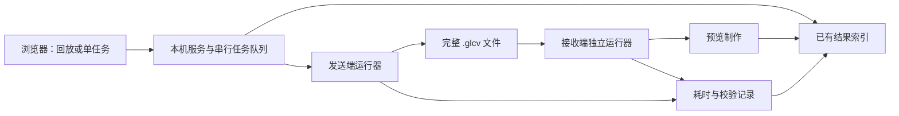

# C 轮方案：编解码提速与网页成果展示

日期：2026-10-19。本文保留最初方案；**后续用户已依次授权并完成 C0、C1；C2 已授权并进行中，C3–C4 尚未启动。** 当前进度以 [阶段入口](README.md)和各阶段报告为准，文中原有“待审阅/尚未执行”描述属于方案制定时的状态。

基线：权威仓库 `main`，提交 `1236c64`；C 轮开发分支为 `codex/glc-c`。本方案依据联网检索、现有代码静态阅读与 B4 已有 JSON 记录整理；文中的目标和试验安排均不是已取得的结果。检索详情见[检索与复用依据](检索与复用依据_20261019.md)。用户已要求以后每完成一个阶段提交并推送一次，规则见[阶段入口](README.md)。

## 1. 建议采用的路线

沿用 **GLC-Video、现有权重、容器 v2 和四档预设**，先找出耗时，再减少工程开销，最后针对实际瓶颈接入成熟加速实现。网页沿用已有本机 GLC 控制台，增加四档成果展示与优化前后对比。

C 轮包含两项交付：

1. 一条有计时证据、可回退、保持独立解码正确性的加速路径。
2. 一个本机网页，能展示已有成果、比较优化前后表现，并按需运行单个新任务。

本轮不重新选模型、不训练、不追加 ROI 增强，也不恢复 B 阶段未完成的研究验证。实际水声链路接入另立任务；当前“10 秒视频约 20 秒发送完”的目标继续指发送预算，不能自动改写为端到端预算。

## 2. 目前已经查清的事实

### 2.1 时间需要分层看

从 B4 `joint_360p_12_5` 的既有 `encode.json`、`decode.json` 读取：

| 最小档，10 秒、125 帧 | 编码 | 解码 |
| --- | ---: | ---: |
| 预览生成前的流程时间 | 67.999 s | 44.939 s |
| 逐帧处理时间合计 | 36.549 s | 27.335 s |
| 两种计时的差额 | 31.450 s | 17.604 s |

逐帧计时包含网络、熵编码、数据搬运和重建摘要；流程计时还包含模型准备、抽帧、PNG 读写等，但**不含后续 MP4 预览制作，也不等于网页总等待时间**。两端合计约 49.05 秒、43.4% 位于逐帧计时之外，尚不能把这部分全部归因于磁盘或模型加载。

按旧记录作一个理想上限计算：若逐帧处理完全不变、其余时间全部消失，合计也只能从约 112.94 秒降至 63.88 秒，约 1.77 倍。因此，工程整理值得先做；想获得更大的加速还必须处理帧内瓶颈。该计算不是性能预测。它只适用于这份历史流程记录和“帧内时间不变”的假设，不能直接套到 C0 热态基线上，也不能据此提前认定 C2 必须采用哪项技术；C1 的缓冲与搬运优化也可能影响帧内时间。

这些是历史单次记录。C 轮正式加速比以 C0 同机、同工况的新基线为分母，不能拿不同时间、不同输出范围的旧结果直接宣布提升。

### 2.2 现有代码已经具备的能力

| 现有资产 | C 轮判断 |
| --- | --- |
| `NeuralCodec.frame()` 已使用 `torch.inference_mode()`，模型已 `eval()` | 继续保留，不能作为新增优化成果 |
| FP32、确定性算法、关闭 TF32；解码器核对算术环境 | 加速必须接受严格一致性检查 |
| 本地 Python byte-rANS，逐符号循环，来源注明 `ryg_rans` | 若占比足够大，可复用同源 C/C++ 核心，避免另设计熵编码算法 |
| 抽帧先存 PNG，再读回编码；重建帧再存 PNG | 有减少中间文件和重复转换的空间 |
| 每次命令建立 `NeuralCodec`；解码校验还另建一次熵表 | 可研究常驻进程、模型与只读熵表复用 |
| `glc_demo_server.py`、`glc_console` 已有上传、单任务队列、取消、历史、同步播放和下载 | 优先扩展，而不是重新搭建一套网站 |

旧网页仍以 q63、1280 宽、GOP32 等早期配置为默认，旧 roundtrip 入口没有完整接入 B4 四档与 v2 选项。旧启动脚本还假设环境位于快照目录内。因此，**已有网页可复用，但不能直接把启动旧网页当作 C 轮交付**。

## 3. 网上成果如何使用

| 方法或成果 | 本轮取舍 | 适用边界 |
| --- | --- | --- |
| PyTorch Profiler、CUDA events | C0 直接复用工具 | 看清 CPU、GPU、同步和 I/O 的贡献；采样跟踪与正式计时分开 |
| `ryg_rans` 的 byte-rANS 原生实现 | C2 优先候选 | 保留本地 CDF、逃逸符号和包格式；不能直接换成另一种 rANS 格式 |
| OpenCV 内存帧、FFmpeg rawvideo/pipe | C1 优先 | 先保持 OpenCV 当前解码、缩放和取帧规则，只去掉 PNG 往返；FFmpeg 管道优先用于预览输出 |
| PyTorch CUDA Graphs | C2 条件候选 | 仅用于静态形状的纯 GPU 子模块，不能捕获整条含 Python rANS 的流水线 |
| `torch.compile` 与 Triton Windows | C2 次级候选 | 当前有 Windows 实现；仍须核对 PyTorch 2.5.1、CUDA、Python 与工具链组合，单独环境验证 |
| TensorRT / 混合精度 | 本轮不列为必做 | FP32 后端替换也可能改变数值；FP16、TF32 会影响熵模型及参考状态，不能直接打开 |
| DCVC-RT（CVPR 2025） | 借鉴降低操作开销的思路 | 官方公开代码和权重；换成它会改变已选 GLC 路线，论文速度不是本机保证 |
| DCVC-UF（CVPR 2026） | 记录为后续研究参考 | 多帧成块编码是另一套模型结构，不能当作 GLC 的无改动加速插件 |
| Gradio | 网页备用方案 | 有视频组件与队列，但现有控制台已具备这些能力，迁移收益暂不足 |

上述事实分别来自 [PyTorch Profiler](https://docs.pytorch.org/tutorials/recipes/recipes/profiler_recipe.html)、[ryg_rans](https://github.com/rygorous/ryg_rans)、[FFmpeg](https://ffmpeg.org/ffmpeg-formats.html#rawvideo)、[CUDA Graphs](https://github.com/pytorch/pytorch/blob/v2.5.1/docs/source/notes/cuda.rst)、[Triton Windows](https://github.com/triton-lang/triton-windows)、[TensorRT 精度说明](https://docs.nvidia.com/deeplearning/tensorrt/10.x.x/inference-library/accuracy-considerations.html)、[DCVC-RT](https://github.com/microsoft/DCVC/blob/main/DCVC-family/DCVC-RT/README.md)、[DCVC-UF 论文](https://arxiv.org/abs/2606.04410)和 [Gradio 队列文档](https://www.gradio.app/guides/queuing)。取舍是结合本项目作出的工程判断。

## 4. 分阶段安排

| 阶段 | 要解决的问题 | 交付与进入下一阶段的条件 |
| --- | --- | --- |
| C0：建立耗时基线 | 时间具体花在哪里 | 统一计时记录、热点报告；确认旧码流仍可独立解码 |
| C1：减少工程开销 | 重复加载、PNG 往返、预览阻塞 | 常驻任务执行器、内存帧路径、独立的预览状态；同输入产生相同码流和 RGB |
| C2：热点加速 | 帧内 CPU 或 GPU 瓶颈 | 最多选两个有依据的候选逐项对照，保留有收益且通过一致性检查的实现 |
| C3：网页整合 | 怎样清楚、稳定地展示成果 | 四档选择、视频对比、耗时分解、证据下载、已有结果回放和单任务运行 |
| C4：验收与归档 | 提速是否真实，展示是否可信 | 四档回归、一个独立素材的有限复核、浏览器验收、最终说明 |

C3 的已有结果展示部分可在 C0 数据字段确定后推进；优化前后的实测比较需要等 C1/C2 产生数据。**本次仅提交上述安排，所有执行阶段均等待用户审阅后启动。**

### C0：先建立可比较的基线

记录六种量，网页和报告使用同一字段定义：

| 指标 | 计时范围 |
| --- | --- |
| 初始化时间 | 启动工作进程至权重、熵表与运行器就绪；包含预热或编译时须单独标出 |
| 编码就绪时间 | 编码任务获准执行至完整 `.glcv` 写入并关闭；包括本次必需的取帧和校验 |
| 解码就绪时间 | 完整码流交给解码器至全部 RGB 与序列校验完成；输出范围固定 |
| 帧内时间 | 网络、CPU 熵编码、搬运、摘要等分项诊断；避免嵌套计时重复相加 |
| 观看就绪时间 | 点击运行至新任务视频可播放；另列上传、排队、预览封装与浏览器加载 |
| 发送时间 | 理论估算或实际回环分别记录；没有实测的字段为 `null` |

基线区分“新进程首次任务”和“模型已经就绪的任务”；热态只允许复用模型、熵表及缓冲区，不能复用编码结果。性能表列出原版/最终版的首次任务及常驻后续任务。原版热态对照用最小测量包装保留原逐帧和 I/O 路径；不能用“旧版首次加载”对“新版已预热”计算同条件加速比。初始化与任务处理采用不重叠的区间；首次任务总成本包含实际发生的初始化，预热/编译不能被遗漏或重复相加。

输出范围也要成对：展示模式交付相同的 `.glcv`、RGB 校验结果与观看 MP4；完整证据模式还保存 PNG 和评价记录。分别报告两种模式，不能把少交付证据文件的时间差称作同工作量加速。MP4 就绪时间在观看指标中保留，不能因为它移到后台就从总等待中消失。

正式 wall-clock 计时使用单调高精度时钟，在相关 GPU 边界完成同步；短段诊断使用 Profiler 和 CUDA events。GPU 与 CPU 存在重叠时，以墙钟时间为主，不能把事件耗时简单相加。Profiler 记录额外开销，因此不采用开启详细跟踪的运行作为最终速度成绩。

冻结权重、q0、GOP64、reset32、容器 v2、输入片段、源帧索引、缩放规则、精度、输出范围。记录 GPU/驱动、PyTorch、CPU 线程数、电源模式及运行顺序，先消除明显工况差异再谈加速比。

### 加速收益归因：C1/C2 的必交付结果

除最终总加速比外，记录每项实际采用的改动在什么条件下节省了多少时间。每条对照绑定输入摘要、档位、冷/热状态、输出模式、版本提交或补丁摘要、任务记录 ID、重复次数和一致性结果。

| 优化项 | 对照方式 | 需填写的结果 |
| --- | --- | --- |
| 模型常驻 | 相同的一组连续任务，每任务重新启动进程，对比使用同一个常驻服务；两种策略均计入实际初始化，重置每段参考状态且不复用编码结果 | 首次等待、后续等待、整组总时间和平均每任务节省；尚未测量时留空 |
| 内存帧替代 PNG 往返 | 模型驻留策略相同，其他参数不变，仅切换帧传递路径 | 编码、解码、观看就绪时间的成对差值 |
| 原生 rANS | 保持已经接受的 C1 路径，仅切换熵编码后端 | 熵编码分项与完整任务各节省多少；码流及重建是否一致 |
| GPU 子模块优化 | 保持其他已接受改动，仅切换该 GPU 优化 | 帧内及完整任务差值、初始化/编译成本、显存变化 |
| 最终组合 | C0 参考实现与最终实现按同工况独立对照 | 总节省时间、总加速比，以及重复测量的范围 |

模型常驻的对照属于“连续任务的系统成本”评价；不能把不加载模型所省的时间再次计入“热态对热态”的帧内加速。首次任务仍单列。连续任务对照优先复用计划中的 3 次首次/3 次后续任务；若初始化策略的完整成本未覆盖，不凭推算填写实测节省。

其余改动优先按实际合入顺序比较相邻版本，每次只改变一项，并把结果注明为**在此前优化已开启条件下的边际收益**。这不是该方法脱离其他改动后的独立贡献。只有热点归因仍有歧义时，才在现有有限预算内做一个针对性的开关对照；不开展所有开关组合的穷举。

保留每一对运行的原始时间，报告成对节省时间的中位数与范围。各项结果可能受同步、I/O 重叠和测量波动影响，**不把逐项节省相加或把逐项加速比相乘来替代最终组合的实测**。总效果以相同计时边界的最终对照为准。

归因表中的状态使用“已测有效”“已测无收益/退化”“未实施”或“证据不足”；未实施的候选不填 0 秒，负收益如实保留。网页读取同一份记录，不能另编一组更好看的提升数字。

### C1：工程优化顺序

1. **模型常驻与状态重置。** 发送和接收运行器分别保有模型、熵表；每段任务重置 DPB、帧序号及摘要。接收端不能接收发送端张量或原始媒体。单 GPU 任务排队，不能并行占满显存后把抖动当成算法问题。若两端常驻内存不足，采用按阶段驻留并记录实际切换时间。
2. **保留像素规则的内存帧路径。** 复用现有 OpenCV 解码、`INTER_AREA` 缩放、颜色转换和 `frame_stride`；用有界缓冲替代“PNG 写出后读回”。先逐帧比对新旧输入 RGB 摘要。直接换成 FFmpeg 解码/缩放可能改变像素，暂不作为第一步。
3. **缓冲和只读表复用。** 固定尺寸下复用可安全复用的缓冲、掩码、熵表；优化小块 CPU/GPU 往返前先看热点。不能为了少一次同步而改变量化索引、符号顺序或参考依赖。
4. **预览与主流程分离。** `.glcv` 就绪、解码校验完成、MP4 就绪分别展示。可用 RGB 管道送 FFmpeg 生成 MP4，减少逐帧 PNG；预览输出写普通文件，文件可读后才提供播放。保留可选完整证据导出，但其成本另列并提供相同输出范围的对照。

不能把取消完整性校验当作提速。当前 v2 保留潜变量和 RGB 的有序聚合摘要；发送端生成 RGB 虽然不直接用于下一帧参考，也仍是现有校验链的一部分。直接跳过生成器、删除哈希或改变包尾，不属于本轮无损工程优化。

### C2：按热点选择，避免穷举

**候选 A：原生 byte-rANS。** 当 Python 熵编解码及其封装占有明显比例时，复用 Fabian Giesen 的 `rans_byte.h` 核心，增加薄封装适配现有 CDF、归一化常数、字节顺序和 escape 编码。保留 Python 实现作为参考与回退。先在 CPU 上用已有合法符号、边界值、截断和坏码流验证，再进入视频；新旧双向交叉编解码和载荷逐字节一致是必要条件。构建工具是否具备尚待执行阶段核查。

**候选 B：GPU 固定形状子图。** 若测得大量小 GPU 调用和 CPU 调度空隙，先评估 CUDA Graphs；网络计算占主导时，再评估局部 `torch.compile`。只处理可分离的纯 GPU 子模块，按两种空间尺寸和必要的 I/P 路径缓存；CPU rANS、`.cpu().numpy()`、哈希、文件操作放在捕获之外。不能把 P 帧简单堆成独立 batch，它们依赖前序参考。

候选接入前按 [Amdahl 定律](https://doi.org/10.1145/1465482.1465560)用热点占比估计收益上限：若某部分占总时间 `p`、该部分快 `s` 倍，整体理想加速为 `1 / ((1-p) + p/s)`。忽略新增开销时才成立。若候选占比不足 5%，本轮通常不值得引入新的编译依赖；按 C0 实测调整优先级。

对于 `torch.compile`，先核对 Windows 版本组合，再在隔离环境和小样本中验证；不升级现有验收环境。FP32 编译也不能预设逐位一致。凡是改变码流、参考潜变量或 RGB 的候选，退出当前严格兼容路线，单独记录为后续研究问题，不通过放宽哈希条件掩盖差异。

### 有限试验预算（待审阅）

| 步骤 | 计划样本与次数 | 停止或扩展规则 |
| --- | --- | --- |
| C0 诊断 | 先用 `compact` 的连续 66 个编码帧，覆盖第 0/64 帧 I 帧及 reset32 边界；只保留短 Profiler 窗口 | 工具不支持时记录限制，用分段计时替代，不展开环境迁移 |
| C0 基线 | 已有 10 秒开发片；`compact` 做 3 次独立进程首次任务与 3 次常驻后续任务，其余三档先各 1 次 | 报中位数、最小/最大值，不用 3 次样本宣称可靠 p95 |
| C1/C2 筛选 | 最多两个热点候选；先 8～16 帧功能检查，再 66 帧状态边界检查 | 一致性失败即停止该候选；无明显收益不扩到全矩阵 |
| 最终性能 | 基线与最终候选成对、交错运行；`compact` 与一个尚未用于调优的既有水下素材各 3 对 | 同档同片、同输出范围比较；未有可用独立素材时明确保留缺口 |
| 四档兼容 | 主片其余三档最终实现各 1 次，与既有 B4 码流及解码证据核对 | 疑似退化或噪声只对对应单元补测，最多扩到 5 对 |
| 网页与协议 | 用已有结果验收回放；集成时一次短新任务；协议修改才做必要的小型回归 | 不重跑每片 20/30/40 kbps 三档限速矩阵 |

以上是初始上限设计，不是已安排的后台任务。若出现数值分歧、显存不足或时间波动，先解释原因并缩小问题；不自动追加训练或更换模型。

## 5. 网页展示方案

### 面向观看者的页面

默认打开“成果回放”，可立即查看 B4 已有成果。切换“运行新任务”后，用户选择素材和档位，再明确点击运行；上传、换档或刷新均不自动启动 GPU 工作。

```text
水下视频通信展示                         成果回放 | 运行新任务

素材 / 历史结果        四档选择（新任务必须手动选择）

┌────────────────┬────────────────┬────────────────┐
│ 原始视频        │ B4 同档基线     │ C 轮同档结果    │
│ 时间 / 尺寸     │ 时间 / 尺寸     │ 未产生时留空    │
└────────────────┴────────────────┴────────────────┘
同步播放、暂停、统一时间轴、局部放大

编码耗时   解码耗时   完整码流大小   理论发送时间
冷/热状态  码流与重建校验  “历史结果/本次实测/理论估算”标识

耗时分解与优化前后对照           任务阶段与已用时间
证据下载：码流、报告、JSON/CSV    历史记录
```

默认比较的是**同一档位优化前后**，用于回答“是否提速且画面保持一致”。另提供“四档画质比较”视图回答“发送前应选哪档”，避免把降分辨率或降帧率的收益混成 C 轮加速。

页面还保留一个紧凑的“研究历程与边界”区域，使用已有 A/B 报告和观看材料：A 完成 GLC 路线选择，B 打通软件传输与独立重建并探索语义 ROI，C 研究处理速度和使用体验。提供 B 阶段基线/ROI 增强的历史对照、包大小及报告链接；材料缺失时标注不可用，不为补齐页面重新编码或追加评价。

该区域明确保留已有结论：**ROI 增强增加字节，但用户总体观感差别不明显，语义选择的等预算净收益未证实。** 不生成新的主观评分，不把历史示例当作 C 轮实验。首页简要说明 C 轮提速属于工程结果，不能由此证明语义任务收益、等预算语义优势或真实水声端到端时效；详细证据可展开查看。

视频按同一播放时间对齐；12.5 fps 与 25 fps 不按相同帧号硬配。优先使用已有同步比较 MP4；多播放器联动使用原生媒体 API，并核对时间漂移。浏览器的 [requestVideoFrameCallback](https://developer.mozilla.org/en-US/docs/Web/API/HTMLVideoElement/requestVideoFrameCallback) 提供帧呈现时间，可辅助对齐，但不保证多个独立播放器严格逐帧锁定。需要严格逐帧审阅时使用已核对的合成预览或 RGB 静帧。

视觉方向：深蓝/青色、以视频为中心、中文标签、较少装饰；桌面三栏，小屏上下排列。主要指标一屏可见，技术版本和证据详情放在可展开区。没有 C 实测时显示“待测”，不放虚构的提升百分比或自动播放的假进度。

### 数据与运行方式

推荐继续采用**本机 Python 服务 + 现有 HTML/CSS/JavaScript 前端**，先不迁移 React、Gradio 或云服务。现有 HTTP、媒体 Range、历史记录和队列能力继续复用，增加薄的服务层连接新运行器。科研演示部署默认 `127.0.0.1`，云端发布不在当前交付中。



发送端与接收端只通过完整码流交换数据；同机单 GPU 验收顺序执行。已有传输模块保留为独立选项。网页选择 20/30/40 kbps 时，默认只更新 `8 × (包字节数 + 95) / (kbps × 1000)` 的理论值，不重新运行编码或限速回环。新协议若改变应用层头，估算从协议字段读取，不能永久写死 95 B。

新任务显示实际输出尺寸、帧率、帧数和播放时长。四档配置的帧数基于 25 fps、250 个源帧间隔，**任意上传视频不一定正好 10 秒**；首版沿用实际配置并如实显示。时长驱动裁剪、可变帧率和音频支持不隐式扩入本轮。

拟统一的结果记录包含：结果 ID、输入摘要、代码/权重版本、四档参数、算术配置、源帧映射、冷/热状态、各段计时、峰值显存、码流字节数、完整性结果、预览路径及证据路径。历史缺失字段保留 `null`。旧实验读入只做映射，不改写原报告。

归因记录另存对照组与候选组的运行 ID、唯一改动项、既有优化组合、成对时间差和状态；研究历程记录保存阶段标签与原始报告链接。这样能区分 C 轮实测、A/B 历史证据和理论估算。

成果文件继续留在 `02_实验数据`；通过现有档位索引和新的本机结果索引访问，不复制大视频到代码仓库。新代码拟集中在 C 轮目录的运行器/页面层，原编解码入口抽取可复用接口，保留参考路径；不另造上传仓库。

## 6. 验收标准与失败出口

### 正确性是先决条件

- 同样源帧与预设，预处理 RGB 摘要一致。
- 严格兼容路线的 `.glcv` 神经载荷、容器和整体文件摘要与参考一致；性能信息放在旁路记录，不往码流头塞入时变字段。
- 新编码→旧解码、旧编码→新解码均通过；参考潜变量及最终 RGB 摘要逐帧一致；接收端原媒体读取为零。
- 四档继续可选；跨任务状态不串扰；取消或失败后新任务能正常开始，历史结果不被覆盖。
- 对变更涉及的熵编码、容器、状态重置和网页任务流程运行有针对性的回归；原 55 项作为现有协议回归基线，不能将其历史通过状态写成本轮新通过。

### 速度目标（建议值，待用户审阅）

第一层目标：主片 `compact` 的编码+解码就绪时间，在固定计时边界和同工况下，最终方案相对 C0 基线**至少降低 20%**；主比较为常驻后续任务对常驻后续任务，首次任务另含初始化成本对照。编码或解码单项不因优化明显倒退。先以 5% 为退化复核触发值，有噪声则按有限预算补测。明确收益来自初始化、I/O 还是帧内执行；首次任务若只达到较小改善，也照实保留。

一个独立素材用同档复核；若只在开发片上改善，报告必须限定结论。其他三档做兼容与退化筛查；单次结果不够支撑稳定的加速倍数。**2 倍总体加速是挑战目标，实时编码/解码是长期方向，不作为未经测量的承诺。**

网页验收：四档均可回放，历史与新运行可区分，优化比较口径一致，所有实测数字可追溯，失败/取消/刷新后状态正确，真实 `.glcv` 和观看 MP4 明确区分。已有结果应无需等待新编码即可浏览；预览未就绪时显示实际状态。A/B 历史对照和负结果可找到，首页研究边界与 B 阶段收尾结论一致。

C4 报告必须包含加速收益归因表、最终组合的独立测量和对应证据索引。只报告一个总提升百分比，或用各模块的推算收益相加代替整段实测，均不足以完成性能归因验收。

如果限定候选内未达到 20%，仍交付真实瓶颈、正负结果与可用展示页；结论写“速度目标未达到”，不因页面完成或已有结果秒开而宣称加速验收通过。不为达到数字继续增加实验、降低画质或删校验。

## 7. 审阅后才执行的首批工作

建议先批准 **C0 + C1 + C3 的已有成果回放部分**。C0 找到瓶颈后，在上述两个 C2 候选中选择确有价值的一项；C4 汇总验收。这样能够先得到可用展示与可信计时，再决定是否值得引入编译依赖。

本次实际完成：网上资料核对、代码与已有日志阅读、方案和复用依据落盘。未启动服务、未运行编解码、未运行性能测试、未安装依赖、未训练、未发布网站。本文不构成执行授权，下一步以用户审阅意见为准。
