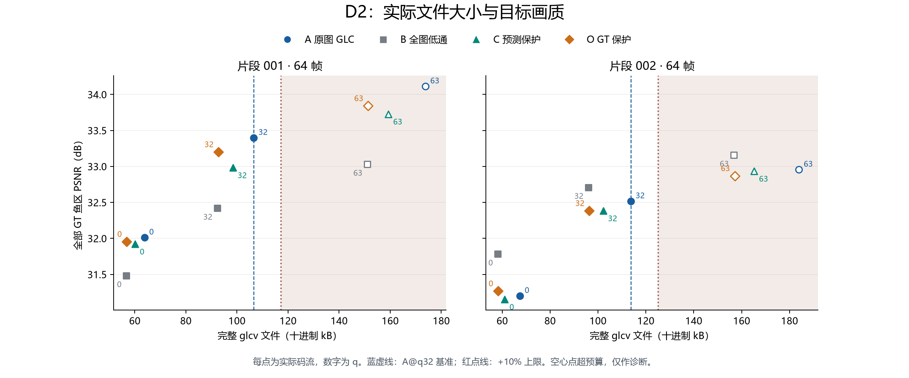

# D2 阶段报告：两片语义预处理机制诊断

日期：2026-10-22。**原定 24 个编码点和 24 个独立解码已全部完成；这完成了两片开发诊断矩阵，完整 D 轮的语义净收益、连续观看与泛化尚未验收。**

**本轮没有证明稳定的语义收益。** 预测保护 C 相比全图低通 B，在片段 001 的鱼区 PSNR 提高 0.564 dB，在片段 002 降低 0.325 dB，两片等权平均仅提高 0.120 dB，同时文件比 B 大约 6.5%–6.6%。相比普通 GLC A，C 的鱼区 PSNR 分别降低 0.415、0.133 dB，文件也分别小 7.65%、10.13%。这些是当前实际文件下的质量与大小取舍，尚不能归因于等字节下的语义增益。

鱼 GT 保护 O 在所选 q32 下也没有超过 A，因此现有证据不支持把问题全部归于预测定位，更不能据此认定只要训练分割模型就能解决。下一步优先在明确次数上限内配齐实际文件字节，再判断保护策略是否带来收益；本轮不追加训练或 q 搜索。

## 完成范围

001/002 各 64 帧，保持 1920×1080、30000/1001 fps、GOP=64/reset=32、容器 v2 和 C 轮既有神经/熵计算。A=原图 GLC，B=全图高斯低通，C=冻结预测保护加同一低通，O=鱼 GT 保护加同一低通。每组 q=0/32/63，24 个真实码流、1,536 帧×方法的独立重建与数值评价。

昨天用户时间有限，留下 15 个编码、5 个解码；今天仅补 9 个编码、19 个解码。中断半成品保存在 `interrupted_20261021`，旧报告和停止证据保留。没有重编码完成项，没有追加 q、训练、语义推理或留出评价，也没有重扫既有数据/权重完整性。

## 相同预算上限下的实际结果

001 的 S0/B10 为 106,549/117,203 B，002 为 113,715/125,086 B。**两档预算、全部方法均选中 q32**：q0 更小，q63 全部超过 10% 上限。因此下面一张表同时对应 B0 和 B10；允许增加 10% 并没有被三档 q 转化为另一个可用点。

| 片段 | 方法 | 完整文件 B | 相对 S0 | 文件 kbps | 鱼 PSNR dB | 其余画面 PSNR dB |
|---|---|---|---|---|---|---|
| 001 | A@q32 | 106,549 | +0.00% | 399.16 | 33.398 | 32.800 |
| 001 | B@q32 | 92,279 | -13.39% | 345.70 | 32.419 | 33.524 |
| 001 | C@q32 | 98,399 | -7.65% | 368.63 | 32.983 | 33.289 |
| 001 | O@q32 | 92,741 | -12.96% | 347.43 | 33.201 | 33.552 |
| 002 | A@q32 | 113,715 | +0.00% | 426.01 | 32.518 | 32.890 |
| 002 | B@q32 | 95,951 | -15.62% | 359.46 | 32.709 | 33.671 |
| 002 | C@q32 | 102,195 | -10.13% | 382.85 | 32.384 | 33.477 |
| 002 | O@q32 | 96,372 | -15.25% | 361.03 | 32.383 | 33.675 |

每片真实播放时长约 2.135 秒。全部 24 个点的文件码率均高于 30–40 kbps 参考范围；本轮只建立原尺寸下的机制对照，没有达到该应用码率目标。完整 glcv 已含封装，发送端保护掩码不传输，每片新增侧信息为 0 B。

## 目标和其余画面的变化

| 片段 | 比较 | 文件增幅 | 鱼 PSNR ΔdB | 其余画面 PSNR ΔdB |
|---|---|---|---|---|
| 001 | C vs A | -7.65% | -0.415 | +0.489 |
| 001 | C vs B | +6.63% | +0.564 | -0.235 |
| 001 | O vs A | -12.96% | -0.197 | +0.751 |
| 001 | O vs B | +0.50% | +0.782 | +0.027 |
| 002 | C vs A | -10.13% | -0.133 | +0.586 |
| 002 | C vs B | +6.51% | -0.325 | -0.194 |
| 002 | O vs A | -15.25% | -0.134 | +0.785 |
| 002 | O vs B | +0.44% | -0.326 | +0.004 |

两片各自先汇总全部帧的三通道 SSE/样本数，再计算 PSNR；以下对两个片段等权平均：

| 比较 | 平均鱼 PSNR ΔdB | 平均其余画面 PSNR ΔdB |
|---|---|---|
| C vs A | -0.274 | +0.538 |
| C vs B | +0.120 | -0.214 |
| O vs A | -0.166 | +0.768 |
| O vs B | +0.228 | +0.016 |

目标分母包括全部原 GT 鱼像素，包含预测漏掉的鱼；其余画面是 GT 的补集，不是保证纯净的背景。参考始终为未处理原始 RGB。数值来自独立接收端无损 PNG，未使用编码器内部重建或有损观看 MP4。昨日四个 q32 点的误差与字节记录在完整评价中保持一致。

## 预算匹配的限制

候选与 A/B 的实际字节均不同，全部 C/O 对照都未满足“候选不更大且相差不超过 2%”的严格近等体积标签。O 相对 B 的字节增幅虽小，也没有被写成完全相等。C/O 比 A 更小、对 B 更大的质量变化应作为实际质量—大小取舍报告，不能把同一个预算上限写成同样字节数。

因此，不能因为某组没有超过 A，就断言定位、语义保护或整条路线无效；同样也不能仅凭超过全图低通 B 宣布语义净收益成立。下一步优先做预算附近的有限 q 匹配，需先另写有明确次数上限的版本化方案；本轮不自动扩搜或训练。

每个散点对应实际码流，没有用插值生成未测的质量/字节结果。空心点为超限诊断样本。完整 24 点、成对差值和处理/理论发送时间见 [数值附表](D2数值附表_20261022.md)。理论发送不是实测链路，处理耗时按真实批次记录，跨日等待不计入，昨日中断阶段只记录时间下界。

## 观看、证据与接续

本地页面：`C:/Users/lenovo/Documents/ChatGPT/语义通信/02_实验数据/D_语义目标增强/D2_20261021_r1/viewing/index.html`。提供两片 × B0/B10 的隐藏方法名同步对照，支持原速、半速和逐帧查看；B0/B10 在本轮选中相同点，画面只因随机栏目顺序而不同。原图与重建使用相同固定裁剪，轨迹 38 的观看裁剪不代表全部鱼。映射在单独 `viewing_key.json`。

本次仅静态检查代表帧和图表；连续观看、闪烁/拖影与主观优劣没有写成通过。两个片段属于同一保守来源组，没有潜水员连续素材或留出测试；D1 定位门槛仍未通过。完整 D 轮门槛要求的三片开发集和观看证据也未齐备。

24 点均由独立接收进程读取真实码流并通过现有完整重建校验，源媒体读取记录为空。跨日实际进程与阶段见 [执行索引](evidence_d2_20261022/execution_index.json)，没有补造昨日中断阶段的完成记录。这是同一台 4060 的分进程实验，不替代跨设备或真实网络验收。

小型证据见 [评价](evidence_d2_20261022/evaluation.json)、[接收审计](evidence_d2_20261022/decoder_audit.json)、[按实际字节预先选点](evidence_d2_20261022/rate_only_selection.json)、[接续计划](evidence_d2_20261022/resume_plan.json)与[复现说明](D2复现说明.md)。原图、模型、码流与完整重建只留本地。原矩阵已完成，不需继续补昨日所述的 9/19 个点；后续实验等待新的明确范围。
