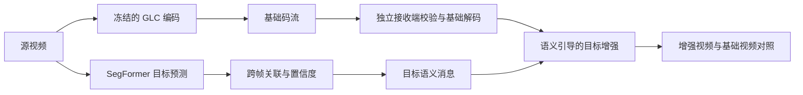

# D 轮方案：语义引导的关键目标视觉增强

2026-10-21。**规划稿，未开始模型推理、训练或视频实验。** 用户要求暂不研究压缩，转向语义，并明确主目标为“让鱼、潜水员等关键目标看得更清楚”。本轮已有数据：新下载的 SFISHTRACK、旧 SUIM 及 SegFormer 权重。

建议主线是：**固定 GLC 基础视频，找准目标、跨帧跟住目标，再验证语义信息能否让接收端恢复更清楚且稳定的目标画面。** 成果应能用同步视频直接看出来，分割准确率是辅助证据。

## 1. 继承的结论与本轮问题

B2 自动 ROI 的基础流为 168,338 B，增强包为 532,330 B，增至 3.16 倍；用户总体反馈是观看差异不明显。预测鱼掩码平均仅占画面 0.1653%，32 帧窗口组织后的传输矩形平均覆盖 42.41%；边缘误差差分也恶化。该掩码面积是模型预测，不能作真实目标召回证明。[B2 报告](../07_新阶段B_GLC语义保护与传输/B2首片实验报告_20261018.md)

因此 D 轮需要依次回答：

1. 关键目标是否找到？漏掉的是小鱼、遮挡、背景相似目标，还是原图本来就难辨认？
2. 找到以后，接收视频中可辨认的轮廓、纹理和动作是否改善？
3. 相同增强模型与训练条件下，语义信息究竟额外贡献了什么？
4. 连续视频是否出现轮廓跳变、纹理闪烁、拖影或错误目标？

GLC 配置、码流和已有收发工具作为固定基础。每个素材采用同一份 GLC 重建供所有增强组复用；参数沿用实际源视频/当前网页选项并登记，不重新硬编码 25 fps 或统一分辨率。新增素材为了取得基准而编码一次属于后续数据准备，不开展压缩器选型、码率搜索或 GPU 提速研究。

## 2. 数据分工与模型起点

| 资源 | D 轮用途 | 边界 |
|---|---|---|
| SFISHTRACK | 鱼体定位、实例对应、连续运动和增强评价 | 本地 54 段，23,532 条图像记录；没有潜水员标签，尚未确认拍摄来源独立性 |
| SUIM | 复用鱼/潜水员语义学习基础，保护八类能力，做静态回归 | 图片数据不能验收视频时序；旧测试集已看过 |
| SUIM SegFormer-B0 | 第一版冻结语义定位器 | 历史测试 mIoU 69.13%，不等于新数据成绩 |
| 旧鱼类适配权重 | 与 SUIM 底模做有限对照 | 旧视频上的局限保留，不预设它优于原底模 |
| 潜水员连续素材 | 后续动态保真和稳定性验收 | 先盘点旧项目素材及标注；需另冻结未参与选择的连续片段 |

详细问题见 [数据与模型盘点](数据与模型盘点_20261021.md)。SFISHTRACK 的 RLE、帧名、类别别名与元数据问题先处理；不要按帧随机切训练/验证/测试。按可确认的拍摄来源分组，再按视频留出；来源不能确认就降低结论范围，不把序列数量写成独立场景数量。

## 3. 建议技术路线

### 先稳定语义定位

保留现有 SegFormer 推理接口，对 SUIM 底模和旧鱼类适配权重各做一个冻结基线。按目标尺寸和遮挡程度观察漏检、误检及轮廓覆盖，不只报平均 mIoU。先关联相邻帧目标并记录短时断裂，低置信度或遮挡时保守退出，避免掩码漂到背景。真实目标 ID 来自离线标注用于评分，正式推理只能使用预测身份。

若冻结模型在新鱼视频上明显不够，再启动一条鱼分支的小规模适配；保留旧八类/潜水员权重。SFISHTRACK 的非鱼区域不等同于 SUIM 的背景水体，适配使用二分类鱼头或明确的部分标签损失，不能污染其他类别。该训练是否必要由 D1 结果决定。

### 再做轻量目标增强

建议以紧凑残差复原网络为第一候选，输入实际 GLC 重建以及鱼/潜水员掩码、置信度等语义条件，输出同尺寸增强 RGB。先研究单帧，再引入短时相邻帧及对齐；掩码以外尽量保持基础图，边界软融合，遮挡/不可靠运动区域回退到基础图。

NAFNet 可作为图像复原骨干候选，其官方任务包括去噪、去模糊等；预训练权重并未证明能修复本项目 GLC 失真，需要用实际“GLC 重建 → 对齐源图”数据验证或适配。[官方实现](https://github.com/megvii-research/NAFNet) 时序传播与对齐可参考 [BasicVSR++](https://github.com/ckkelvinchan/BasicVSR_PlusPlus)，本轮不将其完整大模型作为首版依赖。

训练监督优先使用目标/上下文重建误差和边界误差，再考虑运动对齐的时间一致性项；损失权重在开发集上预先冻结。原片的色偏/浑浊与压缩损失分开记录：当前优先恢复源图中已有目标信息，不将改色、过度锐化或生成虚构鱼纹当作保真改善。语义掩码能告诉模型位置和类别，不能保证恢复已丢失的真实细节。

### 语义消息必须真实到达接收端

第一版旁路消息可采用直接、可审计的掩码和轨迹封装，包含对应基础流 SHA、帧时间戳、目标类别、预测 track_id、置信度、坐标尺度和版本。全部消息及容器字节计入开销；暂不设计新的语义压缩算法。GT 只在离线监督/评价和明确标记的参考组使用。

接收端只读取收到的基础流、语义消息和声明的模型，不能偷读发送端原图或 GT。基础 GLC 校验先完成，增强 RGB 单独保存，不能把增强后的像素拿去替代原基础重建摘要；C7 的基础预览警示继续保留。

## 4. 最小对照与收益归因

第一轮限制为三个实际处理组和一个定位诊断组：

| 组 | 内容 | 能回答什么 |
|---|---|---|
| A | 固定 GLC 重建 | 现有画面的基线 |
| B | 普通增强模型，不输入语义条件 | 图像增强本身的收益 |
| C | 同骨干、加入预测语义条件的增强 | 整套语义增强能否优于普通增强 |
| O | 使用已知正确目标位置/掩码的离线参考 | 在当前方法下，定位错误影响有多大；不是自动系统成绩或保证性的理论上界 |

B/C 的训练素材、骨干容量、迭代预算、尺度、固定分块和评价区域一致；缺省条件通道保留占位，避免仅靠参数量增加制造优势。第一轮 B/C 使用同一损失及采样规则，优先隔离语义条件输入。后续若采用语义加权损失或目标裁剪，需要各自做单因素对照，不能把这些收益混报。

如果 B/C 都采用由语义轨迹选出的目标裁剪，只能说比较了“语义条件的额外作用”；不能把 B 称为完全无语义系统。空间选择效果另用固定区域/无语义选择控制。时序模块在单帧路径有收益后再以同一网络开关做一组对照，避免一次扩大多个变量。

本轮保留固定 GLC 基础和新增语义字节账本，不以提高压缩比作为目标。若未来改为发送真实目标细节补丁，必须另立假设，并与相同额外字节的普通增强控制比较；增加像素载荷后的改善不能直接归因于语义。本轮首版不自动恢复 B2 的大矩形补充视频。

## 5. D0–D4 安排

| 阶段 | 工作与交付 | 进入下一步的条件 |
|---|---|---|
| D0 数据与评价基线 | 修正帧/标注映射，检查 RLE/实例编码，登记来源和划分；确认鱼/潜水员目标；冻结 GLC、模型和主评价协议 | 小样本原图/GT/时间轴逐项对齐；开发与保留数据名单落盘 |
| D1 找准、跟住目标 | 两个现有权重的有限基线；目标覆盖、短时断裂和误保护诊断；必要时只做一条鱼分支适配 | 明确定位是否足以支持增强；未达到时保留已知位置参考，暴露自动定位缺口 |
| D2 让目标真正变清楚 | A/B/C/O 小规模对照；同尺寸目标裁剪、上下文和整段视频；损失与网络一次只改一个因素 | 实际观看和独立区域指标都支持继续；纯分割分数上涨不能过关 |
| D3 连续画面稳定 | 引入短时对齐/传播，减少边界跳变、拖影和鱼纹闪烁；检查目标进出与遮挡 | 相比单帧版本有稳定性收益，同时保住形状与细节 |
| D4 独立接收与保留素材验收 | 语义消息封装、独立接收、基础/增强切换；在冻结保留素材上评价鱼与潜水员 | 输出可播放视频，语义数据可追溯；把通过范围、失败目标和字节/耗时一起归档 |

D0 当前只有静态盘点完成，帧内容对齐和划分尚未完成。D1–D4 都未开始。

### 建议的首轮工作量

- D0/D1 先用 **3 段开发鱼视频、每段最多 64 个连续帧**，覆盖小目标、遮挡/运动和普通场景；保持实际时间轴。另固定最多 **24 张 SUIM 潜水员开发/回归图**。它们是调试规模，不是最终独立验收。
- D2 初次只准备一份实际 GLC 重建缓存，所有组复用。普通增强与语义增强各一个小配置；若需训练，建议初次各最多 2,000 更新步、256 尺寸裁剪、batch 1–2。显存冒烟后再确认，不承诺固定训练分钟数或最终质量。
- 第一个小对照没有视觉收益时先分析结果，不自动增长模型、跑全 54 段或开启长训练。必要时允许一次有明确原因的修正；仍无收益就保存负结果并调整路线。
- 进入最终验收再冻结至少 **6 段鱼视频和 3 段潜水员连续视频**，目标为 6–10 秒/段并覆盖不同可确认来源。若素材或来源不足，报告实际覆盖范围，不填满名义数量。

上述是建议的后续实验预算，本次不执行。D0 可先做数据/标注工作；模型推理和训练按用户后续启动的阶段实施。

## 6. 怎么判断“看得更清楚”

主结果采用隐藏方法名称、随机左右顺序的配对观看：先看正常尺寸连续视频，再看同坐标、同倍率的目标局部。分别记录能否辨认目标、轮廓/纹理是否更接近源图、运动是否稳定，以及平局/变差；带框提示与无提示观看分开统计。

建议至少 3 位独立观察者；若只有用户一人，保留为单人探索性评价。按视频/来源组汇总，不能把相邻帧和同一条轨迹当成大量独立样本。建议进入验收前预注册门槛：C 对 B 的明确偏好超过 60%（平局另列）、多数来源组方向一致、无明显目标形变/新造结构或严重闪烁增加。小样本门槛是工程判断，不是统计显著性证明；置信区间和全部负例一起报告。

辅助数据包括：独立 GT 目标区域 PSNR/SSIM、同裁剪 LPIPS、边界与背景误差、按目标大小的覆盖/漏检、运动对齐且排除遮挡的时间误差。使用真实接收端 RGB，不用二次有损预览 MP4 计算像素质量；也不用负责选区的同一个分割器分数作为唯一评价。

如果只有普通增强 B 变好而语义 C 没有额外收益，结论应为“复原有效，语义增益未证实”。如果 C 只让鱼更清楚，不能写成潜水员一起通过。不能把源图自身不可辨认的细节计作必然可恢复。

## 7. 本次交付与后续起点

已完成新数据的目录/JSON 盘点、旧 SUIM 文件存在性和两份模型 SHA 核验，以及本方案。主建议从 **D0 数据对齐与划分 → D1 冻结模型短基线 → D2 视觉对照** 开始。先保证目标选对和观看收益，再扩大时序增强及网页集成。

参考材料核对日为 2026-10-21：[SFISHTRACK 作者仓库](https://github.com/JosepSanchezCano/SFISHTRACK)、[SUIM 官方数据页](https://irvlab.cs.umn.edu/resources/suim-dataset)、[SegFormer 官方实现](https://github.com/NVlabs/SegFormer)、[NAFNet 官方实现](https://github.com/megvii-research/NAFNet)、[BasicVSR++ 官方实现](https://github.com/ckkelvinchan/BasicVSR_PlusPlus)。这些是数据或方法参考，不构成本项目增强收益的证据。
