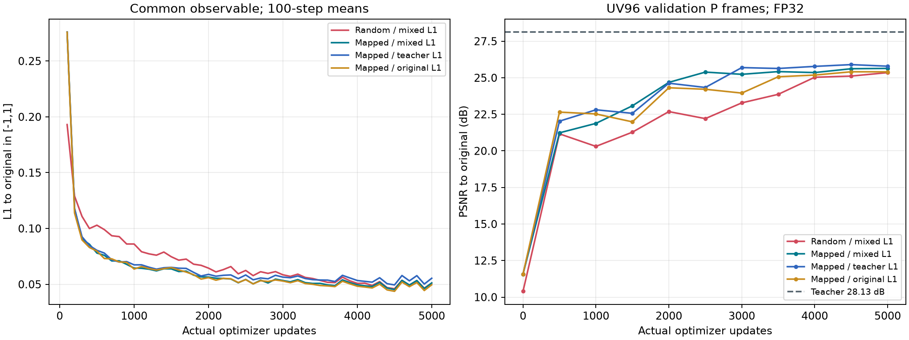
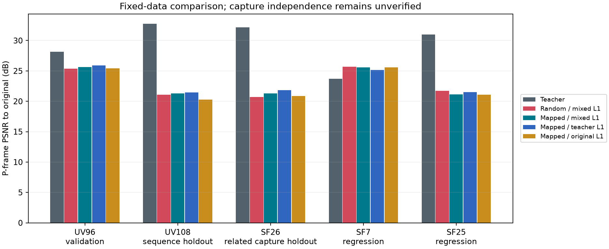

# 第二轮真实蒸馏：扩充数据、初始化及损失对照

2026-10-29。本机RTX4060 Laptop 8GB。代码与预先固定协议先发布于 `a378f8f`，随后补充完整结果。

**49段训练文件和教师迁移带来了改善，但新场景仍存在明显色偏、模糊与纹理丢失，当前不能作为原GLC的可用替换。** 按预定UV96验证指标选出的候选是 `mapped_teacher` 第4500步，即教师迁移初始化＋纯教师L1监督。没有切换生产网页或进行Orin部署。

## 数据量与使用范围

本机27.49GB的SFishTrack包有54段、24,115张RGB图，其中23,532帧有标注。首轮378个P帧是最小先导抽样，并非整包只有这些素材。[整包盘点](素材盘点_20261029.md)已经覆盖54段，包内约26.39GB为Frames、1.00GB为Videos。

本轮49个SFishTrack文件各取居中64个连续RGB帧，候选P帧3,087。按latent输入、原图与教师RGB的精确组合去除35个重复监督后，保留3,052个P帧。四组均抽样5000次，实际访问相同的2,444个不同P样本；5000步不是5000轮数据遍历。

UV-Multi video96前128帧仅作选模验证，video108前128帧作本轮最终序列留出；没有UV帧进入训练。SF26与旧SF25属于同一保守来源家族，作留出诊断；007/025都是已查看的回归片。007已有相近背景进入训练，不能把其改善称为跨来源泛化证明。原始拍摄标识仍不全，54个文件也不等于54个独立来源。

q12、512×288有效画面（填充512×320）、GOP64、reset32固定。全部3,616帧缓存通过独立接收端校验与教师RGB精确重放，其中旧007/025共160帧复用首轮缓存。更多固定规则见[复现说明](复现说明.md)。

## 初始化与损失对照

学生保留教师每级3个残差块，只把宽度128缩为64，共10,985,155参数。相对原P帧生成器42,515,587参数减少约74.2%，不是整个GLC的缩减比例。

迁移按教师GroupNorm组内的gamma排序筛选通道，残差、卷积与注意力使用一致映射，所有学生状态张量均有来源。完整宽度迁移通过状态哈希一致性检查，原P教师在历史帧上精确复现缓存。它是近似初始化，删通道仍改变卷积求和、归一化统计与注意力尺度，不是功能保持裁剪。

四组同数据、同抽样顺序、同学习率，各5000个真实非零更新。FP32参数配合BF16训练，FP32验证；不加入感知、特征或时序损失。

| case | 初始化与监督 | 最佳步数 | UV96 P帧PSNR | 含验证/检查点的训练时间 |
|---|---|---:|---:|---:|
| random_mixed | 随机，教师/原图等权L1 | 5000 | 25.35 dB | 707.94秒 |
| mapped_mixed | 教师迁移，同一混合L1 | 5000 | 25.64 dB | 706.96秒 |
| mapped_teacher | 相同教师迁移，纯教师L1 | 4500 | **25.90 dB** | 705.53秒 |
| mapped_gt | 相同教师迁移，纯原图L1 | 4500 | 25.41 dB | 706.72秒 |
| 原GLC教师 | 冻结参考 | — | 28.13 dB | — |

迁移＋混合L1在2500步已达25.39 dB，约等于随机组5000步的25.35 dB；但相同5000步预算下最终只高约0.29 dB。迁移有前期学习速度收益，本次最终优势有限。

纯教师L1比相同初始化的混合L1高约0.26 dB，比纯原图L1高约0.49 dB。不能据一个种子、一段验证视频宣称统计显著，也不能据此推断所有蒸馏目标都应只用教师。四组日志逐条核对了实际损失公式、抽样与学习率顺序，不只比较配置文字。

## 留出与回归：改善不等于可替换

以下均为P帧对原RGB的聚合MSE换算PSNR。先按UV96冻结各case检查点与总候选，再统一评价其余片段；没有从这些结果反向选模型。

| 片段与角色 | 原教师 | 随机混合 | 迁移混合 | 迁移纯教师（候选） | 迁移纯原图 | 首轮880万KD |
|---|---:|---:|---:|---:|---:|---:|
| UV96，验证 | 28.13 | 25.35 | 25.64 | 25.90 | 25.41 | — |
| UV108，序列留出 | 32.74 | 21.11 | 21.29 | 21.47 | 20.30 | — |
| SF26，相关来源家族留出 | 32.15 | 20.70 | 21.31 | 21.84 | 20.86 | — |
| SF7，旧回归 | 23.72 | 25.68 | 25.55 | 25.18 | 25.56 | 19.26 |
| SF25，旧回归 | 31.02 | 21.72 | 21.11 | 21.49 | 21.10 | 14.73 |

跨轮比较同时改变了数据、深度、初始化与损失，因此不能把SF7的约5.91 dB、SF25的约6.76 dB提升单独归因于教师迁移。原视频、q12码流及参考RGB一致，旧回归数值可直接比较，但不是新的来源独立基准。

抽查6格对比图：学生在007不再完全套用首轮的珊瑚背景，海草轮廓能恢复，但细纹理仍明显偏软、呈平滑线条。007的PSNR甚至高于教师，仍不代表目标细节与观看效果更好。UV108存在明显整体颜色偏差，025仍有模糊与色偏。第65帧保留教师I帧，第66帧回到学生P帧，画质落差仍可见。

标注鱼体区域结果也不一致：

| 片段 | 原教师鱼体PSNR | 候选鱼体PSNR | P帧GT情况 |
|---|---:|---:|---|
| UV96 | 24.00 | 24.98 | 8帧有标注，其中6帧有鱼 |
| UV108 | — | — | 8帧有标注，其中0帧有鱼；不作鱼体质量结论 |
| SF26 | 28.63 | 24.67 | 63帧有标注且有鱼 |
| SF7 | 26.02 | 27.65 | 94帧有标注且有鱼 |
| SF25 | 26.54 | 21.95 | 63帧有标注且有鱼 |

UV稀疏未标注帧不当作背景，鱼类发布色RGB(0,0,128)已与既有鱼体掩码核对。没有测检测mAP或用鱼体PSNR代替识别能力。UV108候选RGB SSIM约0.8635，几乎等于教师0.8633，但PSNR低约11.27 dB，说明单看SSIM也会掩盖问题。

## 事后诊断：颜色偏差与纹理需要分开排查

在不改变模型、选模或任何重建输出的前提下，将每帧RGB误差分成各通道整幅均值偏差与剩余空间变化，利用恒等式 `MSE = mean_c(mean_HW(error_c)^2) + mean_c(var_HW(error_c))` 诊断：

| 片段 | 候选MSE中对应整幅通道均值偏差的比例 |
|---|---:|
| UV96 | 26.1% |
| UV108 | 81.8% |
| SF26 | 64.0% |
| SF7 | 3.2% |
| SF25 | 47.8% |

UV108平均RGB误差约为[-30.09, -7.90, -11.81]（0–255单位），红通道尤其偏低；SF25平均RGB误差约[13.74, -17.83, -12.39]，方向又不同，不能简单用一个固定全局偏置解释所有场景。已知背景SF7主要仍是空间细节误差，UV108则有很强的整体颜色偏差。

该分解使用原图作事后分析，不是接收端颜色修正方案，也不是修正后的模型分数；可由[diagnose_color_error.py](diagnose_color_error.py)复现。它不能单独证明GroupNorm、剪枝、数据颜色覆盖或训练预算中的哪一项是原因。四组都有相关退化，不能只归咎于某个初始化。下一轮需把全局颜色表达与局部纹理保真分别验证，不能保证只加感知损失或延长训练就能修复。

## 实际计算成本与交付

四组总训练47.12分钟，更新平均约0.130秒/步，PyTorch峰值allocated最大2,135.32 MiB，约2.09 GiB；不是整个驱动与其他应用的占用。各组只有一个步骤超过0.5秒，全部保留。新数据编码另用589.85秒，独立解码及逐帧教师重放712.70秒，合计约21.71分钟，不含进程加载等额外开销；旧160帧缓存未重跑。

每个学生推理文件44,003,626字节，约44.00 MB。原I帧生成器、熵模型及潜变量网络仍需保留。学生不是整套44MB的GLC。

按UV96选出的候选与原教师在同一码流上做三组连续配对，交替顺序、各自新进程、先预热I/P两帧，FP32、TF32关闭，保留所有慢步骤：

| 轮次 | 教师128帧核心耗时 | 候选128帧核心耗时 | 配对加速比 |
|---|---:|---:|---:|
| 1 | 14.007秒 | 6.858秒 | 2.042倍 |
| 2 | 14.016秒 | 6.841秒 | 2.049倍 |
| 3 | 14.225秒 | 6.877秒 | 2.069倍 |

配对加速比中位数约2.05倍。计时涵盖熵恢复、原参考链、RGB、CPU传输与校验，排除模型加载、磁盘I/O、MP4和通信。不是整个系统或Orin的加速，也没有与FP16/TensorRT比较。本轮学生及测试片段与首轮不同，不把2.55倍直接当作本轮结果。

同一片段所有RGB模型使用同一码流：UV96为25,507字节，UV108为22,913字节，SF26为13,541字节，007为14,833字节，025为12,761字节；没有减少本轮传输字节，也未额外传颜色统计。完整学生解码保留了原载荷SHA、原逐帧参考链、有序latent与I帧RGB校验，并以新模型ID记录学生RGB。四组完整解码的UV96 MSE均复现各自缓存验证值。

已检查完整对比静帧、I/P边界图及科学曲线；没有声称完成整段人工观看、运动补偿时序评价或Orin验收。UV预览及96帧007均标为帧序30fps，原始时间轴未全部验证；025/026仅做静态质量比较。

公开数值与原始日志SHA见[summary.json](evidence_20261029/summary.json)、[发布SHA清单](evidence_20261029/publication_manifest.json)。源码、固定协议与数据盘点均在本目录；权重、完整日志、源帧、码流、独立解码输出、六格对比图和视频留在本机：

~~~text
C:/Users/lenovo/Documents/ChatGPT/语义通信/02_实验数据/优化_GLC蒸馏/round2_20261029_01/
  student_exports/mapped_teacher_p_rgb_q12.pt
  train_*/loss.jsonl、validation.json、best.pt、last.pt
  evaluation/quality.json、timings.json、posthoc_color_error.json
  evaluation/comparison_uv096_frame_order_30fps.mp4
  evaluation/comparison_v007_frame_order_30fps.mp4
  evaluation/comparison_v025_frame033.png
  evaluation/comparison_uv108_frame033.png
~~~

下一轮优先在固定监督下检查颜色泛化、归一化分组及通道缩减的影响，并考虑更宽中间学生的容量对照；再单独增加特征/感知约束验证细节。现有包仍有更多帧可利用，来源/场景相关性和实际训练覆盖需分别处理。正式泛化验收仍需要未参与调参、来源关系明确的素材；不能继续盯着007/025反复调参又称其为全新测试。
