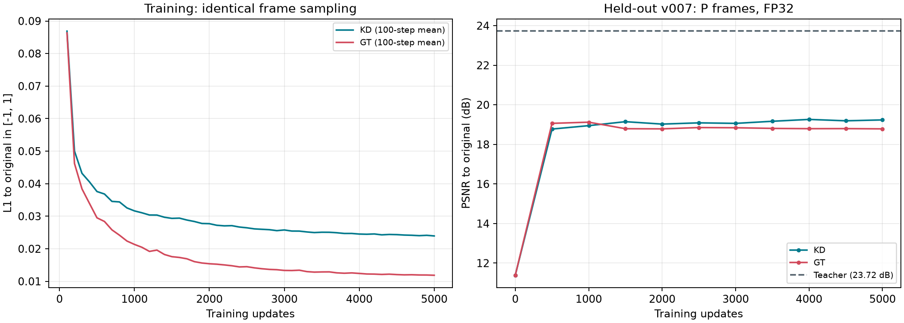
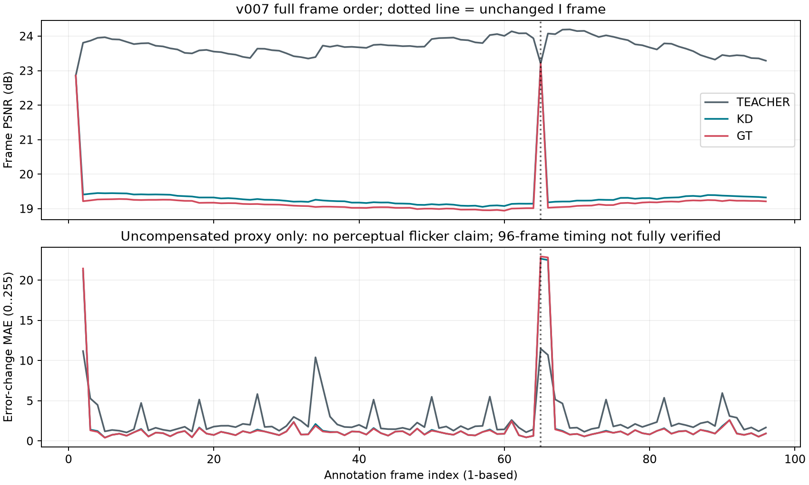

# GLC P帧生成器：首轮真实蒸馏结果

2026-10-29，分支 `codex/glc-distillation`。本机 RTX4060 Laptop 8GB，PyTorch 2.5.1+cu124。

**本机能够完成真实蒸馏，局部替换后解码核心约快2.55倍；当前学生画质不合格，不能替换原GLC。** 这轮得到的是先导学生权重，不是可部署模型。未切换生产网页，也未进行Orin部署。

## 实际完成了什么

训练对象仅为P帧最终RGB生成器：原模块42,515,587参数，学生8,800,707参数，减少约79.3%。I帧仍用原教师。原熵编解码、潜变量网络和 `ref_latent/ref_y` 参考链不训练，原码流保持相同。该比例不能写成整个GLC的参数压缩比例。

已有SFishTrack素材按既有保守分组划分：001–006各64帧训练，共378个P帧；007共96帧验证，94个P帧；025共64帧静态测试，63个P帧。544帧缩小后的RGB各不相同，训练与留出之间没有完全相同的RGB帧。但六段训练片画面高度相似，原始拍摄来源独立性仍未成立；这些是序列留出，不是新的独立来源基准。

固定q12、512×288有效画面，按原规则填充至512×320，GOP64、reset32。两个学生采用相同随机初始化、抽样顺序和学习率计划，各完成5000个非零学习率更新。KD损失为教师uint8输出与原图的等权L1；GT-only只用原图L1。没有感知或时序损失，没有下载新模型。

每500步用007所有P帧的FP32输出对原图MSE选模。KD最佳为第4000步，GT-only最佳为第1000步；下面比较的是这两个最佳检查点。025在两组训练完成、选模冻结后才进入最终质量评价。

## 画质：明显未达到替换要求

以下只统计实际替换的P帧。PSNR从聚合RGB均方误差计算；鱼体指标使用已与发布者掩码核对的标注实例并集，最近邻缩小。

| 模型 | 007 PSNR | 007标注鱼体PSNR | 007 RGB SSIM | 025静态PSNR | 025标注鱼体PSNR |
|---|---:|---:|---:|---:|---:|
| 原GLC教师 | 23.72 dB | 26.02 dB | 0.4379 | 31.02 dB | 26.54 dB |
| 蒸馏学生KD | 19.26 dB | 20.97 dB | 0.4417 | 14.73 dB | 15.55 dB |
| 原图监督GT-only | 19.12 dB | 21.36 dB | 0.4349 | 14.47 dB | 15.60 dB |

KD在007全画面PSNR上比GT-only高约0.14 dB，但标注鱼体PSNR更低；025也没有形成一致的指标优势。只有一个随机种子和很小的数据集，不能据此证明蒸馏明显优于原图监督。

抽查完整画面可见：007学生丢失海草细节，出现训练场景背景偏置；025学生存在明显色偏、模糊和局部伪影。007学生的梯度能量仅为原图约21.7%，教师约94.3%。梯度能量只是细节诊断，不能单独当作质量分数。007上KD的SSIM略高于教师，也不能抵消明显的细节与目标失真。

训练原图L1持续下降，留出PSNR却很早进入平台，符合泛化不足的表现。随机初始化、训练场景单一、样本和训练预算有限都是待检验因素，本轮不能单独确定各自的因果贡献。

第65帧I帧保持教师输出，前后P帧使用学生，形成明显的画质落差。帧间误差变化代理也在边界出现尖峰；平滑导致的其他帧代理变小不能解释为“已解决闪动”。尚未做运动补偿指标或人工连续观看验收。

007扩展96帧中95帧通过原有严格时间唯一性门槛，第66张标注图未达该门槛，未降低阈值。前64帧已验证连续时间；96帧对比视频明确按帧序30fps预览，不用于完整时序或码率结论。025保留真实可变PTS，只做静态质量评价。

## 耗时与模型体积

| 项目 | KD蒸馏 | GT-only对照 |
|---|---:|---:|
| 真实更新步数 | 5000 | 5000 |
| 训练墙钟时间，含验证及检查点 | 539.28秒 | 541.10秒 |
| 训练更新平均耗时 | 0.1011秒/步 | 0.1016秒/步 |
| 本进程PyTorch峰值allocated | 1583.99 MiB | 1583.06 MiB |
| 单步最大耗时 | 0.711秒 | 0.494秒 |
| 超过0.5秒的步骤 | 1 | 0 |

两组总训练约18分钟，FP32参数配合BF16训练，batch1。显存数值不包含其他桌面应用和整个驱动开销。真实缓存编码另用约101.22秒；独立解码加每帧教师重放约118.45秒，均不含进程加载等额外开销。

每份学生推理导出文件35,249,614字节，约35.25 MB，不含优化器。原完整GLC权重仍需保留；不能把学生导出大小当成整个系统模型大小。

同一段007的96帧码流，用教师与KD学生各独立进程运行三轮，顺序交替，各先预热I/P一帧。两者都用FP32、TF32关闭，原生熵后端相同，保留全部慢步骤。

| 轮次 | 原教师解码核心 | KD学生解码核心 | 加速比 |
|---|---:|---:|---:|
| 1 | 10.907秒 | 4.278秒 | 2.549倍 |
| 2 | 10.918秒 | 4.282秒 | 2.550倍 |
| 3 | 10.891秒 | 4.326秒 | 2.518倍 |

配对加速比中位数约2.55倍，两个核心耗时的中位数分别10.907秒、4.282秒。范围包括熵恢复、原潜变量参考链、RGB生成、CPU传输及校验，排除模型加载、磁盘码流读取、输出写盘、MP4编码和通信。不是整个网页/通信流程的端到端加速；未与FP16、TensorRT比较，也不能直接换算Orin速度。

007码流14,833字节，025码流12,761字节，三个RGB模型使用相同文件。此处蒸馏减少重建计算，不减少这轮传输字节。

## 校验与交付

- 544帧都通过独立接收端解码、发送/接收参考链与RGB哈希核对，以及保存后FP32 latent的教师RGB逐字节重放。
- 实验学生解码器禁止读取原图、掩码、缓存latent和缓存教师；所有码流载荷SHA、逐帧参考链、有序latent校验和I帧RGB校验通过。
- 学生RGB明确使用新的模型标识与独立输出校验，不冒充原教师RGB哈希。生产模型协商与校验格式仍需后续工程化。
- 独立完整解码的007学生P帧MSE与选模时缓存验证MSE完全一致，两组均通过核对。
- 5000步日志连续，学习率全部非零，未训练I帧或使用007/025做参数更新。两组初始化、抽样SHA相同，最终参数SHA均已改变。
- 额外CPU诊断中，一份固定尺寸潜变量的训练/推理注意力输出完全相同；质量函数同图比较得到零MSE、SSIM1。已检查对比图、GOP关键帧图和曲线，未声称完成整段人工观看验收。

公开小证据见[summary.json](evidence_pilot_20261029/summary.json)、[发布SHA清单](evidence_pilot_20261029/publication_manifest.json)与[复现说明](先导试验复现.md)。逐步原始日志、源帧、latent、码流、视频、优化器检查点和推理权重都留在本机：

~~~text
C:/Users/lenovo/Documents/ChatGPT/语义通信/02_实验数据/优化_GLC蒸馏/pilot_20261029_01/
  train_kd/、train_gt/              原始损失日志、验证与检查点
  student_exports/                最佳学生推理权重
  evaluation/quality.json          全部逐帧质量与区域指标
  evaluation/full_decode/          独立解码输出和逐帧校验记录
  evaluation/comparison_v007_frame_order_30fps.mp4
  evaluation/comparison_v007_frame033.png
  evaluation/comparison_v025_frame033.png
~~~

## 下一轮该解决什么

先补充来源可分组、场景明显更丰富的连续RGB素材，再在相同预算下比较初始化与蒸馏损失。仅延长当前高度相似场景上的训练，缺少解决泛化问题的依据。重建蒸馏训练本身不要求鱼体像素掩码，检测框数据集的连续RGB帧仍可用于生成教师缓存；精确掩码主要用于区域评价。

这轮没有推翻局部蒸馏路线，也没有证明一定能得到可用模型。已经验证的是本机可训练、参考链可保持一致、解码核心可加速；尚待解决的是新场景画质、目标细节、时序验收和最终部署。
