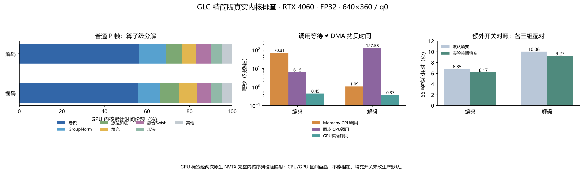
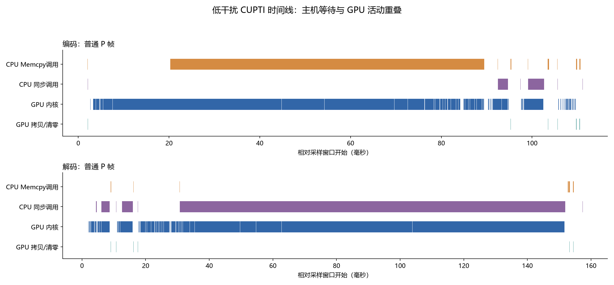

# GLC 编解码时间：真实GPU内核级排查

日期：2026-10-30。RTX4060 Laptop 8GB，驱动560.94，PyTorch2.5.1+cu124，CUDA12.4，现有CUPTI API22。当前按角色精简模型、FP32、TF32关闭、确定性算法开启，发送端免RGB，接收端使用完整原生成器。

**已经定位到模型层→原生ATen/JIT算子→真实CUDA内核→启动配置/输入尺寸，并将CPU等待与实际DMA拷贝分开。主要热点仍是发送端VQGAN图像编码器和接收端RGB生成器。额外发现未初始化内存诊断填充可在本次对照中省约9%–10%编码、约8%解码时间，且全段输出一致；生产默认未改。**

## 正常速度：独立基线

输入是现有long108前66个采样帧，有效640×360、网络填充640×384、q0、GOP64、参考重置32；源片25fps按步长2采样，输出12.5fps/5.28秒。模型先暖机16帧，编码/解码新进程顺序运行，每端三次；未开启CUPTI或算子观察器。核心计时前输入GPU准备完成，结束同步；真实视频I/O和加载另列。

| 指标 | 发送端编码 | 接收端解码 |
|---|---:|---:|
| 三次66帧核心耗时 | 7.003 / 6.989 / 6.992 s | 10.332 / 10.390 / 10.342 s |
| 整段中位数 | 6.992 s | 10.342 s |
| I帧中位数 / P95（6个观测） | 110.10 / 112.77 ms | 159.72 / 167.97 ms |
| P帧中位数 / P95（192个观测） | 105.60 / 108.62 ms | 156.41 / 161.09 ms |

这些是本机神经/熵编解码/原校验核心墙钟，不能当作传输耗时、Orin速度或整文件冷启动时间。

## 采集方法与扰动控制

本机`torch.profiler.supported_activities()`只返回CPU，但PyTorch目录中存在可用的CUPTI DLL。本轮直接使用该DLL，核对CUDA12.4.127官方头文件ABI；未安装新运行库或驱动。通过CUPTI Activity获得真实内核起止、名称、网格/线程块、寄存器、共享内存、拷贝字节和CUDA API调用。[NVIDIA Activity API](https://docs.nvidia.com/cupti/api/group__CUPTI__ACTIVITY__API.html)及[NVTX初始化说明](https://docs.nvidia.com/cupti/main/main.html#nvidia-tools-extension-nvtx-support)。

取零基帧0/1/2/3/9/33/64/65，覆盖I帧、普通P帧、三种适配索引、重置与GOP切换。每端一次CUPTI-only、两次原生C++ NVTX归因，另有填充关闭的CUPTI-only，两端合计64个采样窗口。成功采集的活动均无丢记录；原生归因无未归属内核。

**NVTX采样显著扰动了部分帧：个别帧达到正常同帧中位数的约2–3.9倍。** 因此原生NVTX只提供层、算子和shape标签；实际GPU时间取较低干扰的CUPTI-only。后者16个默认采样窗口的每条内核序列，均与两次NVTX逐流逐项匹配名称、grid/block、寄存器和共享内存配置，算子标签也一致，才投射时间。这是经过验证的序列映射，不伪称低干扰模式直接记录了每个ATen标签。原始归因和低干扰数据分别保留。

CUPTI-only整段核心编码7.092秒、解码10.439秒，较各自正常中位数约多1.4%/0.9%。单帧仍有波动，不通过统一比例强行“修正”内核时间。CPU墙钟与GPU时间重叠；内核累计与活动区间并集也分开，禁止父子模块重复求和。

## 普通P帧的模型层热点

以下是零基第2帧；GPU份额分母为**同一采样窗口的GPU内核累计时间**，包含输入准备，不是端到端CPU+GPU耗时。默认该帧编码1303个、解码1226个内核。

| 方向 | 模块 | GPU内核累计 | 份额 |
|---|---|---:|---:|
| 编码 | `P.vqgan.encoder`输入图像编码器 | 77.804 ms | 83.22% |
| 编码 | `P.y_spatial_prior` | 3.986 ms | 4.26% |
| 编码 | `P.y_prior_fusion` | 2.520 ms | 2.70% |
| 编码 | `P.hyper_tokenizer` | 1.487 ms | 1.59% |
| 解码 | `P.vqgan.generator`RGB生成器 | 130.015 ms | 91.55% |
| 解码 | `P.y_spatial_prior` | 4.174 ms | 2.94% |
| 解码 | `P.y_prior_fusion` | 2.536 ms | 1.79% |

例如编码`P.vqgan.encoder.blocks.2.conv1`的一次`aten::cudnn_convolution`，输入`[1,128,384,640]`、卷积核`[128,128,3,3]`，对应2个CUDA内核，累计5.467ms；解码`P.vqgan.generator.blocks.23.conv1`相同尺寸约5.477ms。**算子调用数与底层内核数不同**，完整输入尺寸表在[evidence中的逐帧CSV](evidence_20261030/gpu_layers_sender_002.csv)。

## 真正耗时的算子

| 原生算子 | 编码GPU累计 / 份额 | 解码GPU累计 / 份额 |
|---|---:|---:|
| `aten::cudnn_convolution` | 52.270 ms / 55.91% | 79.805 ms / 56.20% |
| `aten::native_group_norm` | 9.544 ms / 10.21% | 18.062 ms / 12.72% |
| `aten::add_` | 8.248 ms / 8.82% | 10.504 ms / 7.40% |
| `aten::fill_` | 8.127 ms / 8.69% | 9.568 ms / 6.74% |
| 融合`torchscript.swish` | 6.038 ms / 6.46% | 9.886 ms / 6.96% |
| `aten::add` | 4.999 ms / 5.35% | 7.730 ms / 5.44% |

卷积、归一化、逐元素加法及激活是主要实际计算。不能把它们当作闲置网络删除。后续优化应先针对这些热点；熵编解码和容器不是同一量级的瓶颈。

## CPU拷贝调用时间不等于数据传输时间

| 普通P帧 | 编码 | 解码 |
|---|---:|---:|
| 实际GPU内核累计 | 93.492 ms | 142.009 ms |
| 实际DMA拷贝字节 | 5,606,552 B | 4,623,505 B |
| 实际GPU拷贝区间累计 | 0.446 ms | 0.372 ms |
| CPU `cudaMemcpyAsync`调用累计 | 70.310 ms | 1.087 ms |
| CPU同步API累计 | 6.150 ms | 127.582 ms |

编码中很长的Memcpy调用覆盖了上游GPU工作尚未完成的区间，不能当作70ms的PCIe有效拷贝。解码更直观：一次1字节D2H仅约0.001408ms；其后主机stream同步约121.201ms，时间线上覆盖了RGB生成及相关GPU工作。把这121ms全部归罪于有限值检查或1字节拷贝，会判断错误。

真实文件路径中`rgb_array`累计墙钟约7.99秒/66帧，但其中承接了前面异步生成器的等待，不能通过删掉该函数就省7.99秒。CPU线程时间也可能包含驱动忙等；Windows短调用线程CPU记账较粗，不把它当作微秒级有效CPU计算。

图中CPU调用与GPU内核明显重叠。空白只表示本进程没有记录到活动，不能推断整张GPU空闲；桌面其他程序未关闭。

## 从算子排查得到的可验证优化：诊断填充

PyTorch确定性模式默认会将未初始化内存填为已知值。官方说明：程序不读取未初始化内存时可关闭该填充以改善性能。[本机对应PyTorch2.5.1说明](https://github.com/pytorch/pytorch/blob/v2.5.1/docs/source/notes/randomness.rst)。这与关闭确定性算法是两个独立开关。

在专用诊断子进程中，只把`torch.utils.deterministic.fill_uninitialized_memory`设为False；FP32、TF32关闭、确定性算法True、权重、输入及全部码流/参考校验保留。每端三组交替配对：

| 66帧核心耗时 | 填充开启中位数 | 诊断关闭中位数 | 逐对加速比中位数 |
|---|---:|---:|---:|
| 编码 | 6.851 s | 6.169 s | 1.103× |
| 解码 | 10.062 s | 9.270 s | 1.090× |

此表是独立同时段配对，不能拿上表6.992/10.342直接相除代替对照；先逐对相除再取中位数，也不等于两列中位数相除。按这些观测编码约省9%–10%、解码约省8%。

普通P帧编码1303→1004个内核，减少299个填充内核；解码1226→890个，减少336个。全部16个补充采样窗口都验证了：关闭后序列仅删除部分`fill_`内核，其余计算内核顺序与启动配置不变。仍有必要的填充保留，不能删除所有`fill_`。三组全段码流、参考状态和RGB均与原正确版本一致。

**这仍是单片/q0上的诊断结果，生产默认没有切换。** 它不证明所有输入都不存在未初始化读取；正式启用还需扩展素材、档位、长期和目标盒子验证。

## 真实文件与初始化开销

另外在冷进程上采集读视频、输入张量、参数加载、原生C熵核心、容器及FFmpeg。一次更细分的66帧文件任务：编码加载2.061秒、文件操作7.649秒；解码加载2.127秒、文件操作10.953秒。没有暖机，不能与暖机核心基线直接相减作为优化收益。

- 元模型构造约0.78–0.79秒；张量验证约0.41–0.46秒；角色资产哈希约0.29–0.33秒；`torch.load`约0.18–0.19秒；上卡墙钟约0.23秒。模型常驻能避免每文件重复这些启动开销。
- 编码读帧/缩放/RGB转换约0.177秒；媒体打开约0.028秒；输入pad的CPU调用约0.040秒。输入调用可能嵌套，只单列、不重复加总。
- 66帧原生C rANS编码本体约0.075秒，解码约0.055秒；外层还含检查/准备。它们相对神经网络核心较小。
- 编码容器add/finish合计约0.00074秒。解码FFmpeg打开约0.024秒、排队喂RGB约0.161秒、收尾约0.102秒；FFmpeg后台工作可与GPU重叠，不能将其独占CPU墙钟简单相加。

编码的真实视频输入文件、解码的观看副本均保持既有摘要一致；接收器禁止读取原始媒体，最终仍需参考状态聚合验证才能发布视频。完整CPU范围列表见[analysis.json](evidence_20261030/analysis.json)。

## 证据、复现与边界

[研究入口](README.md)列出运行命令、工具与数据目录。GitHub保留[逐层/逐算子/逐输入尺寸CSV](evidence_20261030/gpu_layers_sender_002.csv)、[完整数值](evidence_20261030/analysis.json)、[计时](evidence_20261030/baseline_frames.json)、[来源/ABI](evidence_20261030/provenance.json)、[校验清单](evidence_20261030/manifest.json)。大体积原生profile和Chrome Trace兼容JSON留在工作区`02_实验数据/优化_算子精确排查/operator_profile_20261030_01/`，包括两端`P002_activity_trace.json`和`P002_native_trace.json`，可用兼容查看器载入。

本轮以CUDA活动区间及CPU墙钟为准；ns存储精度不等于ns物理准确度。未取得SM活跃周期、实际占用率/硬件带宽计数器或指令级指标，也未测能耗、Orin或水声信道。旧10月25日模块CUDA Event区间包含不同边界，不与本轮内核累计直接相减。生产网页、原始权重、模型精度及默认诊断填充均保持原样。

52项CPU检查通过：本轮ABI/时间并集/NVTX/图映射6项，既有角色/容器/熵编码/C1入口46项；命令和日志见[verification.json](evidence_20261030/verification.json)。所有成功完整运行的码流与帧摘要均复核，零丢活动、完整图匹配及填充开关删除范围均通过。
