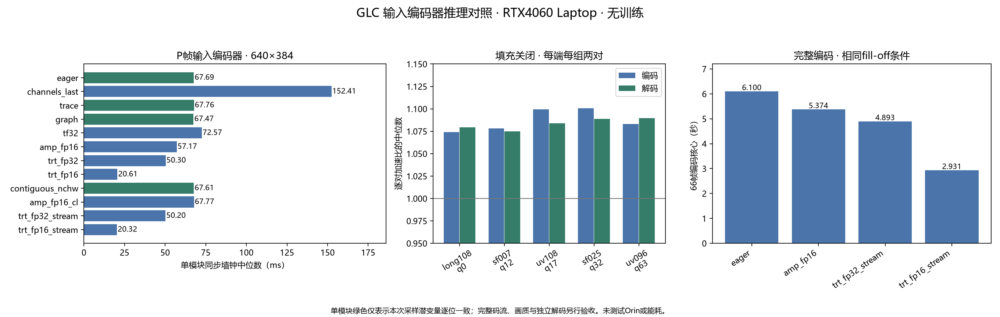
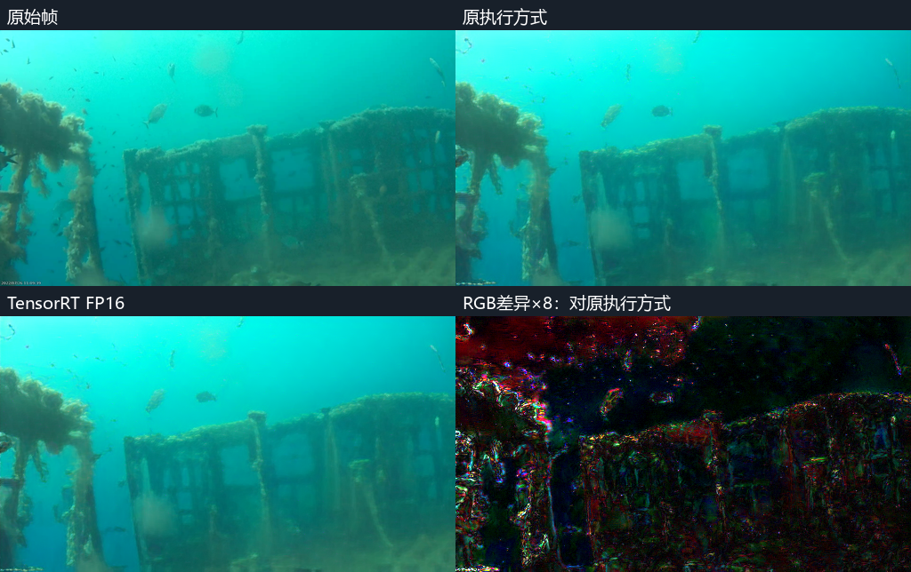

# 输入编码器推理加速实测：无需训练的GLC优化

2026-10-30，RTX4060 Laptop 8GB、Windows、PyTorch2.5.1+cu124、TensorRT10.5.0/cu12。原始GLC权重不变，发送端免RGB，原生C rANS，接收端保留原完整生成器。所有优化仅在诊断子进程使用，生产默认和网页未切换。

本阶段完成五组素材的填充扩大对照、24个I/P输入编码器单模块任务，以及四组视频上的三种候选完整编解码。它验证了现有执行方式仍有优化空间；现阶段不需要先启动编码器蒸馏。

## 填充开关：五组素材、五档q、40次完整运行

547个输入帧，每组每端两对新进程，顺序on/off、off/on，8帧暖机。FP32、确定性算法True及全部符号/CDF/参考校验保留。原三组匹配历史码流和RGB，新增两组独立解码通过。

| 素材 | 帧数/q | 编码on→off中位秒 | 编码逐对加速中位 | 解码on→off中位秒 | 解码逐对加速中位 |
|---|---:|---:|---:|---:|---:|
| long108_q0_640 | 66/0 | 6.791→6.322 | 1.074× | 9.739→9.022 | 1.080× |
| sf007_q12_512 | 96/12 | 6.992→6.486 | 1.078× | 10.026→9.326 | 1.075× |
| uv108_q17_512 | 66/17 | 4.847→4.409 | 1.099× | 6.903→6.370 | 1.084× |
| sf025_q32_512 | 64/32 | 4.705→4.274 | 1.101× | 6.743→6.193 | 1.089× |
| uv096_q63_512_255 | 255/63 | 18.564→17.141 | 1.083× | 26.900→24.685 | 1.090× |

逐对比值先计算再取中位数，不等同于两列中位数相除；省时比例为`1-1/加速比`。这些结果扩大了单片q0证据，仍不能证明所有输入都不读取未初始化内存。UV096的255帧覆盖四个GOP，不是长期部署稳定性测试。

## 单模块：布局、图、精度和引擎分开比较

真实输入640×384（有效640×360），帧0/2/33，I/P编码器分别测。每模式每样本12次、三轮交替顺序，独立原布局控制；所有观测保留。下表为包含输入转换及输出复制的同步墙钟中位数，GPU Event另存。均使用fill-off。控制输入实测连续NCHW；channels-last候选使用单独的等值权重副本。

| 实现 | P输入编码器ms | I输入编码器ms | 采样潜变量逐位一致（P/I） |
|---|---:|---:|---|
| eager | 67.687 | 67.724 | True/True |
| channels_last | 152.411 | 151.229 | False/False |
| trace | 67.757 | 68.173 | True/True |
| graph | 67.470 | 67.275 | True/True |
| tf32 | 72.566 | 72.240 | False/False |
| amp_fp16 | 57.172 | 57.143 | False/False |
| trt_fp32 | 50.302 | 50.449 | False/False |
| trt_fp16 | 20.611 | 20.589 | False/False |
| contiguous_nchw | 67.613 | 67.755 | True/True |
| amp_fp16_cl | 67.767 | 67.054 | False/False |
| trt_fp32_stream | 50.200 | 49.996 | False/False |
| trt_fp16_stream | 20.317 | 20.710 | False/False |

channels-last、TF32和FP16+channels-last没有获得普遍收益；TorchScript、CUDA Graph、显式连续输入在本机收益很小。TensorRT默认流警告触发了独立流补测；其收益按实测记录，不把警告当作加速保证。

## 完整编码与原接收端独立解码

候选依据单模块速度、部署复杂度选择，先冻结selection.json，再评价完整画质。每组两次发送，第一轮候选正序、第二轮逆序；随后独立接收器禁止读取源视频、源数组和GT。压缩符号、CDF和参考状态逐帧核对。所有方向都采用相同fill-off条件，不能与第15阶段默认fill-on或其他时段基线直接相除。

| 素材 | 实现 | 编码核心中位秒 | 逐对加速中位 | P帧PSNR变化dB | 标注区域P帧PSNR变化dB | 压缩载荷变化 |
|---|---|---:|---:|---:|---:|---:|
| long108_q0_640 | eager | 6.100 | 1.000× | +0.0000 | — | +0.0000% |
| long108_q0_640 | amp_fp16 | 5.374 | 1.135× | -0.1139 | — | +0.9915% |
| long108_q0_640 | trt_fp32_stream | 4.893 | 1.247× | +0.0000 | — | +0.0000% |
| long108_q0_640 | trt_fp16_stream | 2.931 | 2.081× | -0.1182 | — | +0.5103% |
| sf007_q12_512 | eager | 6.410 | 1.000× | +0.0000 | +0.0000 | +0.0000% |
| sf007_q12_512 | amp_fp16 | 5.484 | 1.169× | +0.0123 | +0.0355 | -0.0905% |
| sf007_q12_512 | trt_fp32_stream | 5.068 | 1.265× | +0.0000 | +0.0000 | +0.0000% |
| sf007_q12_512 | trt_fp16_stream | 3.174 | 2.021× | +0.0154 | +0.0430 | -0.3620% |
| sf025_q32_512 | eager | 4.292 | 1.000× | +0.0000 | +0.0000 | +0.0000% |
| sf025_q32_512 | amp_fp16 | 3.688 | 1.164× | +0.0036 | +0.0365 | -0.2388% |
| sf025_q32_512 | trt_fp32_stream | 3.356 | 1.279× | +0.0000 | +0.0000 | +0.0000% |
| sf025_q32_512 | trt_fp16_stream | 2.054 | 2.090× | -0.0038 | -0.1201 | -0.0492% |
| uv096_q63_512_255 | eager | 17.187 | 1.000× | +0.0000 | — | +0.0000% |
| uv096_q63_512_255 | amp_fp16 | 14.595 | 1.178× | -0.0035 | — | -0.1704% |
| uv096_q63_512_255 | trt_fp32_stream | 13.297 | 1.293× | -0.0009 | — | +0.0165% |
| uv096_q63_512_255 | trt_fp16_stream | 8.367 | 2.054× | -0.0099 | — | -0.0418% |

TensorRT FP32：3/4组压缩载荷/符号/参考与原执行方式一致，3/4组RGB逐位一致。这是本次素材的实测结果，不是跨框架FP32普遍逐位一致的保证。
TensorRT FP16：完整编码加速范围2.021–2.090×；其码流和重建可以变化，仍全部由原接收端正确解码。具体画质代价见上表，不能称为无损替换。

码流头明确记录实验输入编码器实现；原arithmetic字段对应未改的参考/熵/解码路径。因此全文件SHA不同可能仅因头部元数据，表中单独比较压缩载荷和逐帧状态；文件bpp及容器开销另存quality.json。完整输出仍是实验GLCSND01协议，非官方GLC标准码流。

## 实际传输文件：精简研究元数据

详细实验头曾额外携带代码SHA和长解释，短码流的整文件增幅明显大于压缩载荷增幅。因此另外生成精简实现标识的副本，溯源信息放旁证；不改变任何z/y载荷、符号或有序参考摘要，也不计作神经编码加速。16份副本均通过逐载荷/参考摘要验证，原执行方式的重打包还要求全文件逐位一致。两种TensorRT的66帧精简副本另由原接收CLI实际输出视频。

| 素材 | 实现 | 详细实验文件大小变化 | 精简标识文件大小变化 | 压缩载荷变化 |
|---|---|---:|---:|---:|
| long108_q0_640 | trt_fp32_stream | +2.6814% | +0.2450% | +0.0000% |
| long108_q0_640 | trt_fp16_stream | +3.1382% | +0.7084% | +0.5103% |
| sf007_q12_512 | trt_fp32_stream | +2.7203% | +0.2485% | +0.0000% |
| sf007_q12_512 | trt_fp16_stream | +2.3912% | -0.0739% | -0.3620% |
| sf025_q32_512 | trt_fp32_stream | +2.5958% | +0.2371% | +0.0000% |
| sf025_q32_512 | trt_fp16_stream | +2.5445% | +0.1923% | -0.0492% |
| uv096_q63_512_255 | trt_fp32_stream | +0.4474% | +0.0554% | +0.0165% |
| uv096_q63_512_255 | trt_fp16_stream | +0.3899% | -0.0011% | -0.0418% |

比较对象均为本段原执行方式的相同协议文件。精简后的文件仍需保留实现标识，并非自动完全等长；详细记录见[compact_transport.json](evidence_20261030/compact_transport.json)。

## 时间、画质和部署边界

- 核心计时前完成输入上卡，结束同步，含原熵编码及诊断校验；实际任务时间、初始化和引擎构建另存。单模块采用同步墙钟/CUDA Event，不将其称为新一轮CUPTI内核归因。
- 首次TensorRT建立包含ONNX导出、算法搜索、序列化，可能明显长于编码一段短视频；这些成本没有计入上表。后续复用同一固定形状引擎。640×384和512×320分别构建，I/P权重分别构建，不声称动态形状通用。
- TensorRT FP32显式禁用TF32；FP16标志允许混合精度，不代表每层均为FP16。局部PyTorch精度开关离开输入编码器后恢复。参考/熵/接收端仍为原FP32。
- PSNR先聚合RGB MSE，再转dB，整段/I/P分组分别记录。标注区域仅用已有SFishTrack标签并记录掩码SHA；UV未标注区域不作背景。帧序误差变化只是诊断代理，未证明解决感知闪动。
- 无独立拍摄来源保证，UV/SFishTrack均是项目已有素材。本次是推理实现对照，未用这些指标训练权重。
- PyTorch显存计数不包含TensorRT自行分配的内存；实验封装还保留原模块用于对照，不能当作最终部署包峰值。桌面其他程序保留运行，没有能耗或SM硬件计数器结论。
- Windows/RTX4060引擎不是Orin部署产物。仍需依据盒子的JetPack/TensorRT重新构建，测试目标功耗模式、长时运行及岸上跨设备解码。生产默认未切换。

## 证据与接续

[运行方法](README.md)、[填充结果](evidence_20261030/fill_results.json)、[单模块数值](evidence_20261030/encoder_results.json)、[完整链结果](evidence_20261030/full_results.json)、[画质与码率](evidence_20261030/quality.json)、[逐帧校验表](evidence_20261030/frame_checks.csv)、[执行清单](evidence_20261030/execution_manifest.json)。9项CPU校验通过，覆盖数值/形状拒绝、符号/CDF/参考/RGB变更检测及ROI/PSNR聚合。完整运行均检查参考与压缩符号。
原始码流、RGB数组、引擎及视频留在工作区`02_实验数据/优化_输入编码器推理/inference_20261030_01`。实际接收CLI另生成观看副本，媒体/帧序对比摘要在执行清单；H264观看副本不用于画质计分。
下一步优先将经过完整链验证的引擎方案在真实盒子上复现；FP32路线与FP16路线分别保留。暂不启动编码器蒸馏。

原理参考：[PyTorch数值准确性](https://github.com/pytorch/pytorch/blob/v2.5.1/docs/source/notes/numerical_accuracy.rst)、[CUDA Graph](https://github.com/pytorch/pytorch/blob/v2.5.1/docs/source/notes/cuda.rst)、[TensorRT跨框架FP32差异](https://docs.nvidia.com/deeplearning/tensorrt/latest/reference/troubleshooting-reporting.html#reporting-an-accuracy-issue)、[TensorRT10.5支持矩阵](https://docs.nvidia.com/deeplearning/tensorrt/archives/tensorrt-1050/pdf/TensorRT-Support-Matrix-Guide.pdf)。
