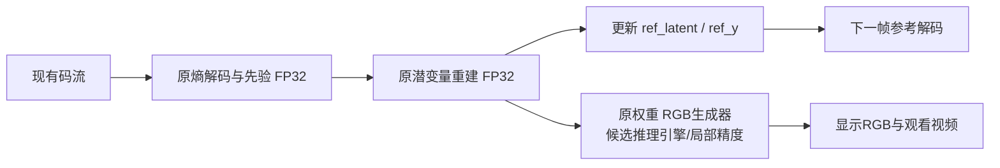

# 解码端算子复核与加速评估

2026-10-31。结论是**已有解码端算子级报告，而且剩余热点非常集中，值得继续做不需要训练的推理优化**。优先对象是原权重`I/P.vqgan.generator`，先不改熵模型、参考潜变量重建或网络结构。本轮仅复核已有数据、代码与官方文档，没有新的视频编解码或训练。

## 已有数据足够定位问题

[第15阶段原报告](../15_优化阶段_算子精确排查/算子级精确排查_20261030.md)采集了两端真实CUPTI GPU活动，以原生NVTX标注关联到模型层、ATen算子、输入尺寸。解码采样为零基0/1/2/3/9/33/64/65帧，包含I帧、普通P帧、参考重置及GOP切换。归因时校验过两次完整内核序列，零丢活动；没有必要为确认热点再跑一次相同采集。

本轮重新汇总全部8份接收端CSV，验证其内核累计与原analysis.json逐帧一致。数值及输入SHA见[analysis.json](evidence_20261031/analysis.json)，逐采样结果见[decoder_frames.csv](evidence_20261031/decoder_frames.csv)。

测量条件为RTX4060 Laptop、640×360有效画面、640×384网络填充、q0、FP32、TF32关闭。下列算子时间来自**旧fill-on采样窗口**，不是刚刚重测，也不是当前fill-off网页的精确算子占比。正常三次66帧解码核心为10.332/10.390/10.342秒；采集扰动另行记录，未把NVTX观察器时间当作正常速度。

## 瓶颈在RGB生成

代表P帧（零基2）的GPU内核累计142.009ms，RGB生成器130.015ms，占91.55%。原报告的空间概率先验约4.174ms，先验融合约2.536ms，其余部分远小于生成器。

| 算子 | 整帧GPU累计ms | 整帧份额 | 其中生成器ms |
|---|---:|---:|---:|
| cudnn卷积 | 79.805 | 56.20% | 70.506 |
| GroupNorm | 18.062 | 12.72% | 18.062 |
| 原地加法add_ | 10.504 | 7.40% | 9.837 |
| Swish | 9.886 | 6.96% | 9.886 |
| fill_ | 9.568 | 6.74% | 9.407 |
| 普通加法add | 7.730 | 5.44% | 7.411 |

详见[算子表](evidence_20261031/p002_operators.csv)。这些是排他归因，不能再与父模块130.015ms相加。卷积模块里的加法和残差加法都需要正确保留；实现融合可能减少独立内核/访存，不能直接删掉加法。

进一步按生成器子模块汇总：

| 部位 | GPU累计ms | 占整帧内核累计 |
|---|---:|---:|
| blocks.23残差块 | 23.828 | 16.78% |
| blocks.24残差块 | 23.006 | 16.20% |
| blocks.25残差块 | 22.107 | 15.57% |
| 上述三块合计 | 68.940 | 48.55% |

按每个算子的第一个四维张量输入尺寸分组，640×384的一组为82.055ms，占生成器63.11%、整帧57.78%；320×192的一组25.200ms。该分组指**输入特征尺寸**，上采样算子的输出尺寸可能更大，不能把它误解成严格的输出分辨率阶段计时。见[块表](evidence_20261031/p002_generator_blocks.csv)与[尺寸表](evidence_20261031/p002_generator_input_shapes.csv)。

最高分辨率处有7个128→128、3×3卷积，每个约5.02–5.48ms，另有128→3的输出卷积。重点应放在这类大特征图卷积，以及归一化、激活、加法的执行效率。

## 为什么可以先只优化最终生成器

[当前适配器frame()](../04_外部依赖快照/semantic-video-training/scripts/glc_video_codec.py)先从码流恢复潜变量，更新`ref_latent/ref_y`，之后才调用`vqgan.generator(latent)`形成显示RGB。下一帧参考使用潜变量，不使用最终RGB。

所以可以设计“同一份码流、同一参考链、不同RGB执行后端”的对照，不必重编码，也不必训练一个新学生。输入文件SHA、CDF/参考摘要应保持；输出画质仍须实际验收。要区分`P.decoder`/`I.dec`（潜变量参考重建）和`P/I.vqgan.generator`（最终RGB），前者先保持原样。直接把整个接收模型`.half()`会触及概率和参考路径，不是本建议。

现有GLCSND实验流声明发送端不生成RGB，仍可保留整流/参考校验。对于另带严格RGB哈希的旧容器，候选后端数值变化可能触发拒绝；应保留严格模式，并使用已有明确的参考校验预览策略，不能悄悄跳过所有校验。解码显示后端信息记录在接收任务旁证，不为此修改接收到的压缩载荷。

## 优化方案与优先级

| 优先级 | 方案 | 判断与验证重点 |
|---|---|---|
| 1 | 原生成器TensorRT FP32，TF32关闭 | 原结构、原权重，先检查算子融合/卷积执行是否有收益；FP32跨框架也需比较RGB，不能先宣称逐位一致 |
| 2 | 原生成器TensorRT FP16或局部混合精度 | 目标是加速主要卷积；归一化/敏感计算必要时保留FP32，观察鱼体细节、色偏、纹理、闪动和I/P交界 |
| 3 | 少量latent批量RGB生成，batch 2/4 | 潜变量仍按帧顺序解码，生成器可独立排队；同形状、相同I/P权重分别组批，检查显存、顺序及数值变化 |
| 4 | 参考解码与RGB生成流水线 | 用有界队列、独立CUDA流和事件管理生命周期；同GPU可能争抢资源，不能把两段耗时直接相加或假定完全重叠 |
| 5 | 模型常驻、缓冲区复用、图执行 | 短文件可避免重复加载，长文件仍应先解决生成器；编码器已有图执行对照收益很小，不能直接承诺解码也有大收益 |
| 后置 | INT8、结构裁剪、蒸馏 | 引入额外精度/校准或训练工作，先判断原模型推理引擎是否已经足够 |

TensorRT官方将融合、batch、流并行列为优化方向，但具体支持和收益依赖网络、精度与硬件，必须以本机实测决定。[NVIDIA性能优化说明](https://docs.nvidia.com/deeplearning/tensorrt/latest/performance/optimization.html)。本机仍使用已隔离的TensorRT10.5，不升级环境；当前官方网页属于新版本，不能直接照抄新版本API。

两个实现细节尤其重要：

- 这里是GroupNorm，`num_groups=32, eps=1e-6`，不是可在推理时用固定运行统计量折叠的BatchNorm。GroupNorm在训练和评估时都依据当前输入计算统计量，直接“折进卷积”不成立；可研究其实现与周边算子的融合。[PyTorch2.5.1定义](https://github.com/pytorch/pytorch/blob/v2.5.1/torch/nn/modules/normalization.py)。Swish本身已使用`torch.jit.script`，也不能假定当前完全未融合。
- 当前`rgb_array()`直接在输入dtype上执行clamp、乘127.5和round。若生成器输出FP16，应先明确转换回FP32再走原像素量化路径，以免把额外的半精度像素量化误差混进对照。归一化归约和Sigmoid等也需检查有限值和误差；不能把FP16开关理解为所有层都安全或都实际用FP16。[NVIDIA精度说明](https://docs.nvidia.com/deeplearning/tensorrt/latest/inference-library/accuracy-considerations.html)。

本机PyTorch2.5.1环境未安装Triton，不能把`torch.compile`/Inductor当作无需配置就能使用的首选GPU后端。本轮只做模块存在性检查，没有安装包或尝试编译；已有TensorRT路线更容易接续。未来若评估compile，应先明确对应平台和后端支持。

## 哪些收益不能重复算

诊断填充关闭此前已扩大到五组素材，解码配对加速约1.075–1.090×，现网页工作器已经采用fill-off。当前不能再把这约7%–8%的省时作为新的额外收益。

按角色剥离、去PNG和训练模块、原生rANS也已经做过。旧测量中原生rANS解码本体一次66帧约0.055秒，量级远小于生成器。代表P帧实际DMA约0.372ms，而CPU同步调用累计127.582ms主要在等待GPU完成，不能把等待当作可直接删除的开销。模型常驻减少初始化，对数分钟长任务的核心加速有限。

常规解码依然需要输出可观看画面，不能照搬发送端免RGB方案。半帧率降低待解码的帧数，但会改变视频的时间采样，应独立比较，不当作每帧解码内核变快。

## 能快多少：只有情景计算，没有新实测

采用旧P002的GPU工作量分解，固定其他11.994ms，仅假设生成器内部变快：

| 假设生成器局部加速 | 推算整帧GPU内核累计ms | GPU工作量比值 |
|---|---:|---:|
| 1.5× | 98.671 | 1.44× |
| 2× | 77.002 | 1.84× |
| 3× | 55.333 | 2.57× |

这些是`其他内核+生成器内核/s`的计算，不是端到端墙钟预测，也不是TensorRT实测；表格还包含旧fill-on条件。不能把第16阶段输入编码器的2倍直接套到生成器，实际收益与画质代价目前未知。

另一方面，归档的2477帧原帧率任务，TensorRT FP16**输入编码端**核心113.305秒、未换生成器的解码核心358.129秒，后者已占两端核心之和约75.97%。因此解码端已是本机闭环中的主要等待来源；该长任务数据用于说明优先级，不能与旧单帧CUPTI比例混算出精确加速秒数。

## 下一轮的具体验收设计

同一份现有码流，依次比较原生成器、TensorRT FP32、TensorRT FP16和必要的FP32归一化混合方案。I/P分别准备真实latent输入；原先的输入编码器引擎不能复用为生成器，引擎缓存至少区分角色、I/P、权重SHA、输入形状和精度。固定640×360、512×288及原q档，先覆盖I帧、P帧、重置和GOP边界，再扩长视频。

单模块与整段都测，暖机、加载、构建、核心、输出分别列出，交替配对；同一GPU避免与用户网页任务并行。仅改生成器时输入流SHA和参考摘要必须一致；RGB逐位一致/最大误差、全图及鱼体区域PSNR、逐帧变化和I/P切换分别检查，不把模糊当作闪动改善。原RGB与GT在独立解码结束后由CPU评价，接收器不读取GT。视频仍需全部参考校验通过后发布。

速度比较包含实际输入/输出转换和必要复制；TensorRT显存不能只看PyTorch分配器，需同时观察设备可用显存。先通过单帧数值与完整流验证，再接入网页作为可选解码模式。

本次已完成的是证据复核和方案评估，新增GPU任务数、训练步数均为0；没有改网页默认、生成器权重或现有编解码行为。
