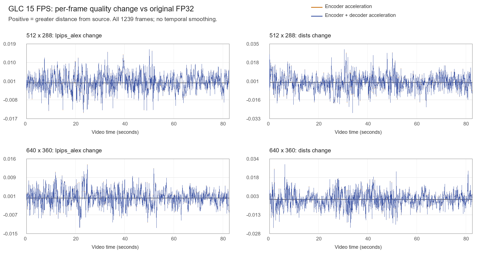
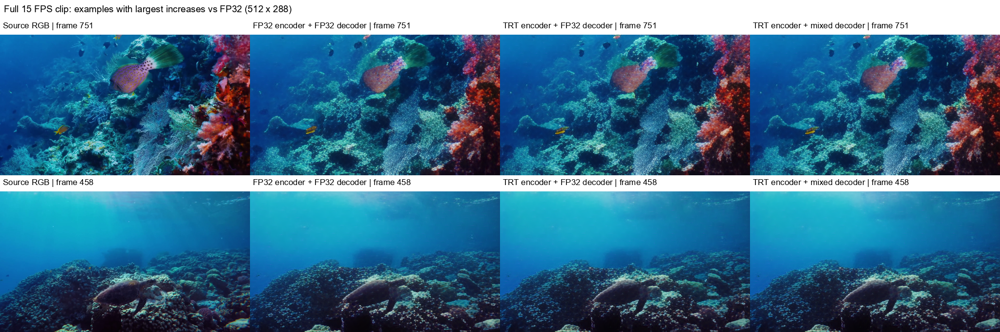

# 完整82.6秒视频：FP32与加速方案的画质差异

2026-11-05。按用户要求，针对刚跑完的512×288、640×360两档完整视频，补齐原版FP32对照并计算感知质量。每档1239帧、15FPS、82.6秒，三种路径共 **7434条逐帧质量记录**，另有7434条像素差异记录。

**结论：相对原始输入，平均LPIPS略变差、DISTS略变好，PSNR变化很小，未出现一致的平均画质下降趋势。但加速结果与FP32重建并不等价，像素及生成细节变化主要来自编码端TRT FP16；解码端保护混精单独引入的变化小得多。**

## 1. 三组完整对照与评价口径

| 名称 | 输入图像编码器 | 最终RGB生成器 |
|---|---|---|
| FP32基线 | 原版PyTorch FP32 | 原版PyTorch FP32 |
| 仅编码加速 | 既有TRT FP16执行方案 | 原版PyTorch FP32 |
| 编解码均加速 | 同上 | 既有TRT保护混精 |

所有路径保留原权重、q0、GOP64/reset32、20I/1219P，参考/熵路径均为原FP32、TF32关闭。所谓FP32基线是原版PyTorch执行，不是另一个TensorRT FP32引擎。

主表的LPIPS、DISTS和PSNR均以**同档分辨率的编码前无损源RGB**为参照；另一张像素表单独比较FP32重建与加速重建，不能混淆两个参照。

LPIPS使用Alex v0.1、`normalize=True`；DISTS使用既有官方alpha/beta和VGG16；FP32、batch1，不再缩放或补边，不抽帧，不使用MP4像素。PSNR由全片RGB总MSE换算，不平均逐帧dB。指标恒等、反相负对照、对称及重复检查通过。

512档新做FP32编码、独立FP32解码，以及TRT编码流的FP32解码。640档复用已有真实码流及已核验的“TRT编码＋FP32解码”无损数组，原版FP32码流重新独立解码；当前640源的20个无损块均匹配历史输入哈希，复用数组及码流SHA通过。各组独立参考校验通过。

## 2. 对原始输入的平均感知质量

LPIPS/DISTS越低表示与输入更接近，PSNR越高表示像素误差更小。

| 分辨率 | 路径 | LPIPS-Alex ↓ | DISTS ↓ | RGB PSNR dB ↑ |
|---|---|---:|---:|---:|
| 512×288 | FP32基线 | **0.138711** | **0.151466** | **22.135154** |
| 512×288 | 仅编码加速 | 0.138928 | 0.151114 | 22.142478 |
| 512×288 | 编解码均加速 | 0.138945 | 0.151121 | 22.142085 |
| 640×360 | FP32基线 | **0.140013** | **0.140337** | **22.461641** |
| 640×360 | 仅编码加速 | 0.140236 | 0.140120 | 22.458734 |
| 640×360 | 编解码均加速 | 0.140236 | 0.140120 | 22.458723 |

完整加速相对FP32基线，取“加速减FP32”：

| 分辨率 | ΔLPIPS | ΔDISTS | ΔPSNR |
|---|---:|---:|---:|
| 512×288 | +0.0002343 | −0.0003448 | +0.006931dB |
| 640×360 | +0.0002229 | −0.0002170 | −0.002917dB |

这些平均差值很小，方向也不一致，不能称为感知质量整体提升，亦不能换算成人眼“画质损失百分比”。两档GT分辨率不同，应分别看各自相对FP32的变化，不能直接用这张表判断两档的人眼优劣。

完整文件码率并非完全相同：512档FP32/加速为26.221017/26.222179kbps；640档为34.673414/34.654722kbps。均为q0，但输入编码器数值变化会改变码流。

## 3. 以FP32重建为参照：像素变化并不小

以下PSNR是“两个重建之间的PSNR”，不是上表对原图的PSNR。MAE单位为0–255的8位RGB通道值。

| 分辨率 | 比较 | RGB MAE ↓ | 两重建间PSNR dB ↑ | 最大单通道差 |
|---|---|---:|---:|---:|
| 512×288 | 仅编码加速 vs FP32 | 6.7568 | 25.7029 | 245 |
| 512×288 | 编解码均加速 vs FP32 | **6.7581** | **25.7026** | **245** |
| 640×360 | 仅编码加速 vs FP32 | 6.4061 | 26.0277 | 255 |
| 640×360 | 编解码均加速 vs FP32 | **6.4068** | **26.0275** | **255** |

完整加速相对FP32，约86.11%/84.64%的RGB通道值有变化；这只是像素不相同的比例，不是画质损失比例。平均对GT的距离接近，同时两种重建采用不同细节纹理，是可以同时发生的。本结果不能描述为“与FP32画面无损等价”。

## 4. 解码混精本身的影响

这一步固定**同一TRT编码码流**，只比较原版FP32 RGB生成器与保护混精生成器。两者全序列CDF/熵符号摘要和逐帧参考SHA一致，因此这里可以单独归因于最终RGB执行后端。

| 分辨率 | 两解码结果MAE | 两重建间PSNR | 最大单通道差 | 对GT的ΔLPIPS | 对GT的ΔDISTS |
|---|---:|---:|---:|---:|---:|
| 512×288 | **0.1500** | **55.5758dB** | 65 | +0.00001676 | +0.00000671 |
| 640×360 | **0.1220** | **56.5806dB** | 39 | −0.000000312 | +0.0000000308 |

对GT的PSNR变化分别为−0.000393dB和−0.0000107dB。解码端影响远小于编码端，但仍有少量较大的单像素差，不能把全部差异称作±1舍入。

据本轮端到端拆分，优先担心画面复现一致性时，应重点审视输入编码器FP16方案，而不是把变化全部归于解码混精。保留FP32编码是更保守的方向；本轮没有自动改网页或部署默认。

## 5. 平均数掩盖的单帧变化

完整加速相对FP32基线，对原图的距离变化：

| 分辨率 | 最大单帧ΔLPIPS（更差） | 位置（零基帧/秒） | 最大单帧ΔDISTS（更差） | 位置 |
|---|---:|---|---:|---|
| 512×288 | +0.015859 | 751 / 50.07秒 | +0.030139 | 458 / 30.53秒 |
| 640×360 | +0.013625 | 372 / 24.80秒 | +0.028986 | 94 / 6.27秒 |

逐帧变化既有正也有负，平均值会抵消。下面两条曲线几乎重合，也说明主要变化来自编码端；它们是逐帧图像质量变化，不是正式时序闪动指标。

512档最大LPIPS/DISTS增量帧的原始RGB对照如下，列为源图、FP32、仅编码加速、全部加速。图片取自无损数组，没有截取播放MP4，也没有后处理原像素。

本轮不能证明纹理闪动改善、运动更流畅或人眼完全等价；也没有将少数帧的指标变化解释成全片主观损失百分比。

## 6. 文件与验证

- [机器可读结果](evidence_full15_quality_20261105/summary.json)、[逐记录核验](evidence_full15_quality_20261105/verification.json)。两档每组1239帧、每档3717条质量记录，7434条质量与7434条像素记录完整；全片均值、总MSE的PSNR及像素差统计从CSV独立重算通过。
- [512逐帧质量](evidence_full15_quality_20261105/width512_per_frame.csv)、[640逐帧质量](evidence_full15_quality_20261105/width640_per_frame.csv)；同目录另有像素差CSV、I/P分组、P95、最大值和哈希。
- [对照准备](prepare_full15_quality.py)、[完整指标](measure_full15_quality.py)、[核验与发布](publish_full15_quality.py)。使用已有隔离感知包和权重，没有安装依赖或升级环境。
- 原始目录：工作区 `02_实验数据/优化_编解码执行复核/full_video_15fps_quality_20261105_01`。FP32码流、新独立重建、来源计划、评价日志和无损数组保留。
- 观看目录 `观看对照_GLC_完整82秒_15FPS_20261105` 新增两档 `GLC_FP32_q0.mp4`，均核对1239帧、15FPS、82.6秒和SHA，可与之前的TRT版本比较。MP4仅供观看，不参与上述指标。
